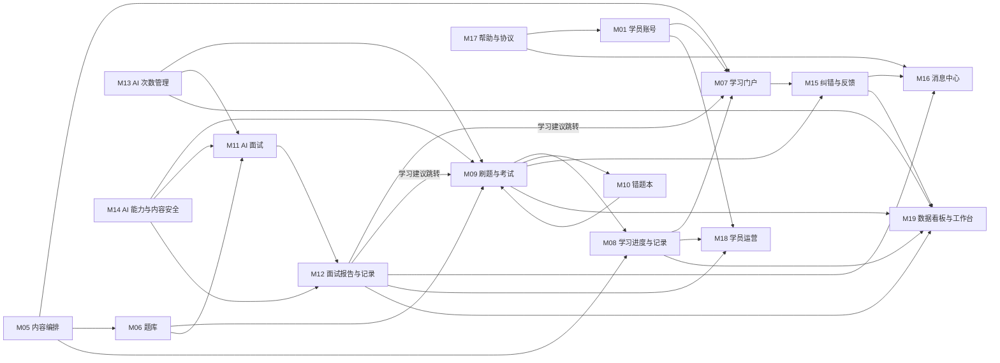
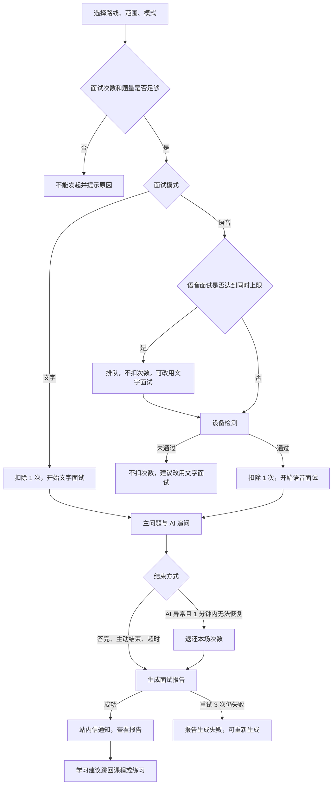

# 云枢智学 第一阶段：需求与功能模块梳理

| 项目 | 内容 |
|---|---|
| 依据 | `docs/需求文档.md`（下称"需求"）、`prototype/` 页面原型（下称"原型"） |
| 范围 | 主要功能、功能模块与职责、模块关系、核心业务流程、待确认问题 |
| 不包含 | 技术选型、数据库设计、接口设计、代码开发 |
| 状态 | 待审核；待确认问题已全部确认，结论见 4.5~4.7 |

阅读说明：

- 本文只整理需求和原型已有的内容，没有新增功能。
- 需求和原型不一致、或都没有写清楚的地方，一律放在第 4 章等待确认，正文没有替你做决定。
- 这里的"模块"是**业务职责划分**，不代表后续的代码结构或部署方式。
- "优先级"一栏沿用需求 11.1 的核心 / 非核心划分。

---

## 1. 主要功能

### 1.1 使用角色

| 角色 | 使用端 | 能做什么 | 依据 |
|---|---|---|---|
| 游客 | 学员前台 | 浏览首页、路线列表、路线详情，使用搜索和帮助中心；点击课程、刷题、AI 面试时要求登录 | 需求 2.1 |
| 学员 | 学员前台 | 使用全部前台功能 | 需求 2.1 |
| 内容运营 | 管理后台 | 学科、课程库、学习路线、刷题题库、面试题库、纠错与反馈 | 需求 2.2 |
| 学员运营 | 管理后台 | 学员管理（含导出）、数据看板 | 需求 2.2 |
| 超级管理员 | 管理后台 | 全部模块；操作日志、系统用户、角色管理、系统配置仅此角色可用 | 需求 2.2 |

### 1.2 学员前台功能

| 功能 | 主要内容 | 需求章节 | 原型页面（student.html） | 优先级 |
|---|---|---|---|---|
| 账号 | 注册、验证码登录、密码登录、找回密码、换绑手机号、注销（7 天冷静期）、登录状态、协议同意 | 5.1 | 登录弹窗、`#/profile?tab=security` | 核心 |
| 首页 | 继续学习、我的路线进度、待重做错题数、今日面试剩余次数、全部路线入口 | 5.2 | `#/` | 非核心（个性化区块） |
| 学习路线与课程 | 路线列表、路线详情、按阶段展示课程、跳转视频平台、标记已学、已学与已掌握进度 | 5.3.1~5.3.3 | `#/routes`、`#/route/:id` | 核心 |
| 搜索 | 按关键词搜索已上架的路线和课程，不搜索题目 | 5.3.4 | `#/search` | 非核心 |
| 按课程顺序练习 | 逐题提交、即时判分，是"已掌握"判定的唯一依据 | 5.4.1、5.4.2 | `#/practice/seq/:id` | 核心 |
| 按阶段随机抽题 | 从阶段题目中随机抽取，成绩单独记录 | 5.4.3 | `#/practice/random/:id` | 核心 |
| 模拟考试 | 按阶段自动组卷、限时作答、交卷统一判分 | 5.4.4 | 路线详情开考、`#/exam/:id`、`#/exam-result` | 核心 |
| 错题本 | 自动收录、筛选、重做、手动移除 | 5.4.6、5.5 | `#/wrong` | 核心 |
| 发起 AI 面试 | 选路线、选范围、选文字或语音模式 | 5.6.1 | `#/interview` | 核心 |
| 文字面试 | 聊天式问答、AI 追问、语音输入转文字 | 5.6.2 | `#/interview/text` | 核心 |
| 语音面试 | 排队、设备检测、实时语音对话、字幕、静默处理 | 5.6.3 | `#/interview/queue`、`/device`、`/voice` | 核心 |
| 面试报告 | 总分与等级、分阶段得分、逐题点评、学习建议 | 5.6.5 | `#/interview/generating/:id`、`#/report/:id` | 核心 |
| 面试记录 | 历次面试、继续作答、查看报告、重新生成报告 | 5.8 | `#/interviews` | 核心 |
| 学习记录 | 学习轨迹、路线进度、刷题记录 | 5.7 | `#/records` | 非核心 |
| 个人中心 | 个人资料、求职画像、账号安全、协议查看 | 5.9 | `#/profile` | 账号安全为核心，其余未单列 |
| 纠错与反馈提交 | 题目纠错、视频失效反馈 | 5.4.5、5.3.3 | 弹窗 | 非核心 |
| 消息中心 | 站内信列表、未读数、标记已读 | 5.10 | `#/messages` | 非核心 |
| 帮助中心 | 常见问题、客服联系方式 | 5.11 | `#/help` | 非核心 |

### 1.3 管理后台功能

| 功能 | 主要内容 | 需求章节 | 原型页面（admin.html） | 优先级 |
|---|---|---|---|---|
| 后台登录 | 账号加密码登录、错误锁定、无操作退出 | 6.9、5.1.6 | `#/login` | 未单列，暂随系统用户归入核心 |
| 工作台 | 按角色显示待办和当日数据 | 6.12 | `#/workbench` | 非核心 |
| 学科管理 | 学科增删改、排序 | 6.1 | `#/subjects` | 核心 |
| 课程库 | 课程增删改、上下架、批量导入、配题情况 | 6.2 | `#/courses` | 核心 |
| 学习路线管理 | 路线增删改、上下架、阶段与课程编排、预览 | 6.3 | `#/routes`、`#/routes/:id` | 核心 |
| 刷题题库 | 四种题型维护、上下架、批量导入 | 6.4 | `#/questions` | 核心 |
| 面试题库 | 面试题维护、上下架、批量导入 | 6.5 | `#/ivbank` | 核心 |
| 纠错与反馈 | 处理题目纠错和视频失效反馈 | 6.6 | `#/feedback` | 非核心 |
| 学员管理 | 列表、详情、封禁解封、查看完整手机号、导出名单 | 6.7 | `#/students` | 核心 |
| 数据看板 | 获客、活跃、学习与刷题、AI 面试与用量，导出 | 6.8 | `#/dashboard` | 非核心 |
| 系统用户 | 后台账号维护、指定角色、重置密码 | 6.9 | `#/sysusers` | 核心 |
| 角色管理 | 展示三个固定角色的权限说明，只读 | 6.10 | `#/roles` | 核心 |
| 操作日志 | 记录并查询后台关键操作 | 6.11 | `#/logs` | 核心 |
| 系统配置 | AI 用量、学习判定、刷题与考试、AI 面试、协议文本、敏感词库、帮助中心与联系方式、视频平台 | 第 7 章 | `#/config` | 核心 |

### 1.4 贯穿多个功能的业务规则

| 规则 | 内容 | 需求章节 |
|---|---|---|
| AI 次数 | 每人每日面试次数和简答题评分次数，各场景的扣减、预留、退还 | 7.1、8.1 |
| 学习状态 | 已打开、已学、已掌握的判定 | 8.2 |
| AI 服务异常 | 评分失败、面试中断、报告生成失败的处理 | 8.6 |
| 内容变更与删除 | 什么内容能删除、修改后如何影响历史数据 | 6.2、8.7 |
| 内容安全与标识 | 敏感词过滤、AI 生成内容标识 | 7.6、9.2 |
| 个人信息与数据保留 | 手机号隐藏、导出留痕、注销删除、各类数据的保存期限 | 5.1.5、6.7、9.2、9.5 |

---

## 2. 功能模块划分

共划分 6 个业务域、19 个模块。

| 业务域 | 模块 |
|---|---|
| 基础与管理 | M01 学员账号、M02 后台账号与权限、M03 系统配置、M04 操作审计 |
| 内容 | M05 内容编排、M06 题库 |
| 学习 | M07 学习门户、M08 学习进度与记录、M09 刷题与考试、M10 错题本 |
| AI 面试 | M11 AI 面试、M12 面试报告与记录 |
| AI 公共规则 | M13 AI 次数管理、M14 AI 能力与内容安全 |
| 运营与服务 | M15 纠错与反馈、M16 消息中心、M17 帮助与协议、M18 学员运营、M19 数据看板与工作台 |

### 2.1 基础与管理

| 模块 | 职责 | 包含功能 | 不负责 |
|---|---|---|---|
| **M01 学员账号** | 管理学员身份和账号生命周期 | 注册、两种登录方式、图形验证与短信验证码规则、密码与强度提示、换绑手机号、注销与冷静期、登录状态、封禁账号的登录拦截、游客访问限制、个人资料、求职画像 | 封禁操作本身（M18）；协议内容（M17） |
| **M02 后台账号与权限** | 管理后台账号，控制各角色能看什么、能做什么 | 后台登录、错误锁定、无操作退出、修改自己的密码、系统用户维护、重置密码（临时密码，登录后强制修改）、超级管理员账号保护、三个固定角色、菜单与操作权限、角色说明 | 操作记录（M04） |
| **M03 系统配置** | 集中维护各模块使用的全局参数和配置内容，超级管理员可改 | AI 用量、学习判定、刷题与考试、AI 面试参数、协议文本、敏感词库、帮助中心内容与联系方式、视频平台列表 | 参数的业务使用（由各模块负责） |
| **M04 操作审计** | 记录后台关键操作，供超级管理员追溯 | 日志记录范围、记录字段、按操作人 / 模块 / 时间筛选、按筛选导出 Excel、不可修改、保留 1 年后清理 | 判断操作是否允许（M02） |

### 2.2 内容

| 模块 | 职责 | 包含功能 | 不负责 |
|---|---|---|---|
| **M05 内容编排** | 维护"学什么"和"按什么顺序学" | 学科管理；课程库及批量导入、上下架、删除规则、配题情况；学习路线、阶段、课程引用、排序、预览、上架校验 | 题目内容（M06）；学员进度（M08） |
| **M06 题库** | 维护练习和面试使用的题目 | 刷题题库（判断、单选、多选、简答）、面试题库（参考答案、评分要点、追问方向）、题目关联课程、上下架、批量导入、删除规则、修改后对历史的影响规则 | 抽题和判分（M09、M11） |

### 2.3 学习

| 模块 | 职责 | 包含功能 | 不负责 |
|---|---|---|---|
| **M07 学习门户** | 让学员和游客找到并进入学习内容 | 首页各区块、路线列表、路线详情展示、课程跳转视频平台（含手机端唤起 B 站 App）、搜索 | 进度计算（M08）；内容维护（M05） |
| **M08 学习进度与记录** | 记录学习行为，计算学习状态和进度 | 打开记录、手动标记已学、已掌握判定与保留规则、路线与阶段的两种进度、继续学习所需的上次学习位置、学习记录页 | 练习作答过程（M09） |
| **M09 刷题与考试** | 组织作答并判定结果 | 按课程顺序练习（含中途续答、重新练习）、按阶段随机抽题、模拟考试（组卷、限时、续答、自动交卷、放弃、成绩）、四种题型判分、简答题自评、作答记录与题目快照、答错结果上报错题本 | 题目维护（M06）；次数计算（M13）；AI 评分本身（M14） |
| **M10 错题本** | 帮助学员复盘答错的题 | 错题收录与累计答错次数、筛选、查看最新版题目、单题或批量重做、答对自动移出、手动移除、题目下架后的展示规则 | 重做时的判分（M09） |

### 2.4 AI 面试

| 模块 | 职责 | 包含功能 | 不负责 |
|---|---|---|---|
| **M11 AI 面试** | 组织一场面试从发起到结束的全过程 | 选路线、范围、模式；按阶段分配主问题；AI 追问流程；文字面试及语音输入；语音面试的排队、设备检测、实时对话、字幕、说完判定、静默处理；时长控制、中途退出与续答；面试状态流转 | 报告内容（M12）；次数计算（M13） |
| **M12 面试报告与记录** | 产出面试结果，保存历次面试 | 计分规则、等级、分阶段得分、逐题点评、学习建议及跳转课程、报告生成状态与重新生成、面试记录页 | 面试过程（M11） |

### 2.5 AI 公共规则

| 模块 | 职责 | 包含功能 | 不负责 |
|---|---|---|---|
| **M13 AI 次数管理** | 统一管理 AI 使用额度 | 每日面试次数和评分次数、北京时间 0 点重置、跨 0 点归属、面试扣减与退还、练习扣减、模拟考试预留 / 扣减 / 释放、剩余次数查询 | 次数上限的设置入口（M03） |
| **M14 AI 能力与内容安全** | 统一提供各业务要用的 AI 能力，并保证内容合规 | 简答题 AI 评分、面试官提问与追问、面试点评、语音转文字、语音播报；敏感词过滤与命中记录；AI 生成内容标识；AI 服务异常时的重试与失败反馈；录音转写后删除 | 业务流程（M09、M11、M12）；敏感词维护（M03） |

### 2.6 运营与服务

| 模块 | 职责 | 包含功能 | 不负责 |
|---|---|---|---|
| **M15 纠错与反馈** | 接收学员反馈并闭环处理 | 题目纠错和视频失效反馈的提交；后台列表、合并显示、筛选；已修正 / 已驳回及处理说明 | 实际修改题目或课程（M05、M06）；发送站内信（M16） |
| **M16 消息中心** | 向学员发送并展示站内信 | 协议已更新、面试报告已生成、纠错与反馈处理结果三类通知；未读数；查看详情；标记已读 | 决定何时发通知（由触发方模块负责） |
| **M17 帮助与协议** | 向学员展示帮助信息和协议内容 | 帮助中心页面、联系方式展示及在各提示中的引用、用户协议与隐私政策查看、协议更新后的重新同意 | 内容编辑（M03） |
| **M18 学员运营** | 让运营人员了解和管理学员，支撑机构跟进转化 | 学员列表与筛选、学员详情、手机号隐藏与查看完整号码、封禁解封、名单导出（排除注销中账号）及 5000 条上限 | 账号登录规则（M01）；转化跟进（由机构已有 CRM 承担） |
| **M19 数据看板与工作台** | 汇总业务数据，提示待办 | 四类指标及统计口径、时间范围、数据更新频率、导出；按角色展示的工作台 | 原始业务数据的产生（各业务模块） |

---

## 3. 模块关系与核心业务流程

### 3.1 模块关系图

下图只画主要的业务依赖，箭头表示"提供给"。M03（配置）、M02（权限）、M04（审计）与多数模块都有关系，单独在 3.2 说明，图中不再逐条连线。

### 3.2 模块依赖说明

| 提供方 | 使用方 | 依赖内容 |
|---|---|---|
| M05 内容编排 | M07、M08、M09、M11 | 已上架的路线、阶段、课程；课程下架后不再显示、不计进度、关联题目停用 |
| M06 题库 | M09、M10、M11、M12 | 刷题题目和面试题目；题目最新版本供错题本和后续作答使用 |
| M01 学员账号 | 学员前台各模块、M18 | 登录状态、学员资料、求职画像、账号状态 |
| M18 学员运营 | M01 | 封禁与解封的结果，决定学员能否登录 |
| M09 刷题与考试 | M08 | 顺序练习的作答结果，用于判定"已掌握" |
| M09 刷题与考试 | M10 | 答错的题目；错题重做复用 M09 的判分 |
| M08 学习进度与记录 | M07、M18、M19 | 课程状态、路线进度、学习记录 |
| M11 AI 面试 | M12 | 抽取的题目、问答内容、结束方式 |
| M12 面试报告与记录 | M07（跳转）、M09（跳转）、M16、M18、M19 | 学习建议跳回课程或练习；报告已生成通知；学员的面试记录；面试场次和得分 |
| M13 AI 次数管理 | M07、M09、M11、M19 | 剩余次数、扣减结果、用量统计 |
| M14 AI 能力与内容安全 | M09、M11、M12 | 评分、追问、点评、语音转写与播报；敏感词过滤结果；AI 服务异常状态 |
| M15 纠错与反馈 | M05、M06、M16、M19 | 待修正的题目或课程；处理结果通知；待处理数量 |
| M17 帮助与协议 | M01、M11、M16 | 协议同意要求；封禁提示和设备检测失败时引用的联系方式；协议已更新通知 |
| M03 系统配置 | M05、M08、M09、M11、M12、M13、M14、M17 | 视频平台、达标线与及格线、组卷规则、面试参数、等级分数线、次数上限、敏感词、协议与帮助内容 |
| M02 后台账号与权限 | 管理后台各模块 | 当前账号角色和可用权限 |
| 后台各模块 | M04 操作审计 | 内容变更、纠错处理、封禁、导出、查看完整手机号、看板导出、账号与配置变更、后台登录 |

### 3.3 核心业务流程

#### 流程一：内容准备到学员可见

涉及模块：M05、M06、M03、M04、M07

1. 内容运营维护学科，在课程库录入或批量导入课程，课程链接必须属于已启用的视频平台。
2. 为课程配置刷题题目和面试题目，也可批量导入。
3. 建立学习路线，增加阶段，从课程库引用课程；同一路线内一门课只能出现在一个阶段。
4. 预览后上架路线。学员前台只展示已上架的路线和课程。
5. 以上操作记入操作日志。工作台提示未配题的课程和题量不足的阶段。

#### 流程二：学员注册与访问

涉及模块：M01、M17、M07

1. 游客浏览首页、路线和搜索结果。
2. 点击课程、刷题或 AI 面试时要求登录。
3. 注册需通过图形验证和短信验证码，并勾选协议；注册后自动登录，引导填写求职画像，可跳过。
4. 协议更新后，学员重新同意才能继续使用。

#### 流程三：学习与掌握

涉及模块：M07、M08、M09、M13、M14、M10

1. 学员进入路线详情，所有阶段都开放。点击课程跳转视频平台，平台记录"已打开"。
2. 学员看完后手动标记"已学"。
3. 学员进入按课程顺序练习，逐题提交，立即看到结果。
4. 简答题由 AI 评分，每题扣 1 次评分次数；次数用完后改为查看参考答案并自评；评分失败不扣次数，可重新提交。
5. 答错的题进入错题本。
6. 完成该课程全部题目，且按每题最近一次作答计算的正确率达到达标线，课程记为"已掌握"，之后不再取消。

#### 流程四：模拟考试

涉及模块：M09、M13、M14、M10、M08

1. 学员选择阶段，系统检查题量，按组卷规则生成试卷。
2. 试卷含简答题时，校验并预留 1 次评分次数；次数为 0 不能开考。
3. 限时作答，中途离开倒计时继续，可在时长内返回。
4. 结果分三种：交卷或到时自动交卷后判分；学员主动放弃则释放次数、不出成绩；简答题评分失败则显示"简答题评分中"，可重新评分。
5. 评分成功后扣减预留次数，出成绩，答错的题进入错题本。成绩单独记录，不影响"已掌握"。

状态流转见需求 8.5。

#### 流程五：错题复盘

涉及模块：M10、M09、M13、M06

1. 学员在错题本筛选错题，查看最新版题目和上次的答案。
2. 单题或批量重做，按最新答案判分；简答题同样消耗评分次数。
3. 答对自动移出，也可手动移除。题目下架后保留查看，不能重做。

#### 流程六：AI 面试与报告

涉及模块：M11、M13、M14、M06、M12、M16、M08

状态流转见需求 8.4。

#### 流程七：纠错与反馈闭环

涉及模块：M09、M10、M07、M15、M05、M06、M16、M04

1. 学员在刷题结果或错题本提交题目纠错，或在课程旁提交视频失效反馈。
2. 反馈进入后台，同一道题或同一门课的多条待处理反馈合并显示。
3. 内容运营核实，必要时修改题目或课程，再标记已修正或已驳回，并填写处理说明。
4. 学员收到站内信，处理操作记入操作日志。

#### 流程八：学员运营与转化

涉及模块：M18、M01、M08、M12、M04、M19

1. 学员运营按条件筛选学员，查看学习、刷题、面试记录。手机号默认隐藏，查看完整号码记入日志。
2. 筛选后导出名单，单次不超过 5000 条，导出内容含完整手机号和求职画像，每次导出留痕。
3. 机构根据名单在已有 CRM 中跟进，平台内不设转化入口。
4. 运营人员在数据看板查看获客、活跃、学习和 AI 用量。

#### 流程九：账号注销

涉及模块：M01、M18、M19、M15、M04

1. 学员通过短信验证和二次确认后申请注销，账号进入"注销中"并退出登录。
2. 7 天冷静期内登录时弹窗，学员选择撤销注销，或继续注销并退出。
3. 到期后删除个人信息和学习、刷题、面试明细；看板已汇总的统计保留；纠错记录和日志中显示为"已注销用户"。

---

## 4. 待确认问题

优先级说明：

- **P0**：影响模块边界或核心业务规则，建议进入下一阶段前确认。
- **P1**：影响具体功能规则，建议在详细设计前确认。
- **P2**：细节或口径问题，可以在详细设计时确认。

### 4.1 P0：影响模块边界或核心规则

| 编号 | 问题 | 现状 | 需要确认 | 影响模块 |
|---|---|---|---|---|
| Q01 | 【已确认，见 4.5】一门课被多条路线引用时，学习状态是否共用 | 需求允许课程复用，但没写状态归属。原型按课程共用，在 A 路线学过，B 路线也显示已学 | 按课程全局共用，还是每条路线各算各的 | M08、M07、M19 |
| Q02 | 【已确认，见 4.5】什么算"学过某条路线" | "我的路线进度""学习路线数""各路线学习人数""完成率分母""学习过的路线"筛选都依赖这个定义，需求没有写 | 打开过其中一门课、标记过已学、作答过题目，满足哪些算学过；课程复用时是否同时算学过多条路线 | M08、M18、M19 |
| Q03 | 【已确认，见 4.5】"已掌握"与"已学"的关系 | 需求把两者分别定义，"已学"靠手动标记。原型把已掌握也计入已学进度，并隐藏"标记已学"按钮 | 已掌握是否自动算已学；已掌握后能否取消已学 | M08、M07 |
| Q04 | 【已确认，见 4.5】已掌握的课程题目全部下架后，如何计算进度 | 需求写状态保留，但未配题课程不计入已掌握进度的分母 | 这门课是否仍计入已掌握进度 | M08 |
| Q05 | 【已确认，见 4.5】阶段能否下架 | 需求 6.3、8.7 写有学习记录的阶段"只能下架"，但 6.3 的阶段操作只有新增、编辑、删除、排序。原型提示"将整条路线下架" | 是否增加阶段上下架；还是有学习记录的阶段不能删除，只能下架整条路线 | M05、M07 |
| Q06 | 【已确认，见 4.5】路线下架对学员的影响 | 需求只写了课程下架的影响，没写路线下架 | 学员的进度、继续学习、学习记录、面试记录如何显示；路线下架后能否继续发起面试或考试 | M05、M07、M08、M09、M11 |
| Q07 | 【已确认，见 4.5】进行中的练习、考试、面试遇到内容变化 | 需求只规定了历史记录和已出成绩的处理 | 作答过程中题目被修改或下架时，继续用开始时的内容，还是立即生效 | M06、M09、M11 |
| Q08 | 【已确认，见 4.5】同一学员能否同时进行多场面试或考试 | 需求允许多设备同时登录，但没写并行规则。原型只保留一场，发起新的会覆盖旧的 | 同时只能进行一场还是可以多场；两台设备同时打开同一场时如何处理 | M09、M11、M13 |
| Q09 | 【已确认，见 4.5】语音面试命中敏感词如何处理 | 7.6 规定学员输入命中时"拦截并提示修改"，AI 输出命中时"替换为 *"。实时语音无法修改，星号也无法播报 | 语音面试中学员说出敏感词、AI 语音内容命中时分别如何处理 | M14、M11 |
| Q10 | 【已确认，见 4.5】追问时学员不说话，这道题怎么算 | 5.6.3 写"本题记为未作答"，5.6.5 规定主问题和追问整体打分 | 已回答主问题、仅追问未回答时，整题记未作答，还是只结束追问并按已答内容评分 | M11、M12 |
| Q11 | 【已确认，见 4.5】AI 异常结束的面试如何计分 | 5.6.5 只写了主动结束和超时结束时未问到的题计 0 分。AI 异常结束时会退还次数，也生成报告 | 未问到的题是否计 0 分；这场面试是否计入看板的场次和平均分 | M12、M19 |
| Q12 | 【已确认，见 4.5】语音面试的同时进行名额如何占用 | 需求只写上限 20 场和超出排队 | 设备检测期间、中途退出待重新进入时是否占名额；重新进入时已满怎么办；排队是否有时长限制 | M11 |
| Q13 | 【已确认，见 4.5】敏感词命中日志在哪里查看 | 7.6 和 9.5 要求记录并保留 1 年以便审查，但操作日志范围不包含它，需求和原型都没有查看页面 | 是否需要查看入口，由哪个角色查看；放在操作日志内还是单独页面 | M04、M14 |
| Q14 | 【已确认，见 4.5】后台账号如何修改自己的密码 | 需求只有超级管理员重置密码，并规定了密码规则。需求和原型都没有个人修改入口。原型重置时生成临时密码，需求未写 | 是否提供修改自己密码的入口；重置后新密码如何交给用户 | M02 |

### 4.2 P1：影响具体功能规则

| 编号 | 问题 | 现状 | 需要确认 | 影响模块 |
|---|---|---|---|---|
| Q15 | 【已确认，见 4.6】学员修改密码时是否验证身份 | 需求只写可设置或修改，原型不要求验证 | 修改时是否验证原密码或短信验证码 | M01 |
| Q16 | 【已确认，见 4.6】简答题自评"会"是否算答对 | 需求只写自评"不会"算答错。原型把"会"算答对，并计入已掌握正确率 | "会"是否算答对；自评结果是否计入已掌握判定 | M09、M08 |
| Q17 | 【已确认，见 4.6】模拟考试是否限制次数 | 需求没有限制，且主动放弃后释放次数、不出成绩，学员可以反复开考看题 | 是否限制开考次数或放弃后的再次开考 | M09、M13 |
| Q18 | 【已确认，见 4.6】路线上架是否需要校验 | 需求未写，原型允许没有阶段或课程的路线上架 | 上架时是否要求至少有阶段和课程 | M05 |
| Q19 | 【已确认，见 4.6】把课程移出阶段或路线后，学习数据如何处理 | 需求只写课程下架，没写移除引用 | 进度、学习记录、已抽取的面试分阶段得分如何处理 | M05、M08 |
| Q20 | 【已确认，见 4.6】注销中的账号如何对待 | 需求只写在列表标注状态。原型不提供封禁操作 | 冷静期内能否被导出、能否封禁、是否计入统计 | M01、M18、M19 |
| Q21 | 【已确认，见 4.6】系统配置修改后何时生效 | 需求只写可在后台调整 | 当日次数、达标线、及格线、组卷规则、面试参数，对当天额度和进行中的场次是否立即生效 | M03、M08、M09、M11、M13 |
| Q22 | 【已确认，见 4.6】面试报告中"薄弱阶段"的判定线 | 需求只写"针对薄弱的阶段"。原型按低于 70 分判定 | 判定线是多少，是否需要后台可配 | M12 |
| Q23 | 【已确认，见 4.6】反馈合并处理后通知谁 | 需求写通知"提交的学员"。合并处理时未写同一学员多次提交的情况 | 是否每位提交者收到一条，同一学员是否合并 | M15、M16 |

### 4.3 P2：细节与口径

| 编号 | 问题 | 现状 | 需要确认 | 影响模块 |
|---|---|---|---|---|
| Q24 | 【已确认，见 4.6】学员默认昵称和头像 | 注册只需手机号，学员列表要显示昵称 | 默认昵称规则、头像格式与大小限制 | M01 |
| Q25 | 【已确认，见 4.6】求职画像的选项 | 需求只定义求职意向来自路线方向。原型自拟了学历和工作年限选项 | 学历和工作年限的正式选项；路线下架后求职意向如何显示 | M01、M18 |
| Q26 | 【已确认，见 4.6】"最近活跃时间"的口径 | 6.8 定义了活跃学员，6.7 的最近活跃时间没有定义 | 是否沿用"有学习行为"的口径 | M18、M19 |
| Q27 | 【已确认，见 4.6】"AI 调用次数"的口径 | 需求写按面试和简答题评分分别统计，未说明计数单位。原型只画出这两条数据，同样没有说明 | 按场次 / 题次统计，还是按实际 AI 调用统计 | M19、M14 |
| Q28 | 【已确认，见 4.6】同一 IP 的短信发送频率 | 9.3 要求限制，没有给出数值 | 具体限制数值 | M01 |
| Q29 | 【已确认，见 4.6】超级管理员账号的保护 | 需求未写，原型可以停用任意账号 | 能否停用自己；是否必须保留至少一个可用的超级管理员 | M02 |
| Q30 | 【已确认，见 4.6】AI 异常结束时一道题都没有作答 | 需求 5.6.5 规定总分只按已问到的主问题计算，8.6 要求按已作答部分生成报告；第一题就异常结束时，没有内容可以计算 | 是否仍生成报告，面试记录如何显示 | M12 |

### 4.4 需求与原型不一致的地方

下表各项的处理方式已确认，见 4.7。

| 编号 | 位置 | 需求文档 | 页面原型 |
|---|---|---|---|
| D01 | 访客首页 | 未登录时只显示全部学习路线（5.2） | 另有宣传主视觉、注册按钮和三项功能介绍 |
| D02 | 学员首页 | 继续学习显示路线、阶段、课程（5.2） | 另外显示该路线的已学进度和本阶段课程清单 |
| D03 | 路线卡片 | 显示封面、阶段数、课程数（5.3.1） | 不显示封面，改为列出各阶段及课程数；后台仍可上传路线和课程封面，前台没有展示位置 |
| D04 | 顺序练习 | 中途退出后从未作答的题继续；支持重新练习（5.4.2） | 每次从第 1 题开始；只有完成页有"重新练习" |
| D05 | 学习记录筛选 | 按路线、时间（5.7） | 只有路线 |
| D06 | 刷题记录 | 包含模拟考试成绩（5.7） | 模拟考试成绩不写入记录 |
| D07 | 学员管理筛选 | 包含"学习过的路线"，没有关键词搜索（6.7.1） | 没有"学习过的路线"，多了昵称或手机号后四位搜索 |
| D08 | 纠错与反馈筛选 | 类型、状态、课程、错误类型、提交时间（6.6） | 只有类型和状态 |
| D09 | 面试题库筛选 | 学科、课程、状态（6.5） | 只有课程和状态 |
| D10 | 课程库筛选 | 学科、状态、是否已配题（6.2） | 多了课程名称搜索 |
| D11 | 语音输入不可用时 | 提示语音输入暂不可用，请直接打字（5.6.2） | 为便于演示，显示示例文字 |

### 4.5 已确认结论

| 编号 | 结论 | 带来的影响 |
|---|---|---|
| Q01 | 学习状态（已打开、已学、已掌握）按课程全局共用。在 A 路线学过的课程，在 B 路线也显示相同状态 | 学习状态归属于"学员 + 课程"，不区分路线 |
| Q02 | 路线内任一门课被打开、标记已学或作答过，即算"学过该路线" | 首页"我的路线进度"、学习路线数、"学习过的路线"筛选、各路线学习人数、完成率分母统一使用此定义。课程被多条路线共用时，同时算学过这些路线 |
| Q03 | 已掌握的课程自动算已学，计入已学进度，隐藏"标记已学"按钮，不可取消 | 需求 8.2"已学可由学员取消"仅适用于未达到已掌握的课程 |
| Q04 | 已掌握的课程，其刷题题目全部下架后，仍显示已掌握，但不计入已掌握进度的分子和分母 | 学员的已掌握进度百分比可能因题目下架而变化 |
| Q05 | 阶段不设上下架。有学习记录的阶段不能删除，需要停用时下架整条路线 | 需求 6.3、8.7 中阶段的"只能下架"需改为"不能删除"；路线仍保留"只能下架" |
| Q06 | 路线下架后，路线列表、搜索、继续学习、我的路线进度都不再显示，不能发起新的考试或面试；学习记录、面试记录、面试报告照常可看，并标注已下架 | 前台可见性统一按路线状态判断，不按学员区分 |
| Q07 | 已开始的模拟考试和面试，按开始时的题目完成，所属路线下架也能完成。顺序练习和随机抽题逐题提交，尚未作答的题按最新内容，已下架的题跳过 | 模拟考试和面试在开始时固定题目；与需求"之后的作答使用最新版本"不冲突，该规则适用于未开始的场次和练习 |
| Q08 | 同一学员同一时间最多一场进行中的面试和一场进行中的模拟考试；已有进行中的场次时，发起新场次会提示先继续或结束。同一场在新设备打开时由新设备接管，旧设备提示已在其他设备继续 | 发起面试和开考时都要检查进行中的场次；原型"发起新的覆盖旧的"需调整 |
| Q09 | 语音面试中，学员说话命中敏感词：字幕显示为 *，这段话不交给 AI，语音提醒"请换一种说法重新回答"。AI 语音命中：该词不播报，字幕显示 *，流程不中断。两种情况都写入日志 | 需求 7.6 需补充语音场景的处理方式 |
| Q10 | 学员已回答主问题、在追问环节静默超时的，整题记为未作答，计 0 分 | 语音面试的静默规则同时适用于主问题和追问；文字面试没有静默规则 |
| Q11 | AI 服务异常提前结束的面试，总分只按已问到的题计算，未问到的阶段显示未测评，报告标注因系统异常提前结束；本场不计入看板的面试场次和平均分 | 需求 5.6.5、6.8 需补充此情况的计分和统计口径 |
| Q12 | 语音面试名额：轮到学员时即保留，用于设备检测，未通过或退出时立即释放。中途断线或关闭页面后保留 3 分钟，超时释放；之后重新进入时若已满，只能排队等待，倒计时不暂停，学员也可以主动结束面试。面试进行中不能切换模式。排队不限时，离开排队页即放弃排位，重新发起从队尾开始 | 需求 5.6.3、5.6.4 需补充名额和排队规则 |
| Q13 | 敏感词命中日志只留存，不提供后台查看页面；需要审查时由技术人员导出 | 不新增后台功能；需求 7.6、9.5 需写明审查方式 |
| Q14 | 所有后台账号都可以修改自己的密码：需输入原密码，新密码规则与需求 6.9 相同，修改后重新登录，并记入操作日志。超级管理员重置密码时，系统生成临时密码并只显示一次，由超级管理员线下告知；对方登录后必须修改密码才能使用 | 属于需求之外的补充，需写入需求 6.9、6.11；原型需增加修改密码入口和强制修改环节 |

以上结论已同步写入 `docs/需求文档.md`，上表"带来的影响"一栏中需求文档需补充的内容均已完成。原型尚未调整，待改内容：发起新面试时不再覆盖进行中的场次（Q08）；后台增加修改密码入口和强制修改环节（Q14）。

### 4.6 已确认结论（P1、P2）

以下结论已同步写入 `docs/需求文档.md`（Q17 无需修改），上表"带来的影响"一栏中需求文档需补充的内容均已完成。

| 编号 | 结论 | 带来的影响 |
|---|---|---|
| Q16 | 简答题自评"会"算答对，计入已掌握的正确率 | 需求 5.4.1、8.2 需补充；与原型一致 |
| Q17 | 模拟考试不限制开考次数 | 不新增功能；含简答题的考试仍受每日评分次数约束 |
| Q19 | 课程移出阶段或路线后，课程自身的学习状态保留；这条路线不再显示该课，也不计入进度。"学过该路线"按当前编排判断，学员只学过这门课时，不再算学过该路线。学习记录和已生成的报告不变 | 进度和"学过该路线"都按当前编排实时计算，不保存历史归属；需求 6.3 需补充 |
| Q21 | 每日次数上限修改后立即生效，按新上限计算当日剩余。达标线、及格线、组卷规则、面试参数只影响修改后新开始的练习判定和场次；进行中的场次和已达成的已掌握不变。语音并发上限调低时，不中断进行中的面试 | 考试和面试开始时需要固定所用参数；需求第 7 章需补充 |
| Q15 | 学员修改密码时：已设置过密码的验证原密码；首次设置的验证短信验证码；忘记原密码走已有的短信重置 | 需求 5.1.3 需补充；原型需增加验证 |
| Q18 | 路线上架时，至少有 1 个阶段，且至少引用 1 门已上架课程，否则提示原因；不校验题量 | 需求 6.3 需补充；原型需增加校验 |
| Q20 | 注销中的账号不能导出，不提供封禁操作；统计照常计入，到期后按需求 5.1.5 匿名保留 | 需求 5.1.5、6.7 需补充；原型导出需排除注销中账号 |
| Q22 | 分阶段得分低于需求 7.4"良好"分数线的阶段算薄弱；没有低于的，取得分最低的阶段 | 不新增配置项；需求 5.6.5 需补充；原型写死的 70 分需改 |
| Q23 | 合并处理后，每位提交者收到一条站内信；同一学员对同一题或同一门课多次提交，只发一条 | 需求 5.10、6.6 需补充 |
| Q24 | 默认昵称为"学员 + 手机号后四位"，使用默认头像；上传头像限 JPG、PNG，不超过 2MB | 需求 5.1.1、5.9 需补充 |
| Q25 | 学历选项：高中及以下、大专、本科、硕士及以上。工作年限选项：在校或应届、1 年以内、1~3 年、3~5 年、5 年以上。路线下架后，求职意向保留原值并标注已下架，不能再选 | 需求 5.9 需补充；原型选项需核对 |
| Q26 | 最近活跃时间沿用需求 6.8 的"有学习行为"口径 | 需求 6.7 需补充 |
| Q27 | AI 调用次数与扣次口径一致：面试按场，简答题评分按实际扣减次数；失败不计 | 需求 6.8 需补充 |
| Q28 | 同一 IP 每小时不超过 30 条、每天不超过 100 条；同一手机号每天不超过 10 条 | 需求 5.1.1、9.3 需补充 |
| Q29 | 不能停用自己的账号；停用账号或修改角色时，必须保留至少 1 个启用的超级管理员 | 需求 6.9 需补充；原型需增加校验 |
| Q30 | AI 服务异常结束且一题未答的面试，不生成报告，面试记录显示"因系统异常结束"；次数退还，不计入看板 | 需求 5.6.5、5.8、6.8、8.4 需补充 |

### 4.7 需求与原型差异的处理结论

需求文档部分已同步写入 `docs/需求文档.md`；原型尚未调整。

| 编号 | 位置 | 结论 | 需要改动 |
|---|---|---|---|
| D01 | 访客首页宣传区 | 以原型为准 | 需求 5.2 |
| D02 | 学员首页的进度和课程清单 | 以原型为准 | 需求 5.2 |
| D03 | 路线卡片封面 | 以原型为准，前台不显示封面，并删除后台路线和课程的封面字段 | 需求 5.3.1、6.2、6.3；原型后台表单 |
| D04 | 顺序练习续答 | 以需求为准 | 原型 |
| D05 | 学习记录时间筛选 | 以需求为准 | 原型 |
| D06 | 刷题记录含模拟考试 | 以需求为准 | 原型 |
| D07 | 学员管理筛选 | 两边都保留：增加"学习过的路线"筛选，保留昵称或手机号后四位搜索 | 需求 6.7.1；原型 |
| D08 | 纠错与反馈筛选 | 以需求为准 | 原型 |
| D09 | 面试题库学科筛选 | 以需求为准 | 原型 |
| D10 | 课程库名称搜索 | 以原型为准 | 需求 6.2 |
| D11 | 语音输入不可用时 | 以需求为准；原型的示例文字仅用于演示，不用改 | 无 |

### 4.8 待同步汇总

- **需求文档**：P0、P1、P2 结论和差异结论均已同步。
- **原型**：Q08、Q14、Q15、Q18、Q20、Q22、Q25、Q29，以及 D03、D04、D05、D06、D07、D08、D09。
