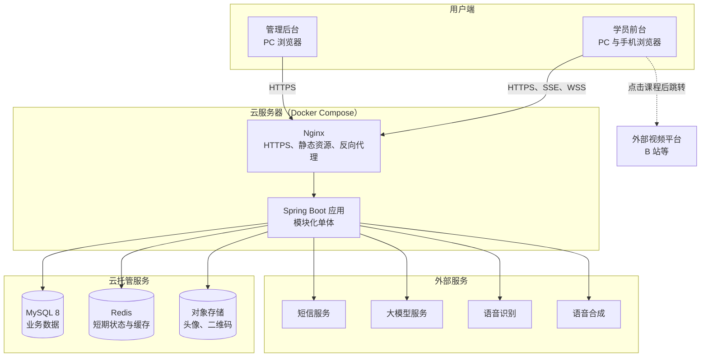
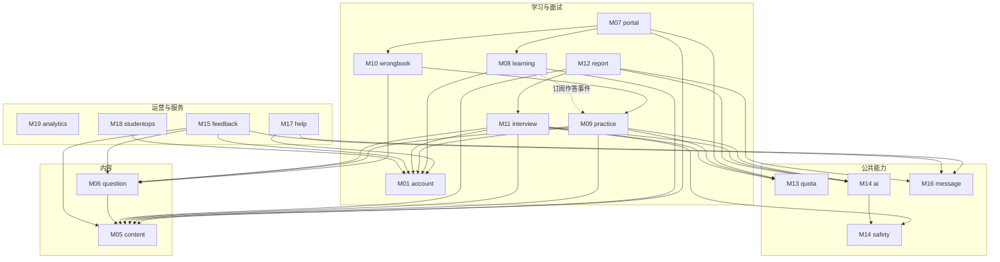
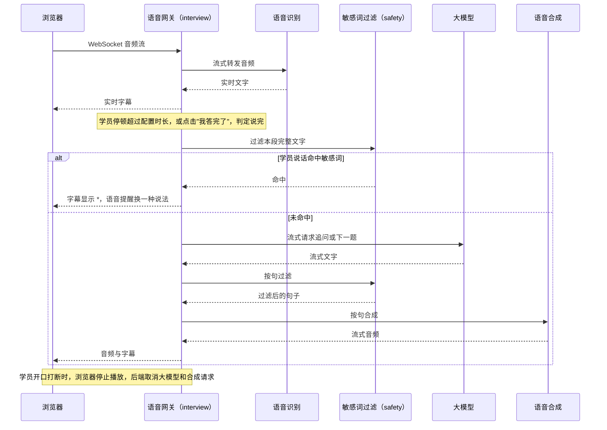
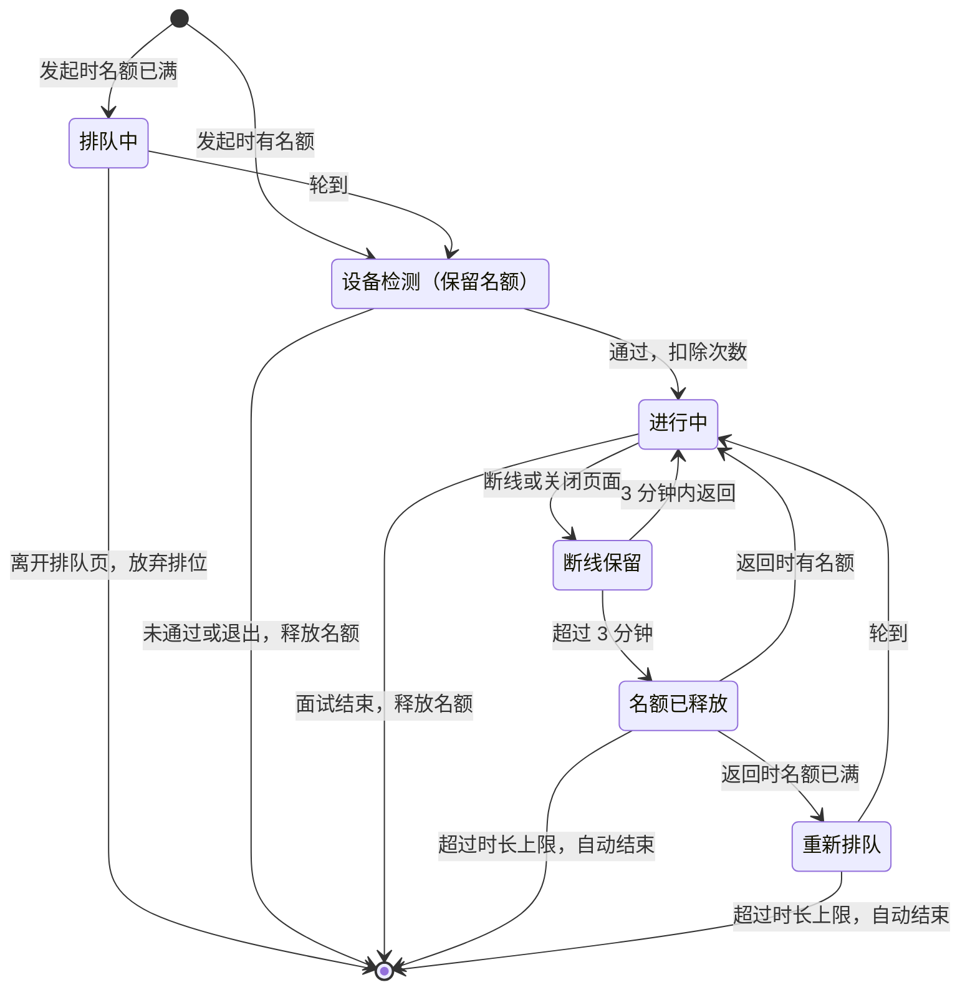

# 云枢智学 第二阶段：技术选型与整体架构设计

| 项目 | 内容 |
|---|---|
| 依据 | `docs/design/01.功能模块梳理.md`（下称"第一阶段"）、`docs/需求文档.md`（下称"需求"）、`prototype/` 页面原型、`docs/rules/` 下的数据库与接口规范 |
| 范围 | 技术选型、整体架构、模块架构、项目目录、关键决策与风险 |
| 不包含 | 表结构、接口定义、业务代码 |
| 状态 | 方案已全部确认；T05、T06 待 M3 实测后确定；第五阶段评审已修订，见 `05.设计方案评审结果.md`；评审后按用户决定改为 JDK 17 |

状态标记说明：

- **已确认**：已与用户逐项确认。
- **待定**：需要验证或后续决定，见第 8 章。

文中的容量和耗时数字都是设计估算，不是实测结果，需要在 M3 语音技术验证和压测中验证。

---

## 1. 设计输入与约束

项目此前没有指定技术栈，也没有存量系统需要兼容。对架构有实际影响的约束如下。

| 来源 | 约束 | 对架构的影响 |
|---|---|---|
| 需求 9.4 | 注册学员 1 万以内，同时在线一两百人 | 不需要分布式架构，单体足够 |
| 需求 9.4、9.6 | 语音面试同时 20 场，90% 的回应不超过 3 秒 | 语音链路是最大的技术风险，需要全程流式处理 |
| 需求 5.6.3、7.6 | 自动判断说完、可打断；学员说话命中敏感词时不能交给 AI | 必须能在语音识别和大模型之间拦截文字 |
| 需求 8.1、8.5 | 面试次数扣减和退还；考试评分次数预留、扣减、释放 | 需要事务保证，业务数据与次数放在同一数据库 |
| 需求 5.1.6 | 封禁、改密码等情况下，所有设备立即退出 | 登录状态必须能由服务端立即作废 |
| 需求 8.7、第 7 章 | 已开始的考试和面试按开始时的题目和参数完成 | 场次开始时要固定题目和参数 |
| 需求 8.4、8.5、8.6 | 到时自动交卷、超时结束、报告失败重试 | 需要可靠的后台任务，且应用重启不丢任务 |
| 需求 9.2、9.5 | 录音不保存；敏感词命中日志和操作日志保留 1 年；注销后删除明细 | 录音只在内存中处理；需要定期清理和跨模块删除 |
| 需求 9.1 | PC 和手机浏览器响应式，无 App，无 SEO 要求 | 单页应用即可，不需要服务端渲染 |
| 需求 R6、R8、M3 | AI 备案；第三方服务可能变动；语音先验证，不达标可降级 | AI 和语音服务必须可替换，架构要支持降级交互 |
| `docs/rules/api-rules.md` | 默认 REST；令牌不得放入 URL 查询参数 | WebSocket 认证不能用 URL 传令牌 |
| `docs/rules/database-rules.md` | 禁止物理外键；统一自增主键；建议 UTC 存储 | 持久层不用会生成外键的关联映射，完整性由应用层维护 |

---

## 2. 技术选型

### 2.1 选型结论

| 类别 | 选型 | 依据 | 状态 |
|---|---|---|---|
| 后端语言与框架 | Java，Spring Boot 4.1，Spring MVC | 用户指定 Java；Spring Boot 3.x 已于 2026-06-30 停止免费维护，4.x 最低要求 Java 17 | 已确认 |
| 运行版本与并发 | JDK 17（Eclipse Temurin，开发和服务器镜像一致），Spring MVC 加按场景隔离的线程池 | 用户指定；AI 和语音的长时间等待放在专用线程池，不占满 Web 请求线程，见 5.8 | 已确认 |
| 整体架构 | 模块化单体 | 规模不需要拆分；次数和业务数据在同一事务内 | 已确认 |
| 工程结构 | 单 Maven 工程，按包划分模块，ArchUnit 校验边界 | 构建简单，调整模块边界成本低 | 已确认 |
| 持久层 | MyBatis-Plus，使用 Spring Boot 4 专用 starter | 单表操作省代码，复杂筛选和统计手写 SQL；不产生物理外键 | 已确认 |
| 主数据库 | MySQL 8（云托管） | 关系型数据为主；JSON 字段可存题目快照；云托管自带备份 | 已确认 |
| 缓存与短期状态 | Redis（云托管） | 验证码、频控、登录会话、语音名额与排队、分布式锁 | 已确认 |
| 登录与权限 | Sa-Token，使用 Spring Boot 4 专用 starter，服务端会话存 Redis | 内置学员与后台两套账号体系、踢下线、滑动续期、权限注解 | 已确认 |
| 后台任务 | 不引入消息队列；数据库记录任务状态，应用内线程池执行，定时扫描重试和到期，Redis 锁防重 | 组件最少，应用重启任务不丢 | 已确认 |
| 文件存储 | 云对象存储 | 只有头像、客服二维码等少量文件；不占服务器磁盘，便于将来扩容 | 已确认 |
| 前端框架 | Vue 3，TypeScript，Vite | 响应式单页应用，无 SEO 要求 | 已确认 |
| 学员端界面 | 自研组件，沿用原型的设计规范 | 保持原型已确定的视觉 | 已确认 |
| 管理后台界面 | Element Plus | 表格、表单、弹窗组件成熟 | 已确认 |
| 前端状态与路由 | Pinia，Vue Router | Vue 官方推荐组合 | 已确认 |
| 图表 | ECharts | 看板趋势图、面试报告雷达图和条形图 | 已确认 |
| 语音实时链路 | 服务端中转流水线，浏览器与后端用 WebSocket | 能在中间拦截敏感词，厂商可替换 | 已确认 |
| 大模型和语音服务 | 暂不指定厂商，通过适配层接入；限定国内已备案的服务，M3 按需求 9.6 实测 2~3 家后选定 | 需求 9.6 的指标需要实测；R8 要求可替换 | 已确认（厂商待定） |
| 部署 | 国内云，Docker Compose 单机起步，MySQL、Redis 用云托管 | 成本和运维量匹配当前规模 | 已确认 |
| 本地开发环境 | Docker Compose 一键启动 MySQL 8.4、Redis 7.4、SeaweedFS（模拟 S3 对象存储），见 `deploy/dev/README.md` | 本地依赖与线上一致；MinIO 官方已停止发布社区版镜像，改用 SeaweedFS，线上仍用云对象存储；本地 MySQL 只建空库，表由后端 Flyway 创建 | 已确认 |
| 接入层 | Nginx | HTTPS、静态资源、反向代理、WebSocket 转发 | 已确认 |
| 数据库版本管理 | Flyway | 表结构变更可追溯；迁移脚本中禁止创建外键 | 已确认 |
| Excel 导入导出 | 基于 Apache POI 的流式读写库，具体库在工程搭建时确定 | 批量导入、名单导出、看板导出 | 已确认 |
| 敏感词匹配 | 进程内 AC 自动机，词库变更后刷新 | 语音链路要求毫秒级；词库量不大 | 已确认 |
| 手机号存储 | 明文存储，显示时隐藏中间四位 | 用户选择；按需求字面实现，风险见第 9 章 | 已确认 |
| 文字面试输出 | SSE 流式，按句过滤后显示 | 减少学员等待；过滤方式与语音面试一致 | 已确认 |
| 后台入口 | 独立子域名 | 可单独限制访问来源；学员端和后台登录状态互不干扰 | 已确认 |
| 可用性 | 接受发布和故障时的短暂中断，发布安排在低峰时段 | 需求没有可用性指标；单机成本最低，应用保持无状态以便扩展 | 已确认 |
| 监控告警 | 应用日志、健康检查、云厂商自带的服务器和数据库监控，AI、语音、短信调用失败告警 | 覆盖第三方依赖的主要风险，投入小 | 已确认 |

具体小版本在工程搭建时按当时的维护状态锁定。依赖必须使用与 Spring Boot 4 对应的 starter（如 `mybatis-plus-spring-boot4-starter`、`sa-token-spring-boot4-starter`），Spring Boot 3 的 starter 不能混用。

### 2.2 明确不引入的技术

| 技术 | 不引入的原因 |
|---|---|
| 微服务、注册中心、分布式事务 | 当前规模不需要，会显著增加开发和运维成本 |
| 消息队列（RabbitMQ 等） | 已确认用数据库加定时扫描 |
| 搜索引擎（Elasticsearch 等） | 需求只搜索路线和课程的名称、简介，数据量小，SQL 查询足够 |
| 服务端渲染（Nuxt 等） | 需求没有 SEO 要求 |
| Kubernetes | 单机容器部署足够 |
| 大数据或 OLAP 组件 | 看板按小时和按天汇总到 MySQL 即可 |

---

## 3. 整体架构

### 3.1 系统部署视图



视频不经过本系统，平台只记录"打开过课程"。录音只在应用内存中流转，不写入数据库或对象存储。

### 3.2 技术分层

| 层 | 位置 | 职责 |
|---|---|---|
| 表现层 | `web/` 下的学员端和后台 | 页面、交互、前端校验、录音与播放；不承载业务规则的最终判断 |
| 接入层 | Nginx | HTTPS 终止、静态资源、反向代理、WebSocket 转发 |
| 控制层 | 各模块的 Controller、WebSocket Handler | 接收请求、参数校验、登录与权限校验、统一响应格式 |
| 应用层 | 各模块的 Service | 编排业务流程、控制事务、调用其他模块的公开接口 |
| 领域规则 | 各模块的规则类 | 判分、状态流转、已掌握判定、计分等不依赖外部系统的业务规则 |
| 数据访问层 | 各模块的 Mapper | 读写 MySQL；完整性校验由应用层负责，遵守无物理外键规范 |
| 基础设施层 | `infra` 包 | Redis、对象存储、短信、大模型与语音适配器、Excel、定时任务框架 |

依赖方向为自上而下，下层不依赖上层。业务规则不写在 Controller、Mapper 和前端中，服务端校验所有输入。

### 3.3 前端、后端、数据库如何协作

| 场景 | 通信方式 | 说明 |
|---|---|---|
| 普通页面和后台操作 | HTTPS，REST 风格 | 遵守 `api-rules.md`；路径和响应结构见 `04.API接口设计.md` |
| 简答题 AI 评分 | HTTPS 同步请求 | 目标 10 秒内返回，30 秒超时按失败处理（需求 8.6） |
| 文字面试的 AI 回复 | SSE 流式输出 | AI 文字按句过滤后依次显示，学员不用等待整段生成 |
| 语音面试、文字面试的语音输入 | WebSocket（WSS），传音频和控制消息 | 双向实时；认证见 5.6 |
| 语音排队状态 | 同一条 WebSocket 推送 | 连接断开即放弃排位，符合需求 5.6.3 |
| 报告生成状态、站内信未读数 | 前端轮询 | 实时性要求低，不需要长连接 |

数据的存放原则：

| 存储 | 存放内容 | 原则 |
|---|---|---|
| MySQL | 账号、内容、作答、错题、面试、次数、消息、日志、看板汇总 | 唯一的业务事实来源；时间按 UTC 存储，按北京时间展示和计算"当日" |
| Redis | 验证码、频控、登录会话、语音名额与排队、断线保留标记、设备接管标记、配置和内容热点缓存 | 只放可重建或可丢失的短期数据；次数额度不以 Redis 为准 |
| 对象存储 | 头像、客服二维码 | 数据库只保存文件地址 |
| 应用内存 | 进行中的语音流、敏感词匹配结构 | 录音不落盘，语音转写结果按需求写入 MySQL |

---

## 4. 模块架构

### 4.1 第一阶段模块在系统中的位置

每个第一阶段模块对应一个后端包，只有 M14 按职责拆成两个包。

| 模块 | 后端包 | 所在层次 | 职责摘要 | 代码依赖 |
|---|---|---|---|---|
| M01 学员账号 | `account` | 业务 | 注册、登录、密码、换绑、注销、资料与画像、活跃记录 | sysconfig；发布"学员已注册"事件；目前已提供 `account.api.StudentDirectory`（学员昵称查询） |
| M02 后台账号与权限 | `iam` | 支撑 | 后台登录、账号、角色、权限码 | audit |
| M03 系统配置 | `sysconfig` | 支撑 | 全局配置的维护和读取，变更事件 | audit；发布"协议已发布""敏感词库已变更"事件 |
| M04 操作审计 | `audit` | 支撑 | 记录和查询后台操作日志 | 无 |
| M05 内容编排 | `content` | 内容 | 学科、课程、路线、阶段 | sysconfig、audit |
| M06 题库 | `question` | 内容 | 刷题题库、面试题库 | content、audit |
| M07 学习门户 | `portal` | 业务 | 首页、路线展示、搜索 | content、learning、wrongbook、quota |
| M08 学习进度与记录 | `learning` | 业务 | 学习状态、进度、已掌握判定、学习记录 | account、content、sysconfig；订阅 practice 事件 |
| M09 刷题与考试 | `practice` | 业务 | 练习、模拟考试、判分、作答快照 | account、question、content、quota、ai、sysconfig |
| M10 错题本 | `wrongbook` | 业务 | 错题收录、筛选、重做 | question、practice；订阅 practice 事件 |
| M11 AI 面试 | `interview` | 业务 | 发起、文字面试、语音面试、状态流转 | account、question、content、quota、ai、safety、sysconfig |
| M12 面试报告与记录 | `report` | 业务 | 计分、报告生成、面试记录 | interview、content、ai、message、sysconfig；订阅 interview 事件；逐题得分通过 interview 公开接口写入 |
| M13 AI 次数管理 | `quota` | 公共能力 | 扣减、预留、释放、退还、剩余次数 | sysconfig |
| M14 AI 能力 | `ai` | 公共能力 | 评分、提问追问、点评、语音识别合成的业务封装 | safety、infra 适配器 |
| M14 内容安全 | `safety` | 公共能力 | 敏感词匹配、替换、命中日志 | sysconfig |
| M15 纠错与反馈 | `feedback` | 运营 | 反馈提交、合并、处理 | account、content、question、message、audit |
| M16 消息中心 | `message` | 公共能力 | 站内信写入、未读数、已读 | 无；目前已提供 `message.api.StudentMessageSender`（写入站内信） |
| M17 帮助与协议 | `help` | 运营 | 帮助内容展示、协议查看、协议同意记录与重新同意 | account、sysconfig、message；订阅 account、sysconfig 事件 |
| M18 学员运营 | `studentops` | 运营 | 学员列表、详情、封禁、导出 | account、audit；只读查询见 4.3 |
| M19 数据看板与工作台 | `analytics` | 运营 | 指标汇总、导出、工作台 | audit；只读查询见 4.3 |

### 4.2 模块依赖关系

下图是**代码调用方向**（箭头指向被依赖方），与第一阶段"提供给"的方向相反。`sysconfig`、`audit`、`iam` 被多数模块使用，图中不再连线。



### 4.3 模块间协作规则

| 规则 | 说明 |
|---|---|
| 只通过公开接口调用 | 每个模块只对外暴露 `api` 子包；其他模块不得访问对方的 Service 实现、Mapper 和表。由 ArchUnit 测试校验 |
| 不允许循环依赖 | 第一阶段的业务关系存在双向依赖，用下表的方式解开。ArchUnit 测试同时校验模块之间没有循环依赖 |
| 后台接口鉴权 | `iam` 的拦截器统一校验登录和"必须修改密码"；接口所需的权限码由业务模块调用 `iam` 的公开接口 `AdminAccess` 校验，或在 Controller 上标注 `common` 中的 `@RequireAdminPermission` 由拦截器校验。`iam` 自身依赖的模块（如 `audit`）只能用注解方式，避免循环依赖；这类接口需要操作人时，从拦截器放入请求的 `common` 中的 `AdminPrincipal` 读取 |
| 事件在同一事务内处理 | 模块事件使用 Spring 同步事件，订阅方在发布方的事务内执行，保证作答、错题和进度一起成功或一起失败 |
| 只读查询例外 | M18 的学员多条件筛选和 M19 的看板汇总需要跨模块关联，允许其专用的只读 SQL 跨模块查询，禁止写入。这是模块边界唯一的例外 |

第一阶段中双向依赖的解决方式：

| 双向关系 | 解决方式 |
|---|---|
| M09 上报错题，M10 重做调用 M09 判分 | M10 依赖 M09；M09 发布"作答完成"事件，M10 订阅 |
| M09 产生作答，M08 判定已掌握 | M09 不依赖 M08；M08 订阅"作答完成"事件 |
| M11 产出面试，M12 生成报告 | M12 依赖 M11；M11 发布"面试已结束"事件，M12 订阅 |
| M06 删除题目时要判断是否被作答或面试抽取过，M09、M11 又依赖 M06 | M06 在 `question.api` 中定义扩展接口 `QuestionUsageProvider`（已作答、已抽取），由 M09、M11 实现；未实现时视为未使用。M06 通过 `content.api.CourseDirectory` 查询课程 |
| M05 删除课程时要判断是否有题目和学习记录，M06、M08 又依赖 M05 | M05 在 `content.api` 中定义"课程使用情况"扩展接口 `CourseUsageProvider`（题目数、已配题课程、删除前检查），由 M06、M08 实现；未实现时题目数按 0 计 |
| M01 执行封禁结果，M18 发起封禁 | M18 调用 M01 的公开接口，M01 不依赖 M18 |
| 协议由 M03 编辑，M17 负责重新同意和通知 | M03 发布"协议已发布"事件（`AgreementPublishedEvent`），M17 订阅后调用 M16 |
| 注销要删除多个模块的数据 | 在 `common` 中定义"学员数据清除"扩展接口，各持有学员明细的模块分别实现，由 M01 到期时统一调用；不放在 M01，避免 M16、M17 与 M01 形成循环依赖 |
| 注册时要记录协议同意，M17 又要读取学员以发送协议通知 | M01 不依赖 M17：M01 发布"学员已注册"事件，M17 订阅后在同一事务内记录同意；M17 依赖 M01 |
| 学习、刷题、面试都会产生"活跃" | 活跃记录和最近活跃时间归 M01，M08、M09、M11 调用 M01 的公开接口记录 |
| M12 生成的逐题点评和分阶段得分存放在 M11 的表中 | M12 通过 M11 的公开接口写入，不直接访问 M11 的表 |
| 协议文本和常见问题由 M03 维护，由 M17 展示 | 表归 M03，M17 通过 M03 的公开接口读取 |

---

## 5. 关键技术方案

### 5.1 语音面试链路

语音链路在 `interview` 模块内编排，`ai` 模块提供识别、大模型、合成能力，`safety` 模块负责过滤。



| 设计点 | 方案 | 依据 |
|---|---|---|
| 响应耗时 | 大模型和合成全程流式，**按句合成**，第一句到达即开始播放 | 需求 9.6 只计算从判定说完到开始发声的耗时 |
| 敏感词 | 学员文字在交给大模型前过滤；AI 文字按句过滤，命中的词不进入合成 | 需求 7.6；按句缓冲可避免敏感词被切开 |
| 说完判定 | 由后端根据识别结果和配置的停顿时长判定，同时接受"我答完了"信号 | 需求 5.6.3、7.4 |
| 打断 | 浏览器检测到人声后立即停止播放，通知后端取消进行中的请求 | 需求 5.6.3 |
| 回声 | 使用浏览器的回声消除采集麦克风 | 防止 AI 的声音被识别成学员说话 |
| 手机浏览器 | 音频播放需要用户手势解锁，放在设备检测和重新进入的点击操作中 | iOS Safari 的限制，需在 M3 验证 |
| 录音 | 只在内存中传递，不落盘 | 需求 5.6.3、9.5 |
| 文字面试语音输入 | 复用同一条识别链路，只返回文字 | 需求 5.6.2；不占语音面试名额 |
| 降级 | M3 不达标时关闭自动判定和打断，只用"点击开始 / 点击结束"，链路不变 | 需求 11.2 |

响应耗时预算（设计目标，待 M3 实测）：

| 环节 | 目标 |
|---|---|
| 语音识别输出最终结果 | 0.3 秒 |
| 敏感词过滤 | 小于 0.01 秒 |
| 大模型输出第一句 | 1.2 秒 |
| 语音合成首包 | 0.4 秒 |
| 网络与播放缓冲 | 0.3 秒 |
| **合计** | **约 2.2 秒**（需求为 90% 不超过 3 秒） |

容量估算：20 场语音同时进行时，16kHz PCM 上行约 5 Mbps，下行视音频编码约 1~2 Mbps。服务器规格和带宽在压测后确定。

### 5.2 语音名额与排队

名额和队列放在 Redis，由 Lua 脚本保证原子性；Redis 丢失时可根据 MySQL 中进行中的语音面试重建名额。



### 5.3 AI 能力适配

`ai` 模块对业务暴露业务语义的能力（评分、追问、点评、识别、合成），`infra` 下按厂商实现大模型、语音识别、语音合成适配器。更换厂商只改适配器和配置，不改业务模块。提示词放在版本化的资源文件中。超时、重试次数按需求 8.6 统一处理。

### 5.4 次数额度

`quota` 模块以 MySQL 为准，按"学员 + 北京时间日期"记录使用量，通过条件更新保证不超扣。扣减和业务状态变更在同一事务内完成。上限从配置读取，修改后立即按新上限计算（第一阶段 Q21）。场次消耗归属开始的那一天。

### 5.5 场次固定与内容变化

模拟考试和面试在开始时，把题目快照和所用参数固定到场次上，后续运营修改内容或配置不影响该场次（第一阶段 Q07、Q21）。练习逐题读取最新内容，已下架的题跳过。同一学员进行中场次的唯一性由数据库约束和服务端校验共同保证。

### 5.6 登录、权限和连接认证

| 项目 | 方案 |
|---|---|
| 账号体系 | Sa-Token 的学员、后台两套账号体系相互隔离 |
| 有效期 | 学员 7 天滑动续期；后台 8 小时无操作失效 |
| 全设备退出 | 服务端作废该账号的所有会话 |
| 后台权限 | 三个固定角色对应代码中定义的权限码，前后端都校验 |
| 临时密码 | 登录后标记为"必须修改密码"，未修改时拒绝其他后台请求 |
| 初始超级管理员 | 系统中没有任何后台账号时，后端启动时按配置（本地 `.env`、线上环境变量 `ADMIN_INIT_*`）创建，首次登录必须修改密码；已有账号时配置不再生效 |
| 后台权限码 | 与管理后台菜单一一对应，按角色固定分配，`GET /api/v1/admin/me` 返回给前端控制菜单 |
| WebSocket 认证 | 建连后第一帧发送短期票据，超时未认证即断开，令牌不放入 URL（`api-rules.md`） |
| 设备接管 | 同一场考试或面试只认最新的连接，旧连接收到"已在其他设备继续"的通知 |
| 操作日志 | 注解和切面统一记录后台操作，需要记录筛选条件等内容时由业务代码补充 |

### 5.7 后台任务

任务状态记录在 MySQL，执行结果落库。到期类任务以服务端时间为准：读取接口只返回截止时间和服务端时间，不改变状态；截止后的写操作被拒绝，前端倒计时结束时调用交卷或结束接口，定时扫描作为兜底。

| 任务 | 触发 | 需求 |
|---|---|---|
| 面试报告生成 | 面试结束后立即提交线程池；失败自动重试 3 次；重启后由扫描恢复 | 8.4、8.6 |
| 模拟考试自动交卷 | 前端到时调用接口，定时扫描兜底 | 5.4.4 |
| 面试超时结束 | 前端到时调用接口，定时扫描兜底 | 5.6.4 |
| 语音名额回收 | 断线 3 分钟到期后释放 | 第一阶段 Q12 |
| 注销到期删除 | 每日或更高频扫描，调用各模块的数据清除 | 5.1.5 |
| 看板当日数据 | 每小时汇总 | 6.8 |
| 看板历史指标 | 每天凌晨汇总 | 6.8 |
| 日志清理 | 每日清理超过 1 年的日志 | 9.5 |

定时任务通过 Redis 锁防止重复执行，将来增加服务器时无需改造。

### 5.8 线程模型

JDK 17 没有虚拟线程。调用第三方服务时的长时间等待放在专用线程池中，避免占满 Web 请求线程；各场景使用独立的线程池，一个场景繁忙不会拖慢其他场景。

| 场景 | 处理方式 | 线程池 | 估算规模 |
|---|---|---|---|
| 普通接口 | 同步处理 | Web 请求线程 | 默认 200 |
| 简答题 AI 评分（最长 30 秒） | 异步 Servlet，等待期间释放 Web 请求线程 | AI 调用池 | 与评分并发量相当 |
| 文字面试流式回复 | `SseEmitter` 异步推送 | AI 调用池 | 与进行中的文字面试数相当 |
| 语音面试 | 每场同时处理语音识别、大模型、语音合成 | 语音池，与其他池隔离 | 20 场约 60~80 个线程 |
| 面试报告生成 | 提交后台任务，失败按 5.7 重试 | 任务池 | 少量固定线程 |
| 定时扫描 | 定时调度 | 调度池 | 少量 |

- 规模是设计估算，在压测时调整。
- 线程池已满时拒绝新任务，按需求 8.6 的原则处理：不扣次数，提示稍后重试。
- 将来升级到 JDK 21 时可以改用虚拟线程，业务代码不需要改动。

---

## 6. 项目目录设计

项目使用一个代码仓库管理前端、后端和部署配置。后端基础包名为 `com.yunshuzhixue`。

```text
云枢智学/
├── docs/                         需求、设计文档与规范
│   ├── 需求文档.md
│   ├── design/
│   └── rules/
├── prototype/                    页面原型，仅作设计参考，不参与构建
├── server/                       后端（Spring Boot，单 Maven 工程）
│   ├── pom.xml
│   └── src/
│       ├── main/
│       │   ├── java/com/yunshuzhixue/
│       │   │   ├── YunshuApplication.java
│       │   │   ├── common/       统一响应、错误码、异常、分页、工具类
│       │   │   ├── infra/        基础设施
│       │   │   │   ├── ai/           大模型、语音识别、语音合成的厂商适配器
│       │   │   │   ├── redis/        Redis、分布式锁
│       │   │   │   ├── sms/          短信
│       │   │   │   ├── storage/      对象存储
│       │   │   │   ├── excel/        Excel 导入导出
│       │   │   │   └── task/         任务扫描与线程池
│       │   │   └── modules/      业务模块，一个模块一个包
│       │   │       ├── account/      M01
│       │   │       ├── iam/          M02
│       │   │       ├── sysconfig/    M03
│       │   │       ├── audit/        M04
│       │   │       ├── content/      M05
│       │   │       ├── question/     M06
│       │   │       ├── portal/       M07
│       │   │       ├── learning/     M08
│       │   │       ├── practice/     M09
│       │   │       ├── wrongbook/    M10
│       │   │       ├── interview/    M11
│       │   │       ├── report/       M12
│       │   │       ├── quota/        M13
│       │   │       ├── ai/           M14 AI 能力
│       │   │       ├── safety/       M14 内容安全
│       │   │       ├── feedback/     M15
│       │   │       ├── message/      M16
│       │   │       ├── help/         M17
│       │   │       ├── studentops/   M18
│       │   │       └── analytics/    M19
│       │   └── resources/
│       │       ├── db/migration/     Flyway 数据库迁移脚本
│       │       ├── mapper/           手写 SQL
│       │       ├── prompts/          AI 提示词
│       │       └── application*.yml  分环境配置
│       └── test/                 单元测试、集成测试、架构规则测试
├── web/                          前端（pnpm 工作区）
│   ├── apps/
│   │   ├── student/              学员前台
│   │   │   └── src/
│   │   │       ├── pages/        页面
│   │   │       ├── features/     业务功能，含语音采集与播放
│   │   │       └── router/
│   │   └── admin/                管理后台（Element Plus）
│   │       └── src/
│   │           ├── pages/
│   │           ├── router/
│   │           └── permission/   菜单与操作权限
│   └── packages/
│       ├── api/                  接口调用和类型
│       ├── shared/               公共工具、校验规则
│       └── design-tokens/        由原型提炼的颜色、字号等设计变量
├── scripts/
│   └── sql/                      建表脚本 schema.sql，作为 Flyway 的初始基线
└── deploy/
    ├── dev/                      本地开发依赖服务（MySQL、Redis、SeaweedFS）的编排
    ├── docker-compose.yml        应用和 Nginx 编排（代码完成后编写）
    ├── nginx/                    Nginx 配置
    └── env/                      环境变量模板，不提交真实密钥
```

单个业务模块的内部结构：

```text
modules/practice/
├── api/          对其他模块公开的接口、数据对象、事件，只有这里可被外部引用
├── controller/   学员端、后台的接口入口
├── service/      业务编排与事务
├── domain/       判分、状态流转等业务规则
├── mapper/       MyBatis-Plus 数据访问
├── entity/       数据库实体
└── task/         本模块的定时任务
```

---

## 7. 关键设计决策

| 编号 | 决策 | 主要理由 | 放弃的方案 | 状态 |
|---|---|---|---|---|
| A01 | 模块化单体 | 规模小，事务简单，运维成本低 | 微服务；单体加独立语音服务 | 已确认 |
| A02 | JDK 17 + Spring MVC + 按场景隔离的线程池 | 用户指定；当前规模下线程池足够 | WebFlux；JDK 21 虚拟线程 | 已确认 |
| A03 | 语音走服务端中转流水线 | 能拦截敏感词，厂商可替换 | 云厂商实时对话；端到端语音模型 | 已确认 |
| A04 | AI 和语音厂商通过适配层接入，M3 实测后选定 | 需求 9.6 需要实测，R8 要求可替换 | 现在指定厂商 | 已确认 |
| A05 | 不引入消息队列 | 任务量小，状态本来就在数据库 | RabbitMQ；XXL-JOB | 已确认 |
| A06 | MySQL 是业务事实来源，Redis 只放短期状态 | 次数和业务状态要在同一事务 | 用 Redis 记录额度 | 已确认 |
| A07 | 登录使用服务端会话 | 全设备立即退出 | 纯 JWT | 已确认 |
| A08 | 手机号明文存储 | 用户选择 | 加密存储 | 已确认 |
| A09 | 模块只通过 `api` 包调用，ArchUnit 校验 | 单 Maven 工程下保持边界 | Maven 多模块 | 已确认 |
| A10 | 模块事件在同一事务内同步处理 | 作答、错题、进度必须一致 | 异步事件、发件箱表 | 已确认 |
| A11 | M18、M19 允许跨模块只读 SQL | 多条件筛选和统计如果逐模块调用，性能和复杂度都不可接受 | 严格按接口组装数据 | 已确认 |
| A12 | 考试和面试开始时固定题目和参数 | 需求 8.7、第一阶段 Q21 | 实时读取最新内容 | 已确认 |
| A13 | WebSocket 建连后第一帧认证 | `api-rules.md` 禁止 URL 传令牌 | 查询参数传令牌 | 已确认 |
| A14 | AI 文字按句过滤后再合成 | 兼顾敏感词规则和响应速度 | 整段生成后再过滤，耗时过长 | 已确认 |
| A15 | Spring Boot 4.1 | 3.x 已停止免费维护；兼容 JDK 17 | Spring Boot 3.5 加商业支持 | 已确认 |
| A16 | JDK 发行版使用 Eclipse Temurin | 免费开源，与本机一致，有官方镜像 | Oracle JDK（17 的免费商用许可已结束）；云厂商发行版 | 已确认 |

---

## 8. 待确认问题

以下两项需要 M3 语音技术验证和压测的结果，暂时无法确定。

| 编号 | 问题 | 建议 | 影响 |
|---|---|---|---|
| T05 | 大模型、语音、短信的具体厂商 | M3 按需求 9.6 实测 2~3 家；短信可随云厂商选定 | 适配器实现、成本 |
| T06 | 服务器规格和带宽 | M3 和压测后确定，建议从 4 核 8GB 起测 | 成本 |

本阶段已确认的待定项：

| 编号 | 问题 | 结论 |
|---|---|---|
| T01 | 文字面试的 AI 回复是否流式显示 | 流式显示，按句过滤 |
| T02 | 管理后台的访问入口 | 独立子域名 |
| T03 | 可用性目标 | 接受发布和故障时的短暂中断，发布安排在低峰时段 |
| T04 | 上线时的监控告警范围 | 基础监控 |

---

## 9. 潜在风险

| 编号 | 风险 | 影响 | 应对 |
|---|---|---|---|
| RT1 | 语音 3 秒响应达不到（需求 R7） | 不满足需求 9.6 | M3 优先验证；按句流式；不达标时按需求 11.2 降级 |
| RT2 | 手机浏览器的音频限制、回声消除效果差异 | iOS Safari 体验不稳定，打断误触发 | M3 覆盖真机测试；打断灵敏度可调 |
| RT3 | WebSocket 在弱网下断线 | 语音面试中断 | 自动重连；断线保留 3 分钟；倒计时规则按需求执行 |
| RT4 | 第三方服务不稳定或价格变动（需求 R8） | 面试中断、成本上升 | 适配层可替换；按需求 8.6 退还次数 |
| RT5 | 所选服务不满足备案口径（需求 R6） | 影响上线 | 选型前由机构确认备案要求，限定国内已备案服务 |
| RT6 | 单机部署存在单点故障 | 服务器故障时全站不可用 | 数据在云托管服务中；容器可快速重建；需要时增加服务器 |
| RT7 | 进程内线程池任务在重启时中断 | 报告生成中断 | 状态落库，由定时扫描恢复 |
| RT8 | 手机号明文存储 | 数据库或备份泄露时完整手机号暴露 | 限制数据库访问权限；备份加密；日志中不输出完整手机号；上线前由法务确认 |
| RT9 | AI 输出格式不稳定 | 评分、报告解析失败 | 约定结构化输出；校验失败按 AI 失败重试（需求 8.6） |
| RT10 | 模块边界随开发被破坏 | 单体逐渐耦合 | ArchUnit 校验纳入构建；跨模块只读 SQL 限定在 M18、M19 |
| RT11 | 原型尚有 18 项未按设计更新（汇总见 `05.设计方案评审结果.md`） | 开发时误以原型为准 | 开发以需求文档为准，原型按需再更新 |
| RT12 | JDK 17 没有虚拟线程，线程池参数不当会导致排队或超时 | AI 回复变慢、语音面试卡顿 | 按场景分池隔离；监控各池的活跃数和队列长度；压测时调整参数 |
| RT13 | JDK 17 的免费更新约到 2027-10-31（第三方数据，官方页面未直接列出） | 上线后的维护期可能没有安全补丁 | 列入升级计划，2027 年 10 月前升级到 JDK 21，先在测试环境回归 |
