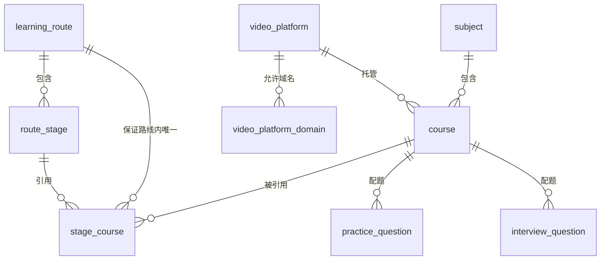
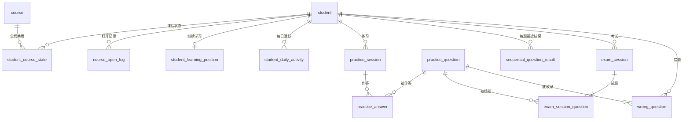
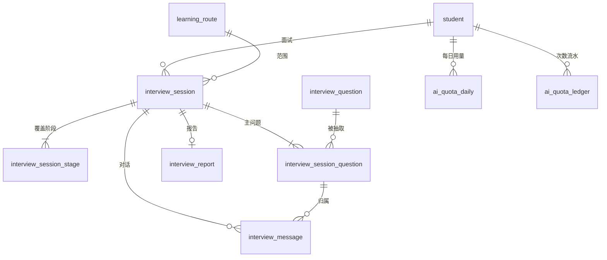

# 云枢智学 第三阶段：数据库设计

| 项目 | 内容 |
|---|---|
| 依据 | `docs/design/01.功能模块梳理.md`（下称"第一阶段"）、`docs/design/02.整体架构设计.md`（下称"第二阶段"）、`docs/需求文档.md`（下称"需求"）、`docs/rules/database-rules.md`（下称"规范"） |
| 建表脚本 | `scripts/sql/schema.sql`；评审前已在 MySQL 8.0.46 上执行通过，第五阶段评审修订后已在 MySQL 8.4.13（本地 Docker 开发环境）上重新执行通过：42 张表、0 个物理外键、73 个 CHECK 约束 |
| 范围 | 业务实体与关系、表结构、逻辑关联、删除策略、需求与规范检查 |
| 不包含 | 接口定义、业务代码、初始化数据脚本 |
| 状态 | 已审核通过；第五阶段评审已修订，见 `05.设计方案评审结果.md` |

第 4 章的字段、索引和约束由建库结果导出；第五阶段的修订已同步写入，并用脚本逐字段核对与 `schema.sql` 一致。

---

## 1. 设计约定

| 项目 | 约定 | 依据 |
|---|---|---|
| 数据库 | MySQL 8.0.16 及以上，InnoDB，字符集 `utf8mb4`，排序规则 `utf8mb4_0900_ai_ci` | 第二阶段 |
| 命名 | 全部小写 `snake_case`；表名统一用单数 | 规范 2；已确认 |
| 主键 | 每张表都是 `id BIGINT UNSIGNED AUTO_INCREMENT` | 规范 4.1 |
| 外键 | **不创建物理外键**；关联字段命名为"实体名 + `_id`"，由应用层校验 | 规范 4.2、4.3 |
| 时间 | `DATETIME(3)`，按 UTC 存储，展示时转为北京时间；数据库连接必须设置 `time_zone='+00:00'` | 规范 3.5 |
| 自然日 | `*_date` 字段类型为 `DATE`，存**北京时间**的自然日（次数归属、统计日期） | 需求 7.1、6.8 |
| 状态字段 | `VARCHAR` 存英文取值，用 `CHECK` 约束限定，取值写在字段注释中 | 规范 3.6；已确认 |
| 布尔字段 | `TINYINT(1)`，以 `is_` 开头或含义明确，用 `CHECK` 限定为 0 或 1 | 规范 3.1 |
| 分数 | 总分和分阶段得分为 `DECIMAL(4,1)`，四舍五入保留 1 位小数，按保留后的数值判定等级；单题 AI 评分为 0~100 的整数 | 规范 3.4；已确认 |
| 默认值 | 只给有明确业务含义的字段设置默认值，如计数器从 0 开始；状态字段不设默认值，由应用显式写入 | 规范 3.3 |
| 结构化字段 | 选项、答案、快照、规则等整体读写的内容用 `JSON`，结构见第 5 章 | 规范 3.7 |
| 删除 | 物理删除，不设删除标记；停用用"上架 / 下架"或状态字段表示 | 已确认 |

**不写入 MySQL 的数据**：验证码及频控、登录会话、密码错误锁定计数、语音名额与排队、断线保留标记、设备接管标记都在 Redis（第二阶段 3.3）。语音排队和设备检测阶段尚未开始面试，所以 `interview_session` 在正式开始时才创建。录音不保存。

角色是固定的三种，权限码定义在代码中（第二阶段 5.6），所以没有角色表和权限表。

---

## 2. 核心业务实体与关系

### 2.1 内容模型

### 2.2 学习、刷题与考试

### 2.3 AI 面试与次数

### 2.4 关键建模说明

| 业务规则 | 建模方式 |
|---|---|
| 同一路线内一门课只能在一个阶段（需求 3.2） | `stage_course` 冗余 `learning_route_id`，建唯一约束 `(learning_route_id, course_id)` |
| 学习状态按课程全局共用（第一阶段 Q01） | `student_course_state` 以"学员 + 课程"为唯一键，不含路线 |
| 已掌握自动算已学（Q03） | 达成时同时写 `is_learned=1`，`CHECK` 保证已掌握必为已学 |
| "学过某条路线"按当前编排判断（Q02、Q19） | 不存储，由 `student_course_state` 关联 `stage_course` 实时计算 |
| 已掌握按每题最近一次结果判定（需求 5.4.2） | `sequential_question_result` 只记录顺序练习；随机抽题、考试、错题重做不写入 |
| 重新练习从第一题开始 | 每轮一条 `practice_session`，每人每课最多一轮进行中 |
| 每人最多一场进行中的考试、一场进行中的面试（Q08） | 生成列 `active_student_id` 加唯一约束，数据库层面兜底 |
| 考试、面试按开始时的题目和参数完成（Q07、Q21） | 开始时写入 `question_snapshot`、`paper_rule`、`config_snapshot` |
| 次数不超扣、不重复扣（需求 8.1） | `ai_quota_daily` 条件更新；`ai_quota_ledger` 唯一约束防止重复 |
| 次数上限修改后立即生效（Q21） | 只记录已用量，上限从 `sys_config` 读取后比较 |
| 反馈合并显示（需求 6.6） | 不建合并表，按题目或课程分组统计待处理记录 |
| 注销后统计保留（需求 5.1.5） | `stat_*` 表不含学员标识，注销时不处理 |

---

## 3. 表清单

共 42 张表。

| 第一阶段模块 | 表 |
|---|---|
| M01 学员账号 | `student`、`student_daily_activity` |
| M02 后台账号与权限 | `sys_user` |
| M03 系统配置 | `sys_config`、`agreement_version`、`faq`、`sensitive_word`、`video_platform`、`video_platform_domain` |
| M04 操作审计 | `operation_log`、`student_export_log` |
| M05 内容编排 | `subject`、`course`、`learning_route`、`route_stage`、`stage_course` |
| M06 题库 | `practice_question`、`interview_question` |
| M07 学习门户 | 无独立表，读取内容和进度 |
| M08 学习进度与记录 | `student_course_state`、`course_open_log`、`student_learning_position` |
| M09 刷题与考试 | `practice_session`、`practice_answer`、`sequential_question_result`、`exam_session`、`exam_session_question` |
| M10 错题本 | `wrong_question` |
| M11 AI 面试 | `interview_session`、`interview_session_stage`、`interview_session_question`、`interview_message` |
| M12 面试报告与记录 | `interview_report` |
| M13 AI 次数管理 | `ai_quota_daily`、`ai_quota_ledger` |
| M14 AI 能力与内容安全 | `sensitive_word_hit_log` |
| M15 纠错与反馈 | `feedback` |
| M16 消息中心 | `student_message` |
| M17 帮助与协议 | `student_agreement_consent` |
| M18 学员运营 | 无独立表，只读查询学员和学习数据 |
| M19 数据看板与工作台 | `stat_daily_overview`、`stat_route_daily`、`stat_stage_interview_daily`、`stat_question_daily` |

每张表只由归属模块写入，其他模块通过归属模块的公开接口读写，M18、M19 的只读查询除外（第二阶段 4.3）。协议文本和常见问题在系统配置中维护，所以归 M03；学员的协议同意记录归 M17；活跃记录被学习、刷题、面试共同产生，归 M01。

---

## 4. 表结构

"默认"一栏的 `—` 表示没有默认值。

### 4.1 账号

#### `student`：学员账号

| 字段 | 类型 | 可空 | 默认 | 说明 |
|---|---|---|---|---|
| `id` | bigint unsigned | 否 | 自增 | 主键 |
| `phone` | char(11) | 否 | — | 手机号，明文存储，显示时隐藏中间四位 |
| `phone_last4` | char(4) | 是 | 生成列 | 手机号后四位，用于后台搜索 |
| `password_hash` | varchar(100) | 是 | — | 登录密码哈希；未设置过密码时为空 |
| `nickname` | varchar(30) | 否 | — | 昵称；注册时为学员加手机号后四位 |
| `avatar_url` | varchar(500) | 是 | — | 头像地址；未上传时为空，显示默认头像 |
| `education` | varchar(30) | 是 | — | 学历：high_school_or_below、junior_college、bachelor、master_or_above；选填 |
| `job_intent_learning_route_id` | bigint unsigned | 是 | — | 求职意向对应的学习路线；选填 |
| `job_intent_name` | varchar(100) | 是 | — | 求职意向名称快照，路线下架或删除后仍可显示 |
| `work_years` | varchar(30) | 是 | — | 工作年限：student_or_graduate、under_1_year、1_to_3_years、3_to_5_years、over_5_years；选填 |
| `status` | varchar(20) | 否 | — | 账号状态：normal 正常、banned 封禁、cancelling 注销中 |
| `ban_reason` | varchar(200) | 是 | — | 封禁原因 |
| `banned_at` | datetime(3) | 是 | — | 封禁时间 |
| `cancellation_requested_at` | datetime(3) | 是 | — | 申请注销时间 |
| `cancellation_effective_at` | datetime(3) | 是 | — | 注销生效时间，即冷静期结束时间 |
| `last_active_at` | datetime(3) | 是 | — | 最近活跃时间，最近一次有学习行为的时间 |
| `created_at` | datetime(3) | 否 | 当前时间 | 注册时间 |
| `updated_at` | datetime(3) | 否 | 当前时间 | 更新时间 |

| 索引 | 类型 | 字段 |
|---|---|---|
| `PRIMARY` | 主键 | `id` |
| `uk_student_phone` | 唯一 | `phone` |
| `idx_student_created` | 普通 | `created_at` |
| `idx_student_job_intent` | 普通 | `job_intent_learning_route_id` |
| `idx_student_last_active` | 普通 | `last_active_at` |
| `idx_student_phone_last4` | 普通 | `phone_last4` |
| `idx_student_status_effective` | 普通 | `status`、`cancellation_effective_at` |

| CHECK 约束 | 条件 |
|---|---|
| `chk_student_phone` | `REGEXP_LIKE(phone, '^1[0-9]{10}$')` |
| `chk_student_status` | `status IN ('normal', 'banned', 'cancelling')` |
| `chk_student_education` | `education IS NULL OR education IN ('high_school_or_below', 'junior_college', 'bachelor', 'master_or_above')` |
| `chk_student_work_years` | `work_years IS NULL OR work_years IN ('student_or_graduate', 'under_1_year', '1_to_3_years', '3_to_5_years', 'over_5_years')` |
| `chk_student_banned` | `status <> 'banned' OR ban_reason IS NOT NULL` |
| `chk_student_cancelling` | `status <> 'cancelling' OR cancellation_effective_at IS NOT NULL` |

#### `student_agreement_consent`：学员同意协议的记录

| 字段 | 类型 | 可空 | 默认 | 说明 |
|---|---|---|---|---|
| `id` | bigint unsigned | 否 | 自增 | 主键 |
| `student_id` | bigint unsigned | 否 | — | 学员 |
| `agreement_type` | varchar(20) | 否 | — | 协议类型：user_agreement 用户协议、privacy_policy 隐私政策 |
| `version_no` | int unsigned | 否 | — | 同意的协议版本号 |
| `agreed_at` | datetime(3) | 否 | — | 同意时间 |

| 索引 | 类型 | 字段 |
|---|---|---|
| `PRIMARY` | 主键 | `id` |
| `uk_consent_student_version` | 唯一 | `student_id`、`agreement_type`、`version_no` |

| CHECK 约束 | 条件 |
|---|---|
| `chk_consent_type` | `agreement_type IN ('user_agreement', 'privacy_policy')` |

#### `sys_user`：后台系统用户

| 字段 | 类型 | 可空 | 默认 | 说明 |
|---|---|---|---|---|
| `id` | bigint unsigned | 否 | 自增 | 主键 |
| `account` | varchar(50) | 否 | — | 登录账号 |
| `name` | varchar(50) | 否 | — | 姓名 |
| `phone` | char(11) | 否 | — | 手机号 |
| `password_hash` | varchar(100) | 否 | — | 登录密码哈希 |
| `role` | varchar(20) | 否 | — | 角色：super_admin 超级管理员、content_operator 内容运营、student_operator 学员运营 |
| `status` | varchar(20) | 否 | — | 账号状态：enabled 启用、disabled 停用 |
| `must_change_password` | tinyint(1) | 否 | — | 是否必须先修改密码才能使用后台：1 是、0 否 |
| `password_changed_at` | datetime(3) | 是 | — | 最近一次修改密码时间 |
| `last_login_at` | datetime(3) | 是 | — | 最近登录时间 |
| `created_at` | datetime(3) | 否 | 当前时间 | 创建时间 |
| `updated_at` | datetime(3) | 否 | 当前时间 | 更新时间 |

| 索引 | 类型 | 字段 |
|---|---|---|
| `PRIMARY` | 主键 | `id` |
| `uk_sys_user_account` | 唯一 | `account` |
| `idx_sys_user_role_status` | 普通 | `role`、`status` |

| CHECK 约束 | 条件 |
|---|---|
| `chk_sys_user_role` | `role IN ('super_admin', 'content_operator', 'student_operator')` |
| `chk_sys_user_status` | `status IN ('enabled', 'disabled')` |
| `chk_sys_user_must_change` | `must_change_password IN (0, 1)` |

### 4.2 系统配置与审计

#### `sys_config`：系统配置项

| 字段 | 类型 | 可空 | 默认 | 说明 |
|---|---|---|---|---|
| `id` | bigint unsigned | 否 | 自增 | 主键 |
| `config_key` | varchar(64) | 否 | — | 配置项键，取值见设计文档 |
| `config_value` | json | 否 | — | 配置项的值，JSON 格式 |
| `description` | varchar(200) | 否 | — | 配置项说明 |
| `updated_by_sys_user_id` | bigint unsigned | 是 | — | 最近修改人；初始化数据为空 |
| `created_at` | datetime(3) | 否 | 当前时间 | 创建时间 |
| `updated_at` | datetime(3) | 否 | 当前时间 | 更新时间 |

| 索引 | 类型 | 字段 |
|---|---|---|
| `PRIMARY` | 主键 | `id` |
| `uk_sys_config_key` | 唯一 | `config_key` |

#### `agreement_version`：协议版本

| 字段 | 类型 | 可空 | 默认 | 说明 |
|---|---|---|---|---|
| `id` | bigint unsigned | 否 | 自增 | 主键 |
| `agreement_type` | varchar(20) | 否 | — | 协议类型：user_agreement 用户协议、privacy_policy 隐私政策 |
| `version_no` | int unsigned | 否 | — | 版本号，同一类型内递增 |
| `content` | mediumtext | 否 | — | 协议正文 |
| `published_by_sys_user_id` | bigint unsigned | 否 | — | 发布人 |
| `published_at` | datetime(3) | 否 | — | 发布时间 |

| 索引 | 类型 | 字段 |
|---|---|---|
| `PRIMARY` | 主键 | `id` |
| `uk_agreement_type_version` | 唯一 | `agreement_type`、`version_no` |

| CHECK 约束 | 条件 |
|---|---|
| `chk_agreement_type` | `agreement_type IN ('user_agreement', 'privacy_policy')` |

#### `sensitive_word`：敏感词库

| 字段 | 类型 | 可空 | 默认 | 说明 |
|---|---|---|---|---|
| `id` | bigint unsigned | 否 | 自增 | 主键 |
| `word` | varchar(100) | 否 | — | 敏感词 |
| `created_by_sys_user_id` | bigint unsigned | 否 | — | 添加人 |
| `created_at` | datetime(3) | 否 | 当前时间 | 创建时间 |

| 索引 | 类型 | 字段 |
|---|---|---|
| `PRIMARY` | 主键 | `id` |
| `uk_sensitive_word` | 唯一 | `word` |

#### `video_platform`：允许使用的视频平台

| 字段 | 类型 | 可空 | 默认 | 说明 |
|---|---|---|---|---|
| `id` | bigint unsigned | 否 | 自增 | 主键 |
| `name` | varchar(50) | 否 | — | 平台名称 |
| `status` | varchar(20) | 否 | — | 状态：enabled 启用、disabled 停用 |
| `created_at` | datetime(3) | 否 | 当前时间 | 创建时间 |
| `updated_at` | datetime(3) | 否 | 当前时间 | 更新时间 |

| 索引 | 类型 | 字段 |
|---|---|---|
| `PRIMARY` | 主键 | `id` |
| `uk_video_platform_name` | 唯一 | `name` |

| CHECK 约束 | 条件 |
|---|---|
| `chk_video_platform_status` | `status IN ('enabled', 'disabled')` |

#### `video_platform_domain`：视频平台允许的域名

| 字段 | 类型 | 可空 | 默认 | 说明 |
|---|---|---|---|---|
| `id` | bigint unsigned | 否 | 自增 | 主键 |
| `video_platform_id` | bigint unsigned | 否 | — | 视频平台 |
| `domain` | varchar(253) | 否 | — | 允许的域名 |
| `created_at` | datetime(3) | 否 | 当前时间 | 创建时间 |

| 索引 | 类型 | 字段 |
|---|---|---|
| `PRIMARY` | 主键 | `id` |
| `uk_video_platform_domain` | 唯一 | `domain` |
| `idx_domain_platform` | 普通 | `video_platform_id` |

#### `faq`：帮助中心常见问题

| 字段 | 类型 | 可空 | 默认 | 说明 |
|---|---|---|---|---|
| `id` | bigint unsigned | 否 | 自增 | 主键 |
| `question` | varchar(200) | 否 | — | 问题 |
| `answer` | text | 否 | — | 回答 |
| `sort_no` | int | 否 | — | 排序号，越小越靠前 |
| `created_at` | datetime(3) | 否 | 当前时间 | 创建时间 |
| `updated_at` | datetime(3) | 否 | 当前时间 | 更新时间 |

| 索引 | 类型 | 字段 |
|---|---|---|
| `PRIMARY` | 主键 | `id` |
| `idx_faq_sort` | 普通 | `sort_no` |

#### `operation_log`：后台操作日志，保留 1 年

| 字段 | 类型 | 可空 | 默认 | 说明 |
|---|---|---|---|---|
| `id` | bigint unsigned | 否 | 自增 | 主键 |
| `sys_user_id` | bigint unsigned | 否 | — | 操作人 |
| `sys_user_name` | varchar(50) | 否 | — | 操作人姓名快照 |
| `role` | varchar(20) | 否 | — | 操作时的角色：super_admin、content_operator、student_operator |
| `module` | varchar(30) | 否 | — | 操作模块 |
| `action` | varchar(30) | 否 | — | 操作类型 |
| `target_type` | varchar(30) | 是 | — | 操作对象类型；后台登录等操作为空 |
| `target_id` | bigint unsigned | 是 | — | 操作对象 ID |
| `target_label` | varchar(200) | 是 | — | 操作对象描述；学员类对象不得写入昵称和手机号 |
| `ip_address` | varchar(45) | 否 | — | IP 地址，兼容 IPv6 |
| `created_at` | datetime(3) | 否 | 当前时间 | 操作时间 |

| 索引 | 类型 | 字段 |
|---|---|---|
| `PRIMARY` | 主键 | `id` |
| `idx_operation_module_time` | 普通 | `module`、`created_at` |
| `idx_operation_time` | 普通 | `created_at` |
| `idx_operation_user_time` | 普通 | `sys_user_id`、`created_at` |

| CHECK 约束 | 条件 |
|---|---|
| `chk_operation_role` | `role IN ('super_admin', 'content_operator', 'student_operator')` |

#### `student_export_log`：学员名单导出记录，保留 1 年

| 字段 | 类型 | 可空 | 默认 | 说明 |
|---|---|---|---|---|
| `id` | bigint unsigned | 否 | 自增 | 主键 |
| `sys_user_id` | bigint unsigned | 否 | — | 操作人 |
| `sys_user_name` | varchar(50) | 否 | — | 操作人姓名快照 |
| `filter_conditions` | json | 否 | — | 导出时的筛选条件 |
| `exported_count` | int unsigned | 否 | — | 导出条数 |
| `created_at` | datetime(3) | 否 | 当前时间 | 导出时间 |

| 索引 | 类型 | 字段 |
|---|---|---|
| `PRIMARY` | 主键 | `id` |
| `idx_export_time` | 普通 | `created_at` |
| `idx_export_user_time` | 普通 | `sys_user_id`、`created_at` |

| CHECK 约束 | 条件 |
|---|---|
| `chk_export_count` | `exported_count <= 5000` |

#### `sensitive_word_hit_log`：敏感词命中日志，保留 1 年

| 字段 | 类型 | 可空 | 默认 | 说明 |
|---|---|---|---|---|
| `id` | bigint unsigned | 否 | 自增 | 主键 |
| `student_id` | bigint unsigned | 否 | — | 学员；注销后关联不到时显示已注销用户 |
| `scene` | varchar(30) | 否 | — | 场景：text_interview 文字面试、voice_interview 语音面试、short_answer_scoring 简答题评分 |
| `source` | varchar(10) | 否 | — | 命中来源：student 学员、ai AI 输出 |
| `word` | varchar(100) | 否 | — | 命中的敏感词 |
| `sentence` | varchar(500) | 否 | — | 命中词所在的原句，超长时截断 |
| `interview_session_id` | bigint unsigned | 是 | — | 所属面试场次；简答题评分场景为空 |
| `created_at` | datetime(3) | 否 | 当前时间 | 命中时间 |

| 索引 | 类型 | 字段 |
|---|---|---|
| `PRIMARY` | 主键 | `id` |
| `idx_hit_student_time` | 普通 | `student_id`、`created_at` |
| `idx_hit_time` | 普通 | `created_at` |

| CHECK 约束 | 条件 |
|---|---|
| `chk_hit_scene` | `scene IN ('text_interview', 'voice_interview', 'short_answer_scoring')` |
| `chk_hit_source` | `source IN ('student', 'ai')` |

### 4.3 内容与题库

#### `subject`：学科

| 字段 | 类型 | 可空 | 默认 | 说明 |
|---|---|---|---|---|
| `id` | bigint unsigned | 否 | 自增 | 主键 |
| `name` | varchar(50) | 否 | — | 学科名称，唯一 |
| `intro` | varchar(500) | 是 | — | 简介 |
| `sort_no` | int | 否 | — | 排序号，越小越靠前 |
| `created_at` | datetime(3) | 否 | 当前时间 | 创建时间 |
| `updated_at` | datetime(3) | 否 | 当前时间 | 更新时间 |

| 索引 | 类型 | 字段 |
|---|---|---|
| `PRIMARY` | 主键 | `id` |
| `uk_subject_name` | 唯一 | `name` |
| `idx_subject_sort` | 普通 | `sort_no` |

#### `course`：课程

| 字段 | 类型 | 可空 | 默认 | 说明 |
|---|---|---|---|---|
| `id` | bigint unsigned | 否 | 自增 | 主键 |
| `subject_id` | bigint unsigned | 否 | — | 所属学科，一门课程只属于一个学科 |
| `title` | varchar(100) | 否 | — | 课程名称 |
| `video_platform_id` | bigint unsigned | 否 | — | 视频平台 |
| `video_url` | varchar(1000) | 否 | — | 视频链接，域名须属于所选平台 |
| `intro` | varchar(1000) | 是 | — | 简介 |
| `duration_minutes` | int unsigned | 是 | — | 时长，单位分钟 |
| `sort_no` | int | 否 | — | 排序号，越小越靠前 |
| `status` | varchar(20) | 否 | — | 状态：on_shelf 上架、off_shelf 下架 |
| `created_at` | datetime(3) | 否 | 当前时间 | 创建时间 |
| `updated_at` | datetime(3) | 否 | 当前时间 | 更新时间 |

| 索引 | 类型 | 字段 |
|---|---|---|
| `PRIMARY` | 主键 | `id` |
| `idx_course_platform` | 普通 | `video_platform_id` |
| `idx_course_status_sort` | 普通 | `status`、`sort_no` |
| `idx_course_subject_status` | 普通 | `subject_id`、`status`、`sort_no` |

| CHECK 约束 | 条件 |
|---|---|
| `chk_course_status` | `status IN ('on_shelf', 'off_shelf')` |

#### `learning_route`：学习路线

| 字段 | 类型 | 可空 | 默认 | 说明 |
|---|---|---|---|---|
| `id` | bigint unsigned | 否 | 自增 | 主键 |
| `name` | varchar(100) | 否 | — | 路线名称 |
| `intro` | varchar(1000) | 是 | — | 简介 |
| `sort_no` | int | 否 | — | 排序号，越小越靠前 |
| `status` | varchar(20) | 否 | — | 状态：on_shelf 上架、off_shelf 下架 |
| `created_at` | datetime(3) | 否 | 当前时间 | 创建时间 |
| `updated_at` | datetime(3) | 否 | 当前时间 | 更新时间 |

| 索引 | 类型 | 字段 |
|---|---|---|
| `PRIMARY` | 主键 | `id` |
| `idx_route_status_sort` | 普通 | `status`、`sort_no` |

| CHECK 约束 | 条件 |
|---|---|
| `chk_route_status` | `status IN ('on_shelf', 'off_shelf')` |

#### `route_stage`：路线阶段

| 字段 | 类型 | 可空 | 默认 | 说明 |
|---|---|---|---|---|
| `id` | bigint unsigned | 否 | 自增 | 主键 |
| `learning_route_id` | bigint unsigned | 否 | — | 所属路线 |
| `name` | varchar(100) | 否 | — | 阶段名称 |
| `intro` | varchar(1000) | 是 | — | 简介 |
| `sort_no` | int | 否 | — | 排序号，越小越靠前 |
| `created_at` | datetime(3) | 否 | 当前时间 | 创建时间 |
| `updated_at` | datetime(3) | 否 | 当前时间 | 更新时间 |

| 索引 | 类型 | 字段 |
|---|---|---|
| `PRIMARY` | 主键 | `id` |
| `idx_stage_route_sort` | 普通 | `learning_route_id`、`sort_no` |

#### `stage_course`：阶段引用的课程

| 字段 | 类型 | 可空 | 默认 | 说明 |
|---|---|---|---|---|
| `id` | bigint unsigned | 否 | 自增 | 主键 |
| `learning_route_id` | bigint unsigned | 否 | — | 所属路线；冗余字段，用于保证同一路线内课程唯一 |
| `route_stage_id` | bigint unsigned | 否 | — | 所属阶段 |
| `course_id` | bigint unsigned | 否 | — | 引用的课程 |
| `sort_no` | int | 否 | — | 阶段内排序号，越小越靠前 |
| `created_at` | datetime(3) | 否 | 当前时间 | 创建时间 |
| `updated_at` | datetime(3) | 否 | 当前时间 | 更新时间 |

| 索引 | 类型 | 字段 |
|---|---|---|
| `PRIMARY` | 主键 | `id` |
| `uk_stage_course_route_course` | 唯一 | `learning_route_id`、`course_id` |
| `idx_stage_course_course` | 普通 | `course_id` |
| `idx_stage_course_stage_sort` | 普通 | `route_stage_id`、`sort_no` |

#### `practice_question`：刷题题目

| 字段 | 类型 | 可空 | 默认 | 说明 |
|---|---|---|---|---|
| `id` | bigint unsigned | 否 | 自增 | 主键 |
| `course_id` | bigint unsigned | 否 | — | 所属课程 |
| `question_type` | varchar(20) | 否 | — | 题型：true_false 判断、single_choice 单选、multiple_choice 多选、short_answer 简答 |
| `stem` | text | 否 | — | 题干 |
| `options` | json | 是 | — | 选项列表，单选和多选使用，2 到 8 个 |
| `correct_answer` | json | 是 | — | 正确答案，判断、单选、多选使用 |
| `reference_answer` | text | 是 | — | 参考答案，简答题使用 |
| `scoring_points` | text | 是 | — | 评分要点，简答题使用 |
| `analysis` | text | 是 | — | 解析 |
| `sort_no` | int | 否 | — | 排序号，用于顺序练习 |
| `status` | varchar(20) | 否 | — | 状态：on_shelf 上架、off_shelf 下架 |
| `created_at` | datetime(3) | 否 | 当前时间 | 创建时间 |
| `updated_at` | datetime(3) | 否 | 当前时间 | 更新时间 |

| 索引 | 类型 | 字段 |
|---|---|---|
| `PRIMARY` | 主键 | `id` |
| `idx_practice_question_course` | 普通 | `course_id`、`status`、`sort_no` |
| `idx_practice_question_status_type` | 普通 | `status`、`question_type` |

| CHECK 约束 | 条件 |
|---|---|
| `chk_practice_question_type` | `question_type IN ('true_false', 'single_choice', 'multiple_choice', 'short_answer')` |
| `chk_practice_question_status` | `status IN ('on_shelf', 'off_shelf')` |
| `chk_practice_question_objective` | `question_type = 'short_answer' OR correct_answer IS NOT NULL` |
| `chk_practice_question_short` | `question_type <> 'short_answer' OR (reference_answer IS NOT NULL AND scoring_points IS NOT NULL)` |
| `chk_practice_question_options` | `question_type NOT IN ('single_choice', 'multiple_choice') OR JSON_LENGTH(options) BETWEEN 2 AND 8` |

#### `interview_question`：面试题目

| 字段 | 类型 | 可空 | 默认 | 说明 |
|---|---|---|---|---|
| `id` | bigint unsigned | 否 | 自增 | 主键 |
| `course_id` | bigint unsigned | 否 | — | 所属课程 |
| `stem` | text | 否 | — | 题干 |
| `reference_answer` | text | 否 | — | 参考答案 |
| `scoring_points` | text | 否 | — | 评分要点 |
| `followup_direction` | text | 是 | — | 追问方向 |
| `status` | varchar(20) | 否 | — | 状态：on_shelf 上架、off_shelf 下架 |
| `created_at` | datetime(3) | 否 | 当前时间 | 创建时间 |
| `updated_at` | datetime(3) | 否 | 当前时间 | 更新时间 |

| 索引 | 类型 | 字段 |
|---|---|---|
| `PRIMARY` | 主键 | `id` |
| `idx_interview_question_course` | 普通 | `course_id`、`status` |
| `idx_interview_question_status` | 普通 | `status` |

| CHECK 约束 | 条件 |
|---|---|
| `chk_interview_question_status` | `status IN ('on_shelf', 'off_shelf')` |

### 4.4 学习进度与记录

#### `student_course_state`：学员的课程学习状态

| 字段 | 类型 | 可空 | 默认 | 说明 |
|---|---|---|---|---|
| `id` | bigint unsigned | 否 | 自增 | 主键 |
| `student_id` | bigint unsigned | 否 | — | 学员 |
| `course_id` | bigint unsigned | 否 | — | 课程；学习状态按课程全局共用 |
| `first_opened_at` | datetime(3) | 是 | — | 首次打开时间 |
| `last_opened_at` | datetime(3) | 是 | — | 最近打开时间 |
| `first_answered_at` | datetime(3) | 是 | — | 首次作答该课程题目的时间 |
| `is_learned` | tinyint(1) | 否 | 0 | 是否已学：1 是、0 否；默认未学 |
| `learned_at` | datetime(3) | 是 | — | 标记已学时间 |
| `is_mastered` | tinyint(1) | 否 | 0 | 是否已掌握：1 是、0 否；默认未掌握，达成后不取消 |
| `mastered_at` | datetime(3) | 是 | — | 达成已掌握时间 |
| `created_at` | datetime(3) | 否 | 当前时间 | 创建时间 |
| `updated_at` | datetime(3) | 否 | 当前时间 | 更新时间 |

| 索引 | 类型 | 字段 |
|---|---|---|
| `PRIMARY` | 主键 | `id` |
| `uk_state_student_course` | 唯一 | `student_id`、`course_id` |
| `idx_state_course` | 普通 | `course_id` |

| CHECK 约束 | 条件 |
|---|---|
| `chk_state_flags` | `is_learned IN (0, 1) AND is_mastered IN (0, 1)` |
| `chk_state_mastered_learned` | `is_mastered = 0 OR is_learned = 1` |

#### `course_open_log`：课程打开记录，每次打开一条

| 字段 | 类型 | 可空 | 默认 | 说明 |
|---|---|---|---|---|
| `id` | bigint unsigned | 否 | 自增 | 主键 |
| `student_id` | bigint unsigned | 否 | — | 学员 |
| `course_id` | bigint unsigned | 否 | — | 课程 |
| `learning_route_id` | bigint unsigned | 是 | — | 打开时所在路线；从搜索等入口进入时可为空 |
| `route_stage_id` | bigint unsigned | 是 | — | 打开时所在阶段；从搜索等入口进入时可为空 |
| `opened_at` | datetime(3) | 否 | — | 打开时间 |

| 索引 | 类型 | 字段 |
|---|---|---|
| `PRIMARY` | 主键 | `id` |
| `idx_open_course` | 普通 | `course_id` |
| `idx_open_student_time` | 普通 | `student_id`、`opened_at` |

#### `student_learning_position`：学员的继续学习位置

| 字段 | 类型 | 可空 | 默认 | 说明 |
|---|---|---|---|---|
| `id` | bigint unsigned | 否 | 自增 | 主键 |
| `student_id` | bigint unsigned | 否 | — | 学员，每人一行 |
| `learning_route_id` | bigint unsigned | 否 | — | 上次学习的路线 |
| `route_stage_id` | bigint unsigned | 否 | — | 上次学习的阶段 |
| `course_id` | bigint unsigned | 否 | — | 上次学习的课程 |
| `last_learned_at` | datetime(3) | 否 | — | 上次学习时间 |

| 索引 | 类型 | 字段 |
|---|---|---|
| `PRIMARY` | 主键 | `id` |
| `uk_position_student` | 唯一 | `student_id` |

#### `student_daily_activity`：学员每日活跃记录，用于活跃和留存统计

| 字段 | 类型 | 可空 | 默认 | 说明 |
|---|---|---|---|---|
| `id` | bigint unsigned | 否 | 自增 | 主键 |
| `student_id` | bigint unsigned | 否 | — | 学员 |
| `activity_date` | date | 否 | — | 有学习行为的日期，北京时间 |

| 索引 | 类型 | 字段 |
|---|---|---|
| `PRIMARY` | 主键 | `id` |
| `uk_activity_student_date` | 唯一 | `student_id`、`activity_date` |
| `idx_activity_date` | 普通 | `activity_date` |

### 4.5 刷题、考试与错题

#### `practice_session`：练习场次，顺序练习每轮一条

| 字段 | 类型 | 可空 | 默认 | 说明 |
|---|---|---|---|---|
| `id` | bigint unsigned | 否 | 自增 | 主键 |
| `student_id` | bigint unsigned | 否 | — | 学员 |
| `practice_mode` | varchar(20) | 否 | — | 练习模式：sequential 顺序练习、random 随机抽题、wrong_redo 错题重做 |
| `course_id` | bigint unsigned | 是 | — | 课程，顺序练习使用 |
| `learning_route_id` | bigint unsigned | 是 | — | 路线，随机抽题使用 |
| `route_stage_id` | bigint unsigned | 是 | — | 阶段，随机抽题使用 |
| `route_name` | varchar(100) | 是 | — | 路线名称快照，用于历史记录 |
| `stage_name` | varchar(100) | 是 | — | 阶段名称快照，用于历史记录 |
| `course_title` | varchar(100) | 是 | — | 课程名称快照，用于历史记录 |
| `status` | varchar(20) | 否 | — | 状态：in_progress 进行中、completed 已完成、unfinished 未完成 |
| `planned_question_ids` | json | 是 | — | 本次抽取的题目 ID 列表，随机抽题和错题重做使用 |
| `question_count` | int unsigned | 否 | — | 本次题目总数 |
| `answered_count` | int unsigned | 否 | 0 | 已作答题数，开始时为 0 |
| `correct_count` | int unsigned | 否 | 0 | 答对题数，开始时为 0 |
| `started_at` | datetime(3) | 否 | — | 开始时间 |
| `finished_at` | datetime(3) | 是 | — | 结束时间 |
| `active_sequential_course_id` | bigint unsigned | 是 | 生成列 | 进行中的顺序练习课程，用于保证同一课程只有一轮进行中 |
| `created_at` | datetime(3) | 否 | 当前时间 | 创建时间 |
| `updated_at` | datetime(3) | 否 | 当前时间 | 更新时间 |

| 索引 | 类型 | 字段 |
|---|---|---|
| `PRIMARY` | 主键 | `id` |
| `uk_practice_active_sequential` | 唯一 | `student_id`、`active_sequential_course_id` |
| `idx_practice_course` | 普通 | `course_id` |
| `idx_practice_student_mode_time` | 普通 | `student_id`、`practice_mode`、`started_at` |

| CHECK 约束 | 条件 |
|---|---|
| `chk_practice_session_mode` | `practice_mode IN ('sequential', 'random', 'wrong_redo')` |
| `chk_practice_session_status` | `status IN ('in_progress', 'completed', 'unfinished')` |
| `chk_practice_session_sequential` | `practice_mode <> 'sequential' OR course_id IS NOT NULL` |
| `chk_practice_session_random` | `practice_mode <> 'random' OR (learning_route_id IS NOT NULL AND route_stage_id IS NOT NULL AND planned_question_ids IS NOT NULL)` |

#### `practice_answer`：练习作答记录

| 字段 | 类型 | 可空 | 默认 | 说明 |
|---|---|---|---|---|
| `id` | bigint unsigned | 否 | 自增 | 主键 |
| `practice_session_id` | bigint unsigned | 否 | — | 所属练习场次 |
| `student_id` | bigint unsigned | 否 | — | 学员 |
| `practice_question_id` | bigint unsigned | 否 | — | 题目 |
| `course_id` | bigint unsigned | 否 | — | 题目所属课程 |
| `practice_mode` | varchar(20) | 否 | — | 练习模式：sequential、random、wrong_redo，错题重做不进入学员刷题记录 |
| `question_type` | varchar(20) | 否 | — | 题型：true_false、single_choice、multiple_choice、short_answer |
| `question_snapshot` | json | 否 | — | 作答时的题目快照 |
| `student_answer` | json | 否 | — | 学员答案 |
| `judge_method` | varchar(10) | 否 | — | 判定方式：auto 自动判分、ai AI 评分、self 学员自评 |
| `is_correct` | tinyint(1) | 否 | — | 是否答对：1 是、0 否 |
| `ai_score` | tinyint unsigned | 是 | — | AI 评分，百分制，仅 AI 评分时有值 |
| `ai_comment` | text | 是 | — | AI 点评，仅 AI 评分时有值 |
| `answered_at` | datetime(3) | 否 | — | 作答时间 |

| 索引 | 类型 | 字段 |
|---|---|---|
| `PRIMARY` | 主键 | `id` |
| `uk_answer_session_question` | 唯一 | `practice_session_id`、`practice_question_id` |
| `idx_answer_question` | 普通 | `practice_question_id` |
| `idx_answer_student_time` | 普通 | `student_id`、`answered_at` |
| `idx_answer_time` | 普通 | `answered_at` |

| CHECK 约束 | 条件 |
|---|---|
| `chk_answer_mode` | `practice_mode IN ('sequential', 'random', 'wrong_redo')` |
| `chk_answer_type` | `question_type IN ('true_false', 'single_choice', 'multiple_choice', 'short_answer')` |
| `chk_answer_method` | `judge_method IN ('auto', 'ai', 'self')` |
| `chk_answer_correct` | `is_correct IN (0, 1)` |
| `chk_answer_score` | `ai_score IS NULL OR ai_score <= 100` |

#### `sequential_question_result`：顺序练习每题最近一次结果，用于判定已掌握

| 字段 | 类型 | 可空 | 默认 | 说明 |
|---|---|---|---|---|
| `id` | bigint unsigned | 否 | 自增 | 主键 |
| `student_id` | bigint unsigned | 否 | — | 学员 |
| `practice_question_id` | bigint unsigned | 否 | — | 题目 |
| `course_id` | bigint unsigned | 否 | — | 题目所属课程 |
| `is_correct` | tinyint(1) | 否 | — | 最近一次顺序练习是否答对：1 是、0 否 |
| `answered_at` | datetime(3) | 否 | — | 最近一次作答时间 |

| 索引 | 类型 | 字段 |
|---|---|---|
| `PRIMARY` | 主键 | `id` |
| `uk_result_student_question` | 唯一 | `student_id`、`practice_question_id` |
| `idx_result_student_course` | 普通 | `student_id`、`course_id` |

| CHECK 约束 | 条件 |
|---|---|
| `chk_result_correct` | `is_correct IN (0, 1)` |

#### `exam_session`：模拟考试场次

| 字段 | 类型 | 可空 | 默认 | 说明 |
|---|---|---|---|---|
| `id` | bigint unsigned | 否 | 自增 | 主键 |
| `student_id` | bigint unsigned | 否 | — | 学员 |
| `learning_route_id` | bigint unsigned | 否 | — | 路线 |
| `route_stage_id` | bigint unsigned | 否 | — | 阶段 |
| `route_name` | varchar(100) | 否 | — | 路线名称快照 |
| `stage_name` | varchar(100) | 否 | — | 阶段名称快照 |
| `status` | varchar(20) | 否 | — | 状态：in_progress 作答中、submitted 已交卷待判分、scoring_pending 简答题评分中、graded 已出成绩、abandoned 已放弃 |
| `paper_rule` | json | 否 | — | 开考时固定的组卷规则 |
| `duration_minutes` | smallint unsigned | 否 | — | 开考时固定的考试时长，单位分钟 |
| `has_short_answer` | tinyint(1) | 否 | — | 试卷是否含简答题：1 是、0 否 |
| `scoring_quota_status` | varchar(10) | 否 | — | 评分次数状态：none 无需预留、reserved 已预留、consumed 已扣减、released 已释放 |
| `quota_date` | date | 否 | — | 次数归属日期，北京时间，即开考当日 |
| `full_score` | decimal(6,2) | 否 | — | 试卷实际满分，用于换算百分制 |
| `score` | decimal(4,1) | 是 | — | 总分，百分制，保留 1 位小数；出成绩后有值 |
| `started_at` | datetime(3) | 否 | — | 开考时间 |
| `deadline_at` | datetime(3) | 否 | — | 截止时间 |
| `submitted_at` | datetime(3) | 是 | — | 交卷时间 |
| `graded_at` | datetime(3) | 是 | — | 出成绩时间 |
| `active_student_id` | bigint unsigned | 是 | 生成列 | 作答中的学员，用于保证每人最多一场作答中的考试 |
| `created_at` | datetime(3) | 否 | 当前时间 | 创建时间 |
| `updated_at` | datetime(3) | 否 | 当前时间 | 更新时间 |

| 索引 | 类型 | 字段 |
|---|---|---|
| `PRIMARY` | 主键 | `id` |
| `uk_exam_active_student` | 唯一 | `active_student_id` |
| `idx_exam_route_stage` | 普通 | `route_stage_id` |
| `idx_exam_status_deadline` | 普通 | `status`、`deadline_at` |
| `idx_exam_student_time` | 普通 | `student_id`、`started_at` |

| CHECK 约束 | 条件 |
|---|---|
| `chk_exam_status` | `status IN ('in_progress', 'submitted', 'scoring_pending', 'graded', 'abandoned')` |
| `chk_exam_quota_status` | `scoring_quota_status IN ('none', 'reserved', 'consumed', 'released')` |
| `chk_exam_short_answer` | `has_short_answer IN (0, 1)` |
| `chk_exam_score` | `score IS NULL OR score BETWEEN 0 AND 100` |
| `chk_exam_graded` | `status <> 'graded' OR score IS NOT NULL` |

#### `exam_session_question`：模拟考试试题与作答

| 字段 | 类型 | 可空 | 默认 | 说明 |
|---|---|---|---|---|
| `id` | bigint unsigned | 否 | 自增 | 主键 |
| `exam_session_id` | bigint unsigned | 否 | — | 所属考试场次 |
| `seq_no` | int unsigned | 否 | — | 题号 |
| `practice_question_id` | bigint unsigned | 否 | — | 题目 |
| `course_id` | bigint unsigned | 否 | — | 题目所属课程 |
| `question_type` | varchar(20) | 否 | — | 题型：true_false、single_choice、multiple_choice、short_answer |
| `question_snapshot` | json | 否 | — | 开考时固定的题目快照 |
| `question_score` | decimal(6,2) | 否 | — | 本题分值 |
| `student_answer` | json | 是 | — | 学员答案；未作答时为空 |
| `judge_status` | varchar(10) | 否 | — | 判分状态：pending 待判分、judged 已判分、failed 评分失败 |
| `is_correct` | tinyint(1) | 是 | — | 是否答对：1 是、0 否；判分后有值 |
| `earned_score` | decimal(6,2) | 是 | — | 本题得分；判分后有值 |
| `ai_score` | tinyint unsigned | 是 | — | AI 评分，百分制，简答题使用 |
| `ai_comment` | text | 是 | — | AI 点评，简答题使用 |
| `answered_at` | datetime(3) | 是 | — | 最近一次保存答案的时间 |
| `created_at` | datetime(3) | 否 | 当前时间 | 创建时间 |
| `updated_at` | datetime(3) | 否 | 当前时间 | 更新时间 |

| 索引 | 类型 | 字段 |
|---|---|---|
| `PRIMARY` | 主键 | `id` |
| `uk_exam_question_seq` | 唯一 | `exam_session_id`、`seq_no` |
| `idx_exam_question_question` | 普通 | `practice_question_id` |

| CHECK 约束 | 条件 |
|---|---|
| `chk_exam_question_type` | `question_type IN ('true_false', 'single_choice', 'multiple_choice', 'short_answer')` |
| `chk_exam_question_judge` | `judge_status IN ('pending', 'judged', 'failed')` |
| `chk_exam_question_correct` | `is_correct IS NULL OR is_correct IN (0, 1)` |
| `chk_exam_question_ai_score` | `ai_score IS NULL OR ai_score <= 100` |

#### `wrong_question`：错题本

| 字段 | 类型 | 可空 | 默认 | 说明 |
|---|---|---|---|---|
| `id` | bigint unsigned | 否 | 自增 | 主键 |
| `student_id` | bigint unsigned | 否 | — | 学员 |
| `practice_question_id` | bigint unsigned | 否 | — | 题目 |
| `course_id` | bigint unsigned | 否 | — | 题目所属课程 |
| `question_type` | varchar(20) | 否 | — | 题型：true_false、single_choice、multiple_choice、short_answer |
| `wrong_count` | int unsigned | 否 | — | 累计答错次数；移出后再次答错从 1 重新计算 |
| `last_student_answer` | json | 否 | — | 学员上次的答案，保留作答时的原样 |
| `last_wrong_at` | datetime(3) | 否 | — | 最近一次答错时间 |
| `created_at` | datetime(3) | 否 | 当前时间 | 收录时间 |
| `updated_at` | datetime(3) | 否 | 当前时间 | 更新时间 |

| 索引 | 类型 | 字段 |
|---|---|---|
| `PRIMARY` | 主键 | `id` |
| `uk_wrong_student_question` | 唯一 | `student_id`、`practice_question_id` |
| `idx_wrong_question` | 普通 | `practice_question_id` |
| `idx_wrong_student_course` | 普通 | `student_id`、`course_id` |

| CHECK 约束 | 条件 |
|---|---|
| `chk_wrong_type` | `question_type IN ('true_false', 'single_choice', 'multiple_choice', 'short_answer')` |
| `chk_wrong_count` | `wrong_count >= 1` |

### 4.6 AI 面试

#### `interview_session`：AI 面试场次

| 字段 | 类型 | 可空 | 默认 | 说明 |
|---|---|---|---|---|
| `id` | bigint unsigned | 否 | 自增 | 主键 |
| `student_id` | bigint unsigned | 否 | — | 学员 |
| `learning_route_id` | bigint unsigned | 否 | — | 路线 |
| `route_name` | varchar(100) | 否 | — | 路线名称快照 |
| `interview_mode` | varchar(10) | 否 | — | 面试模式：text 文字面试、voice 语音面试 |
| `scope_type` | varchar(20) | 否 | — | 面试范围：whole_route 整条路线、selected_stages 所选阶段 |
| `status` | varchar(20) | 否 | — | 状态：in_progress 进行中、ended 已结束 |
| `end_reason` | varchar(20) | 是 | — | 结束方式：completed 答完、student_ended 主动结束、timeout 超时、ai_failure AI 服务异常；结束后有值 |
| `config_snapshot` | json | 否 | — | 开始时固定的面试参数 |
| `main_question_count` | tinyint unsigned | 否 | — | 本场主问题数量 |
| `answered_count` | tinyint unsigned | 否 | 0 | 已作答的主问题数量，开始时为 0 |
| `duration_minutes` | smallint unsigned | 否 | — | 开始时固定的时长上限，单位分钟 |
| `quota_date` | date | 否 | — | 次数归属日期，北京时间，即开始当日 |
| `is_quota_refunded` | tinyint(1) | 否 | 0 | 次数是否已退还：1 是、0 否；默认未退还 |
| `started_at` | datetime(3) | 否 | — | 开始时间 |
| `deadline_at` | datetime(3) | 否 | — | 截止时间；AI 服务异常期间相应顺延 |
| `ended_at` | datetime(3) | 是 | — | 结束时间 |
| `active_student_id` | bigint unsigned | 是 | 生成列 | 进行中的学员，用于保证每人最多一场进行中的面试 |
| `created_at` | datetime(3) | 否 | 当前时间 | 创建时间 |
| `updated_at` | datetime(3) | 否 | 当前时间 | 更新时间 |

| 索引 | 类型 | 字段 |
|---|---|---|
| `PRIMARY` | 主键 | `id` |
| `uk_interview_active_student` | 唯一 | `active_student_id` |
| `idx_interview_route` | 普通 | `learning_route_id` |
| `idx_interview_started` | 普通 | `started_at` |
| `idx_interview_status_deadline` | 普通 | `status`、`deadline_at` |
| `idx_interview_student_time` | 普通 | `student_id`、`started_at` |

| CHECK 约束 | 条件 |
|---|---|
| `chk_interview_mode` | `interview_mode IN ('text', 'voice')` |
| `chk_interview_scope` | `scope_type IN ('whole_route', 'selected_stages')` |
| `chk_interview_status` | `status IN ('in_progress', 'ended')` |
| `chk_interview_end_reason` | `end_reason IS NULL OR end_reason IN ('completed', 'student_ended', 'timeout', 'ai_failure')` |
| `chk_interview_ended` | `status <> 'ended' OR end_reason IS NOT NULL` |
| `chk_interview_refunded` | `is_quota_refunded IN (0, 1)` |

#### `interview_session_stage`：面试覆盖的阶段及分阶段得分

| 字段 | 类型 | 可空 | 默认 | 说明 |
|---|---|---|---|---|
| `id` | bigint unsigned | 否 | 自增 | 主键 |
| `interview_session_id` | bigint unsigned | 否 | — | 所属面试场次 |
| `route_stage_id` | bigint unsigned | 否 | — | 阶段 |
| `stage_name` | varchar(100) | 否 | — | 阶段名称快照 |
| `question_count` | tinyint unsigned | 否 | — | 本阶段分配的主问题数量 |
| `score` | decimal(4,1) | 是 | — | 分阶段得分，保留 1 位小数；为空表示尚未评分或未测评 |
| `created_at` | datetime(3) | 否 | 当前时间 | 创建时间 |
| `updated_at` | datetime(3) | 否 | 当前时间 | 更新时间 |

| 索引 | 类型 | 字段 |
|---|---|---|
| `PRIMARY` | 主键 | `id` |
| `uk_session_stage` | 唯一 | `interview_session_id`、`route_stage_id` |
| `idx_session_stage_stage` | 普通 | `route_stage_id` |

| CHECK 约束 | 条件 |
|---|---|
| `chk_session_stage_score` | `score IS NULL OR score BETWEEN 0 AND 100` |

#### `interview_session_question`：面试抽取的主问题及逐题点评

| 字段 | 类型 | 可空 | 默认 | 说明 |
|---|---|---|---|---|
| `id` | bigint unsigned | 否 | 自增 | 主键 |
| `interview_session_id` | bigint unsigned | 否 | — | 所属面试场次 |
| `seq_no` | tinyint unsigned | 否 | — | 主问题序号 |
| `interview_question_id` | bigint unsigned | 否 | — | 面试题目 |
| `course_id` | bigint unsigned | 否 | — | 题目所属课程，用于学习建议跳转 |
| `route_stage_id` | bigint unsigned | 否 | — | 抽题时所属阶段，用于分阶段得分 |
| `question_snapshot` | json | 否 | — | 开始时固定的题目快照 |
| `answer_status` | varchar(20) | 否 | — | 作答状态：not_asked 未问到、answered 已作答、unanswered 未作答 |
| `followup_count` | tinyint unsigned | 否 | 0 | 已追问次数，开始时为 0 |
| `score` | tinyint unsigned | 是 | — | 本题得分，百分制，主问题连同追问整体打分 |
| `ai_comment` | text | 是 | — | AI 点评 |
| `missing_points` | text | 是 | — | 缺失要点 |
| `created_at` | datetime(3) | 否 | 当前时间 | 创建时间 |
| `updated_at` | datetime(3) | 否 | 当前时间 | 更新时间 |

| 索引 | 类型 | 字段 |
|---|---|---|
| `PRIMARY` | 主键 | `id` |
| `uk_session_question_seq` | 唯一 | `interview_session_id`、`seq_no` |
| `idx_session_question_question` | 普通 | `interview_question_id` |

| CHECK 约束 | 条件 |
|---|---|
| `chk_session_question_status` | `answer_status IN ('not_asked', 'answered', 'unanswered')` |
| `chk_session_question_score` | `score IS NULL OR score <= 100` |

#### `interview_message`：面试对话消息

| 字段 | 类型 | 可空 | 默认 | 说明 |
|---|---|---|---|---|
| `id` | bigint unsigned | 否 | 自增 | 主键 |
| `interview_session_id` | bigint unsigned | 否 | — | 所属面试场次 |
| `interview_session_question_id` | bigint unsigned | 是 | — | 所属主问题；开场白和结束语为空 |
| `seq_no` | int unsigned | 否 | — | 消息序号 |
| `speaker` | varchar(10) | 否 | — | 说话方：ai 面试官、student 学员 |
| `message_type` | varchar(20) | 否 | — | 消息类型：opening 开场白、main_question 主问题、followup 追问、answer 回答、transition 过渡语、closing 结束语 |
| `content` | text | 否 | — | 消息文字；语音面试为转写文字 |
| `created_at` | datetime(3) | 否 | 当前时间 | 创建时间 |

| 索引 | 类型 | 字段 |
|---|---|---|
| `PRIMARY` | 主键 | `id` |
| `uk_message_session_seq` | 唯一 | `interview_session_id`、`seq_no` |
| `idx_message_question` | 普通 | `interview_session_question_id` |

| CHECK 约束 | 条件 |
|---|---|
| `chk_message_speaker` | `speaker IN ('ai', 'student')` |
| `chk_message_type` | `message_type IN ('opening', 'main_question', 'followup', 'answer', 'transition', 'closing')` |

#### `interview_report`：面试报告

| 字段 | 类型 | 可空 | 默认 | 说明 |
|---|---|---|---|---|
| `id` | bigint unsigned | 否 | 自增 | 主键 |
| `interview_session_id` | bigint unsigned | 否 | — | 所属面试场次；一题未答的异常场次不生成报告 |
| `status` | varchar(20) | 否 | — | 状态：generating 生成中、generated 已生成、failed 生成失败 |
| `retry_count` | tinyint unsigned | 否 | 0 | 已自动重试次数，开始时为 0，上限 3 次 |
| `next_retry_at` | datetime(3) | 是 | — | 下次重试时间 |
| `total_score` | decimal(4,1) | 是 | — | 总分，百分制，保留 1 位小数 |
| `grade` | varchar(20) | 是 | — | 等级：excellent 优秀、good 良好、needs_improvement 待提升 |
| `learning_advice` | json | 是 | — | 学习建议及推荐课程 |
| `failure_reason` | varchar(500) | 是 | — | 最近一次失败原因，仅供排查 |
| `generated_at` | datetime(3) | 是 | — | 生成完成时间 |
| `created_at` | datetime(3) | 否 | 当前时间 | 创建时间 |
| `updated_at` | datetime(3) | 否 | 当前时间 | 更新时间 |

| 索引 | 类型 | 字段 |
|---|---|---|
| `PRIMARY` | 主键 | `id` |
| `uk_report_session` | 唯一 | `interview_session_id` |
| `idx_report_status_retry` | 普通 | `status`、`next_retry_at` |

| CHECK 约束 | 条件 |
|---|---|
| `chk_report_status` | `status IN ('generating', 'generated', 'failed')` |
| `chk_report_grade` | `grade IS NULL OR grade IN ('excellent', 'good', 'needs_improvement')` |
| `chk_report_score` | `total_score IS NULL OR total_score BETWEEN 0 AND 100` |
| `chk_report_retry` | `retry_count <= 3` |
| `chk_report_generated` | `status <> 'generated' OR (total_score IS NOT NULL AND grade IS NOT NULL)` |

### 4.7 AI 次数

#### `ai_quota_daily`：学员每日 AI 次数使用量

| 字段 | 类型 | 可空 | 默认 | 说明 |
|---|---|---|---|---|
| `id` | bigint unsigned | 否 | 自增 | 主键 |
| `student_id` | bigint unsigned | 否 | — | 学员 |
| `quota_date` | date | 否 | — | 日期，北京时间 |
| `interview_used` | int unsigned | 否 | 0 | 已用面试次数，当日初始为 0 |
| `scoring_used` | int unsigned | 否 | 0 | 已用评分次数，当日初始为 0 |
| `scoring_reserved` | int unsigned | 否 | 0 | 模拟考试预留的评分次数，当日初始为 0 |
| `created_at` | datetime(3) | 否 | 当前时间 | 创建时间 |
| `updated_at` | datetime(3) | 否 | 当前时间 | 更新时间 |

| 索引 | 类型 | 字段 |
|---|---|---|
| `PRIMARY` | 主键 | `id` |
| `uk_quota_student_date` | 唯一 | `student_id`、`quota_date` |

#### `ai_quota_ledger`：AI 次数变动流水，同时用于防止重复扣减

| 字段 | 类型 | 可空 | 默认 | 说明 |
|---|---|---|---|---|
| `id` | bigint unsigned | 否 | 自增 | 主键 |
| `student_id` | bigint unsigned | 否 | — | 学员 |
| `quota_date` | date | 否 | — | 次数归属日期，北京时间 |
| `quota_type` | varchar(10) | 否 | — | 次数类型：interview 面试、scoring 评分 |
| `action` | varchar(10) | 否 | — | 动作：charge 扣减、reserve 预留、consume 预留转扣减、release 释放、refund 退还 |
| `business_type` | varchar(20) | 否 | — | 业务类型：interview_session、exam_session、practice_answer |
| `business_id` | bigint unsigned | 否 | — | 业务记录 ID |
| `created_at` | datetime(3) | 否 | 当前时间 | 发生时间 |

| 索引 | 类型 | 字段 |
|---|---|---|
| `PRIMARY` | 主键 | `id` |
| `uk_ledger_business_action` | 唯一 | `business_type`、`business_id`、`quota_type`、`action` |
| `idx_ledger_date_type` | 普通 | `quota_date`、`quota_type`、`action` |
| `idx_ledger_student_date` | 普通 | `student_id`、`quota_date` |

| CHECK 约束 | 条件 |
|---|---|
| `chk_ledger_type` | `quota_type IN ('interview', 'scoring')` |
| `chk_ledger_action` | `action IN ('charge', 'reserve', 'consume', 'release', 'refund')` |
| `chk_ledger_business` | `business_type IN ('interview_session', 'exam_session', 'practice_answer')` |

### 4.8 运营与服务

#### `feedback`：题目纠错与视频失效反馈

| 字段 | 类型 | 可空 | 默认 | 说明 |
|---|---|---|---|---|
| `id` | bigint unsigned | 否 | 自增 | 主键 |
| `feedback_type` | varchar(30) | 否 | — | 反馈类型：question_correction 题目纠错、video_invalid 视频失效 |
| `student_id` | bigint unsigned | 否 | — | 提交学员；注销后关联不到时显示已注销用户 |
| `course_id` | bigint unsigned | 否 | — | 相关课程；题目纠错时为题目所属课程 |
| `practice_question_id` | bigint unsigned | 是 | — | 被纠错的题目，题目纠错使用 |
| `error_type` | varchar(20) | 是 | — | 错误类型：stem_error 题干有误、answer_error 答案有误、analysis_error 解析有误、other 其他，题目纠错使用 |
| `description` | varchar(1000) | 是 | — | 学员填写的说明；题目纠错必填 |
| `video_url` | varchar(1000) | 是 | — | 反馈时的视频链接，视频失效反馈使用 |
| `status` | varchar(20) | 否 | — | 状态：pending 待处理、corrected 已修正、rejected 已驳回 |
| `handling_note` | varchar(1000) | 是 | — | 处理说明；处理后必填 |
| `handled_by_sys_user_id` | bigint unsigned | 是 | — | 处理人 |
| `handled_at` | datetime(3) | 是 | — | 处理时间 |
| `created_at` | datetime(3) | 否 | 当前时间 | 提交时间 |
| `updated_at` | datetime(3) | 否 | 当前时间 | 更新时间 |

| 索引 | 类型 | 字段 |
|---|---|---|
| `PRIMARY` | 主键 | `id` |
| `idx_feedback_course_status` | 普通 | `course_id`、`status` |
| `idx_feedback_created` | 普通 | `created_at` |
| `idx_feedback_question_status` | 普通 | `practice_question_id`、`status` |
| `idx_feedback_status_type` | 普通 | `status`、`feedback_type`、`created_at` |

| CHECK 约束 | 条件 |
|---|---|
| `chk_feedback_type` | `feedback_type IN ('question_correction', 'video_invalid')` |
| `chk_feedback_error_type` | `error_type IS NULL OR error_type IN ('stem_error', 'answer_error', 'analysis_error', 'other')` |
| `chk_feedback_status` | `status IN ('pending', 'corrected', 'rejected')` |
| `chk_feedback_correction` | `feedback_type <> 'question_correction' OR (practice_question_id IS NOT NULL AND error_type IS NOT NULL AND description IS NOT NULL)` |
| `chk_feedback_handled` | `status = 'pending' OR (handling_note IS NOT NULL AND handled_by_sys_user_id IS NOT NULL AND handled_at IS NOT NULL)` |

#### `student_message`：站内信

| 字段 | 类型 | 可空 | 默认 | 说明 |
|---|---|---|---|---|
| `id` | bigint unsigned | 否 | 自增 | 主键 |
| `student_id` | bigint unsigned | 否 | — | 接收学员 |
| `message_type` | varchar(30) | 否 | — | 类型：agreement_updated 协议已更新、interview_report_generated 面试报告已生成、feedback_result 纠错与反馈处理结果 |
| `title` | varchar(100) | 否 | — | 标题 |
| `content` | varchar(2000) | 否 | — | 正文 |
| `business_id` | bigint unsigned | 是 | — | 关联业务记录 ID，用于跳转 |
| `is_read` | tinyint(1) | 否 | 0 | 是否已读：1 是、0 否；默认未读 |
| `read_at` | datetime(3) | 是 | — | 已读时间 |
| `created_at` | datetime(3) | 否 | 当前时间 | 发送时间 |

| 索引 | 类型 | 字段 |
|---|---|---|
| `PRIMARY` | 主键 | `id` |
| `idx_message_student_read` | 普通 | `student_id`、`is_read`、`created_at` |

| CHECK 约束 | 条件 |
|---|---|
| `chk_student_message_type` | `message_type IN ('agreement_updated', 'interview_report_generated', 'feedback_result')` |
| `chk_student_message_read` | `is_read IN (0, 1)` |

### 4.9 数据看板汇总（不含学员个人信息，注销时不删除）

#### `stat_daily_overview`：每日总览指标

| 字段 | 类型 | 可空 | 默认 | 说明 |
|---|---|---|---|---|
| `id` | bigint unsigned | 否 | 自增 | 主键 |
| `stat_date` | date | 否 | — | 统计日期，北京时间 |
| `new_student_count` | int unsigned | 否 | — | 新增注册数 |
| `cumulative_student_count` | int unsigned | 否 | — | 累计学员数 |
| `daily_active_student_count` | int unsigned | 否 | — | 日活跃学员数 |
| `monthly_active_student_count` | int unsigned | 否 | — | 月活跃学员数：含当天在内近 30 天有学习行为的学员数 |
| `next_day_retained_count` | int unsigned | 是 | — | 当天注册的学员中，注册后第 1 天有学习行为的人数，用于计算次日留存率；未到统计时间时为空 |
| `seven_day_retained_count` | int unsigned | 是 | — | 当天注册的学员中，注册后第 7 天有学习行为的人数，用于计算 7 日留存率；未到统计时间时为空 |
| `answer_count` | int unsigned | 否 | — | 刷题量 |
| `correct_answer_count` | int unsigned | 否 | — | 答对题数，用于计算正确率 |
| `interview_count` | int unsigned | 否 | — | 面试场次，不含 AI 服务异常结束的场次 |
| `interview_scored_count` | int unsigned | 否 | — | 已生成总分的面试场次，用于计算平均分 |
| `interview_score_sum` | decimal(12,1) | 否 | — | 面试总分之和，用于计算平均分 |
| `ai_interview_call_count` | int unsigned | 否 | — | AI 调用次数：面试，按场统计 |
| `ai_scoring_call_count` | int unsigned | 否 | — | AI 调用次数：简答题评分，按实际扣减次数统计 |
| `refreshed_at` | datetime(3) | 否 | — | 最近更新时间，用于页面展示 |

| 索引 | 类型 | 字段 |
|---|---|---|
| `PRIMARY` | 主键 | `id` |
| `uk_stat_daily_date` | 唯一 | `stat_date` |

#### `stat_route_daily`：各路线每日指标

| 字段 | 类型 | 可空 | 默认 | 说明 |
|---|---|---|---|---|
| `id` | bigint unsigned | 否 | 自增 | 主键 |
| `stat_date` | date | 否 | — | 统计日期，北京时间 |
| `learning_route_id` | bigint unsigned | 否 | — | 路线 |
| `route_name` | varchar(100) | 否 | — | 路线名称快照 |
| `learner_count` | int unsigned | 否 | — | 学过该路线的学员数 |
| `average_learned_progress` | decimal(5,2) | 否 | — | 平均已学进度，百分比 |
| `average_mastered_progress` | decimal(5,2) | 否 | — | 平均已掌握进度，百分比 |
| `refreshed_at` | datetime(3) | 否 | — | 最近更新时间 |

| 索引 | 类型 | 字段 |
|---|---|---|
| `PRIMARY` | 主键 | `id` |
| `uk_stat_route_date` | 唯一 | `stat_date`、`learning_route_id` |
| `idx_stat_route_route` | 普通 | `learning_route_id`、`stat_date` |

#### `stat_stage_interview_daily`：各阶段每日面试得分

| 字段 | 类型 | 可空 | 默认 | 说明 |
|---|---|---|---|---|
| `id` | bigint unsigned | 否 | 自增 | 主键 |
| `stat_date` | date | 否 | — | 统计日期，北京时间 |
| `route_stage_id` | bigint unsigned | 否 | — | 阶段 |
| `stage_name` | varchar(100) | 否 | — | 阶段名称快照 |
| `stage_interview_count` | int unsigned | 否 | — | 有该阶段得分的面试场次 |
| `stage_score_sum` | decimal(12,1) | 否 | — | 阶段得分之和，用于计算平均得分 |
| `refreshed_at` | datetime(3) | 否 | — | 最近更新时间 |

| 索引 | 类型 | 字段 |
|---|---|---|
| `PRIMARY` | 主键 | `id` |
| `uk_stat_stage_date` | 唯一 | `stat_date`、`route_stage_id` |

#### `stat_question_daily`：题目每日作答指标，用于错误率排行

| 字段 | 类型 | 可空 | 默认 | 说明 |
|---|---|---|---|---|
| `id` | bigint unsigned | 否 | 自增 | 主键 |
| `stat_date` | date | 否 | — | 统计日期，北京时间 |
| `practice_question_id` | bigint unsigned | 否 | — | 题目 |
| `stem_excerpt` | varchar(200) | 否 | — | 题干摘要快照，用于排行展示 |
| `answer_count` | int unsigned | 否 | — | 作答次数 |
| `wrong_count` | int unsigned | 否 | — | 答错次数 |
| `refreshed_at` | datetime(3) | 否 | — | 最近更新时间 |

| 索引 | 类型 | 字段 |
|---|---|---|
| `PRIMARY` | 主键 | `id` |
| `uk_stat_question_date` | 唯一 | `stat_date`、`practice_question_id` |

---

## 5. 结构化字段约定

### 5.1 JSON 字段结构

| 字段 | 结构 |
|---|---|
| `practice_question.options` | `[{"key":"A","text":"选项内容"}]` |
| `practice_question.correct_answer` | 判断题 `true` 或 `false`；单选 `["A"]`；多选 `["A","C"]` |
| `*.question_snapshot`（刷题、考试） | `{"stem":"","question_type":"","options":[],"correct_answer":null,"reference_answer":"","scoring_points":"","analysis":""}` |
| `interview_session_question.question_snapshot` | `{"stem":"","reference_answer":"","scoring_points":"","followup_direction":""}` |
| `student_answer`、`last_student_answer` | 判断题布尔值；选择题选项数组；简答题字符串 |
| `practice_session.planned_question_ids` | 题目 ID 数组 `[101,102]` |
| `exam_session.paper_rule` | `{"true_false":{"count":5,"score":3},"single_choice":{"count":8,"score":5},"multiple_choice":{"count":5,"score":5},"short_answer":{"count":2,"score":10}}` |
| `interview_session.config_snapshot` | `{"max_followup_count":2,"voice_end_pause_seconds":3,"grade_thresholds":{"excellent":80,"good":60}}` |
| `interview_report.learning_advice` | `[{"route_stage_id":1,"advice":"","courses":[{"course_id":1,"title":""}]}]` |
| `student_export_log.filter_conditions` | 导出时的筛选条件键值 |

### 5.2 `sys_config` 配置项

| `config_key` | 含义 | 默认值 | 需求 |
|---|---|---|---|
| `ai.interview_daily_limit` | 每人每日面试次数 | `2` | 7.1 |
| `ai.scoring_daily_limit` | 每人每日简答题评分次数 | `20` | 7.1 |
| `learning.mastery_threshold` | 已掌握达标线（百分比） | `80` | 7.2 |
| `learning.short_answer_pass_score` | 简答题及格线 | `60` | 7.2 |
| `practice.random_question_count` | 随机抽题数量 | `10` | 7.3 |
| `practice.random_min_question_count` | 随机抽题最低题量 | `5` | 7.3 |
| `exam.paper_rule` | 组卷规则 | 见 5.1 | 7.3 |
| `exam.duration_minutes` | 考试时长 | `30` | 7.3 |
| `exam.min_question_count` | 考试最低题量 | `10` | 7.3 |
| `interview.main_question_count` | 主问题数量 | `5` | 7.4 |
| `interview.max_followup_count` | 每题最多追问次数 | `2` | 7.4 |
| `interview.duration_minutes` | 面试时长上限 | `30` | 7.4 |
| `interview.min_question_count` | 面试最低题量 | `3` | 7.4 |
| `interview.voice_end_pause_seconds` | 语音说完判定停顿 | `3` | 7.4 |
| `interview.voice_concurrency_limit` | 语音面试同时进行上限 | `20` | 7.4 |
| `interview.grade_thresholds` | 等级分数线 | `{"excellent":80,"good":60}` | 7.4 |
| `help.contact` | 客服联系方式 | `{"wechat_qrcode_url":null,"email":null,"phone":null}` | 7.7 |

协议文本、敏感词、常见问题、视频平台内容较多或是列表，使用独立的表。

---

## 6. 表之间的逻辑关联

所有关联都没有物理外键，由应用层在写入前校验目标存在。

| 关联字段 | 指向 | 应用层校验 |
|---|---|---|
| `course.subject_id` | `subject.id` | 写入时校验学科存在 |
| `course.video_platform_id` | `video_platform.id` | 新建时校验平台已启用，且链接域名属于该平台 |
| `video_platform_domain.video_platform_id` | `video_platform.id` | 随平台一起维护 |
| `route_stage.learning_route_id` | `learning_route.id` | 随路线维护 |
| `stage_course.learning_route_id`、`route_stage_id` | `learning_route.id`、`route_stage.id` | 校验阶段属于该路线 |
| `stage_course.course_id` | `course.id` | 校验课程存在 |
| `practice_question.course_id`、`interview_question.course_id` | `course.id` | 校验课程存在 |
| `student.job_intent_learning_route_id` | `learning_route.id` | 选择时校验路线已上架；路线删除后靠 `job_intent_name` 显示 |
| `student_agreement_consent.student_id` 及第 4 章所有 `student_id` | `student.id` | 由登录身份确定 |
| `student_course_state.course_id`、`course_open_log.course_id`、`student_learning_position.course_id` | `course.id` | 校验课程存在 |
| `course_open_log.learning_route_id`、`route_stage_id`，`student_learning_position` 同名字段 | `learning_route.id`、`route_stage.id` | 校验路线和阶段匹配 |
| `practice_session.course_id`、`learning_route_id`、`route_stage_id` | 对应内容表 | 按练习模式校验；历史用名称快照显示 |
| `practice_answer.practice_session_id` | `practice_session.id` | 校验场次属于当前学员且进行中 |
| `practice_answer.practice_question_id`、`sequential_question_result.practice_question_id`、`wrong_question.practice_question_id`、`exam_session_question.practice_question_id` | `practice_question.id` | 校验题目存在 |
| `exam_session.learning_route_id`、`route_stage_id` | 路线、阶段 | 开考时校验；历史用名称快照显示 |
| `exam_session_question.exam_session_id` | `exam_session.id` | 随场次创建 |
| `interview_session.learning_route_id` | `learning_route.id` | 发起时校验；历史用名称快照显示 |
| `interview_session_stage.interview_session_id`、`interview_session_question.interview_session_id`、`interview_message.interview_session_id`、`interview_report.interview_session_id` | `interview_session.id` | 随场次创建 |
| `interview_session_stage.route_stage_id`、`interview_session_question.route_stage_id` | `route_stage.id` | 发起时校验 |
| `interview_session_question.interview_question_id` | `interview_question.id` | 发起时校验 |
| `interview_message.interview_session_question_id` | `interview_session_question.id` | 校验属于同一场次 |
| `ai_quota_ledger.business_id` | 由 `business_type` 决定：`interview_session`、`exam_session`、`practice_answer` | 多态关联，由 `quota` 模块保证 |
| `student_message.business_id` | 由 `message_type` 决定：`interview_report`、`feedback`，协议通知为空 | 多态关联，由 `message` 模块保证 |
| `feedback.course_id`、`practice_question_id` | `course.id`、`practice_question.id` | 提交时校验；内容删除后显示"已删除" |
| `sensitive_word_hit_log.interview_session_id` | `interview_session.id` | 仅面试场景有值 |
| `operation_log.sys_user_id`、`student_export_log.sys_user_id` 及 `*_by_sys_user_id` | `sys_user.id` | 由登录身份确定；后台账号不删除 |
| `stat_*` 的路线、阶段、题目 ID | 对应内容表 | 只用于聚合，内容删除后靠名称快照显示 |

---

## 7. 数据删除策略

### 7.1 内容数据

| 表 | 策略 | 删除条件（应用层校验） | 需求 |
|---|---|---|---|
| `subject` | 物理删除 | 下面没有课程 | 6.1 |
| `course` | 物理删除，否则下架 | 未被路线引用、没有题目、没有学习记录 | 6.2 |
| `learning_route` | 物理删除，否则下架 | 没有学习记录；连同阶段和引用一起删除 | 6.3 |
| `route_stage` | 物理删除，**没有下架** | 没有学习记录；连同引用一起删除 | 6.3、Q05 |
| `stage_course` | 物理删除 | 无条件，移出后按当前编排计算（Q19） | Q19 |
| `practice_question` | 物理删除，否则下架 | `practice_answer` 和 `exam_session_question` 中没有记录 | 6.4 |
| `interview_question` | 物理删除，否则下架 | `interview_session_question` 中没有记录 | 6.5 |
| `video_platform` | 不删除，只启用或停用 | — | 7.8 |
| `video_platform_domain` | 物理删除 | 随平台编辑 | 7.8 |
| `sensitive_word`、`faq` | 物理删除 | 无条件 | 7.6、7.7 |
| `agreement_version` | 不删除 | 保留历史版本 | 7.5 |
| `sys_user` | 不删除，只启用或停用 | — | 6.9 |
| `sys_config` | 不删除 | — | 第 7 章 |

"学习记录"指打开过其中的课程、标记过已学或作答过其中课程的题目，通过 `student_course_state` 判断。

### 7.2 学员产生的数据

| 表 | 日常删除 | 注销生效时 |
|---|---|---|
| `student` | — | **删除** |
| `student_agreement_consent` | — | 删除 |
| `student_course_state`、`course_open_log`、`student_learning_position`、`student_daily_activity` | — | 删除 |
| `practice_session`、`practice_answer`、`sequential_question_result` | — | 删除 |
| `exam_session`、`exam_session_question` | — | 删除 |
| `wrong_question` | 答对或手动移除时物理删除；再次答错从 1 重新计数 | 删除 |
| `interview_session`、`interview_session_stage`、`interview_session_question`、`interview_message`、`interview_report` | — | 删除 |
| `ai_quota_daily`、`ai_quota_ledger` | — | 删除 |
| `student_message` | — | 删除 |
| `feedback` | — | **保留**，保留 `student_id`，关联不到时显示"已注销用户" |
| `sensitive_word_hit_log` | 保留 1 年后清理 | **保留**，同上 |
| `operation_log`、`student_export_log` | 保留 1 年后清理 | **保留**，日志不可修改 |
| `stat_*` | 长期保留 | **保留**，不含学员标识 |

注销由定时任务执行：各模块通过第二阶段定义的"学员数据清除"扩展接口分别删除自己的表，`student` 行**最后删除**，失败时可以重试。头像文件同时从对象存储删除。

`operation_log.target_label` 和 `student_export_log.filter_conditions` 不得写入学员昵称和手机号，否则注销后无法清除。

### 7.3 定期清理

| 表 | 规则 | 需求 |
|---|---|---|
| `operation_log`、`student_export_log`、`sensitive_word_hit_log` | 每日按 `created_at` 分批删除 1 年前的数据 | 9.5 |

---

## 8. 设计检查

### 8.1 规范符合性（`docs/rules/database-rules.md`）

以下结果来自实际建库后查询系统表和约束测试。

| 规范条款 | 检查方式 | 结果 |
|---|---|---|
| 2.1 `snake_case` | 查询所有字段名 | 全部符合 |
| 2.3 表名单复数统一 | 人工检查，全部单数 | 通过 |
| 2.4 主键 `id`，外键"实体名 + `_id`" | 查询主键；脚本检查 `*_id` 字段名和类型 | 主键全部合规；关联字段都以实体名加 `_id` 结尾，可带业务前缀（如 `handled_by_sys_user_id`），类型都是 `BIGINT UNSIGNED`。`operation_log.target_id`、`ai_quota_ledger.business_id`、`student_message.business_id` 是多态关联，分别由 `target_type`、`business_type`、`message_type` 说明指向，作为明确记录的例外 |
| 2.5 时间字段含义明确 | 人工检查，统一 `*_at`、`*_date` | 通过 |
| 2.6 不用保留字 | 与 `information_schema.KEYWORDS` 比对 | 表名和字段名都没有命中 |
| 3.2 必填字段 `NOT NULL` | 人工检查，可空字段都有业务原因 | 通过 |
| 3.3 默认值有业务含义 | 状态字段无默认值；默认值只用于计数器和未发生状态 | 通过 |
| 3.4 精确数值 | 查询 `float`、`double` 字段 | 0 个 |
| 3.5 统一时区 | 无 `timestamp` 字段，统一 UTC 的 `DATETIME(3)` | 通过 |
| 3.6 状态取值有限且有说明 | 所有 `status` 都有 `CHECK` 和字段注释 | 通过 |
| 3.7 不拼接多值字段 | 多值内容使用约定结构的 JSON，见第 5 章 | 通过 |
| 4.1 统一自增主键 | 查询系统表 | 42 张表全部是单列自增主键 |
| 4.2 禁止物理外键 | 查询 `REFERENTIAL_CONSTRAINTS` | 0 个 |
| 4.4 业务唯一值用唯一约束 | 约束测试 | 通过，见 8.3 |

### 8.2 需求覆盖

| 需求 | 支撑的表或字段 |
|---|---|
| 5.1 注册、登录、密码、换绑 | `student`、`student_agreement_consent`；验证码和锁定在 Redis |
| 5.1.5 注销冷静期 | `student.status`、`cancellation_effective_at` |
| 5.2 首页 | `student_learning_position`、`student_course_state`、`wrong_question`、`ai_quota_daily` |
| 5.3 路线、课程、进度 | `learning_route`、`route_stage`、`stage_course`、`course`、`student_course_state` |
| 5.4.2 顺序练习、续答、重新练习 | `practice_session`、`practice_answer`、`sequential_question_result` |
| 5.4.3 随机抽题 | `practice_session.planned_question_ids`，退出不续答，状态为 `unfinished` |
| 5.4.4、8.5 模拟考试 | `exam_session`、`exam_session_question` |
| 5.4.5 题目纠错 | `feedback` |
| 5.4.6、5.5、8.3 错题本 | `wrong_question`；最新题目读 `practice_question` |
| 5.6 发起与过程 | `interview_session`、`interview_session_question`、`interview_message` |
| 5.6.5 面试报告 | `interview_report`、`interview_session_stage`、`interview_session_question` |
| 5.7 学习记录 | `course_open_log`、`student_course_state`、`practice_session`、`exam_session` |
| 5.8 面试记录 | `interview_session`、`interview_report`；"因系统异常结束"由 `end_reason='ai_failure'` 且 `answered_count=0` 得出 |
| 5.9 个人中心 | `student` |
| 5.10 消息中心 | `student_message` |
| 5.11、7.7 帮助中心 | `faq`、`sys_config.help.contact` |
| 6.1~6.5 内容管理 | 内容与题库各表 |
| 6.6 纠错与反馈 | `feedback` |
| 6.7 学员管理与导出 | `student`、`student_export_log`；导出排除 `status='cancelling'` |
| 6.8 数据看板 | `stat_*`；源数据为 `student_daily_activity`、`practice_answer`、`exam_session_question`、`interview_*`、`ai_quota_ledger` |
| 6.9、6.10 系统用户与角色 | `sys_user`；角色为固定取值 |
| 6.11 操作日志 | `operation_log` |
| 6.12 工作台 | 查询 `feedback`、`course`、`practice_question`、`interview_question`、`student`、`stat_daily_overview` |
| 第 7 章系统配置 | `sys_config`、`agreement_version`、`sensitive_word`、`video_platform`、`faq` |
| 8.1 AI 次数 | `ai_quota_daily`、`ai_quota_ledger`、`exam_session.scoring_quota_status` |
| 7.6、9.5 敏感词日志 | `sensitive_word_hit_log` |

### 8.3 约束测试

在实际数据库上执行了 51 项写入测试，全部符合预期。覆盖：手机号格式与唯一、状态取值、封禁必须有原因、同一路线内课程唯一、选项数量 2~8、客观题必须有答案、简答题必须有参考答案、已掌握必为已学、每人一场进行中的考试和面试（结束后可再开）、每人每课一轮进行中的顺序练习、一场面试一份报告、报告重试上限、次数流水防重复、反馈处理必须有说明、导出不超过 5000 条。

### 8.4 容量估算

| 表 | 估算 | 说明 |
|---|---|---|
| `practice_answer` | 约 500 万行、10GB | 按 1 万学员、人均 500 题、每条约 2KB，是全库最大的表 |
| `interview_message` | 约 200 万行以内 | 按需求次数上限和实际使用率估算 |
| 其他表 | 百万行以内 | 当前规模不需要分库分表或分区 |

估算未经实测。

---

## 9. 本阶段确认的规则

| 问题 | 结论 |
|---|---|
| 删除策略 | 物理删除，不设删除标记 |
| 注销后的学员主记录 | 删除；留存表保留学员 ID，关联不到时显示"已注销用户" |
| 题目快照 | 每条作答存 JSON 快照 |
| 命名和状态字段 | 表名单数，状态用英文值和 `CHECK` |
| 随机抽题中途退出 | 不续答，已答部分保留，记录标为未完成 |
| 错题移出后再答错 | 累计次数从 1 重新计算 |
| 学习轨迹 | 每次打开课程记一条 |
| 敏感词命中日志 | 保存命中词和所在原句，原句最长 500 字 |
| 错题重做的统计 | 计入看板的刷题量和正确率，不进入学员刷题记录；答错时累计次数加 1 |
| 分数精度 | 四舍五入保留 1 位小数，按保留后的数值判定等级 |
| 课程时长 | 整数分钟 |
| 放弃的模拟考试 | 刷题记录不显示，数据保留，注销时删除 |
| 新建后台账号 | 与重置一致：系统生成临时密码，只显示一次，登录后必须修改 |
| 新建内容默认状态 | 课程和题目默认上架，路线默认下架 |
| 唯一性 | 只有学科名称、学员手机号、后台账号等已明确的值唯一；课程、路线允许同名 |
| 解析、追问方向 | 选填 |
| 字段长度 | 昵称 30、学科名称 50、课程和路线名称 100、学科简介 500，课程、路线、阶段简介 1000，封禁原因 200，反馈说明和处理说明 1000，题干和解析为 `TEXT` |
| 看板口径 | 月活为近 30 天滚动；留存按注册当天的新学员计算；时点指标取时间范围最后一天；比率按分子、分母合计后相除；按周、月查看时日活取日均值；错误率排行至少作答 10 次、取前 20 |
| 学员列表的面试场次 | 包含全部发起的场次，含 AI 服务异常结束的场次 |
| 协议更新的站内信 | 只发给状态正常的学员，由后台任务分批写入；封禁和注销中的账号恢复后，登录时仍要重新同意 |

---

## 10. 待同步事项与风险

### 10.1 待同步事项

本阶段没有遗留待确认的规则。第 9 章中对需求的补充，已在第五阶段评审时写入 `docs/需求文档.md`。

原型的调整（课程时长改为分钟录入、新建后台账号改为系统生成临时密码）汇总在 `05.设计方案评审结果.md`，在需求同步后统一更新。

### 10.2 风险

| 编号 | 风险 | 应对 |
|---|---|---|
| DB1 | 手机号明文存储（第二阶段 RT8） | 限制数据库访问权限；备份加密；日志不输出完整手机号；上线前由法务确认 |
| DB2 | 没有物理外键，应用缺陷可能产生孤立数据 | 关联校验集中在模块公开接口；集成测试覆盖删除规则 |
| DB3 | 敏感词日志原句可能含个人信息，注销时不删除 | 写入《隐私政策》；原句限长；保留 1 年后清理 |
| DB4 | 学员注销后作答记录被删除，题目可能变为可删除 | 符合"没有作答记录才能删除"的字面规则，不影响其他学员 |
| DB5 | 依赖应用连接设置 UTC 时区 | 在连接配置中固定 `time_zone`，并由集成测试验证 |
| DB6 | JSON 字段结构无法由数据库校验 | 由应用层校验，结构变更按第 5 章同步更新 |
| DB7 | `schema.sql` 与 Flyway 迁移可能不一致 | `schema.sql` 作为初始基线，工程搭建时作为第一个迁移脚本，之后的变更只通过迁移脚本 |
