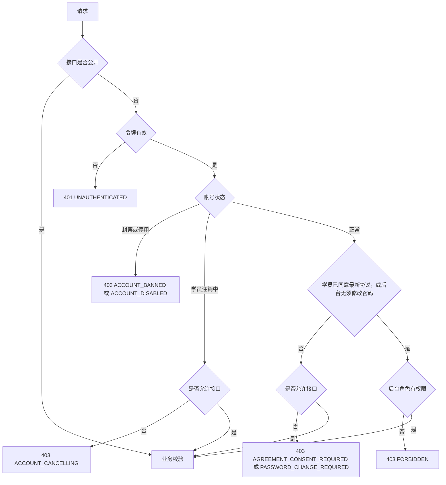
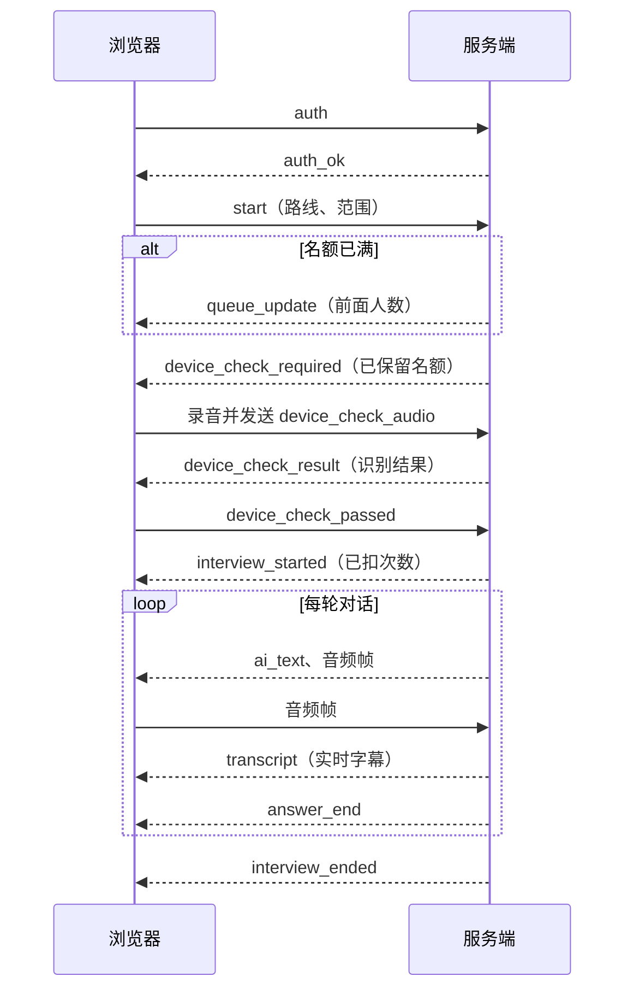

# 云枢智学 第四阶段：API 接口设计

| 项目 | 内容 |
|---|---|
| 依据 | `docs/design/01.功能模块梳理.md`（下称"第一阶段"）、`docs/design/02.整体架构设计.md`（下称"第二阶段"）、`docs/design/03.数据库设计.md`（下称"第三阶段"）、`docs/需求文档.md`（下称"需求"）、`docs/rules/api-rules.md`（下称"规范"） |
| 接口数量 | HTTP 接口 143 个（学员端 57 个，后台 86 个），WebSocket 接口 2 个 |
| 范围 | 接口清单、请求与响应、业务规则、统一响应、校验、异常和权限 |
| 不包含 | 业务代码、接口实现 |
| 状态 | 已完成第五阶段评审修订，见 `05.设计方案评审结果.md` |

文档中的接口定义由结构化清单生成，字段名已用脚本与 `scripts/sql/schema.sql` 逐一比对，结果见 8.2 节。

---

## 1. 接口组织

| 使用端 | 基础路径 | 账号体系 |
|---|---|---|
| 学员端 | `/api/v1/student` | 学员 |
| 管理后台 | `/api/v1/admin` | 后台账号 |
| WebSocket | `/ws/v1/student` | 学员，见第 7 章 |

路径使用小写英文，多个单词用短横线连接，资源用名词。少量动作型操作表达为资源：提交答卷是 `submission`，放弃是 `abandonment`，主动结束是 `termination`，重新生成是 `regeneration`。这样可以避免在路径中使用动词（规范 2.2）。

| 方法 | 使用方式 |
|---|---|
| `GET` | 读取，不产生业务副作用。查看完整手机号要写日志，所以用 `POST` |
| `POST` | 创建资源或执行非幂等操作 |
| `PUT` | 整体替换某项状态，如上下架、已读、修改密码，重复调用结果相同 |
| `PATCH` | 部分更新，只修改传入的字段 |
| `DELETE` | 删除资源，或撤销状态，如撤销注销、取消已学、解封 |

---

## 2. 通用约定

### 2.1 认证与请求头

| 请求头 | 说明 |
|---|---|
| `Authorization: Bearer <token>` | 登录令牌。学员和后台的令牌相互隔离，令牌不放入 URL |
| `Content-Type` | JSON 接口为 `application/json`；上传文件为 `multipart/form-data` |
| `X-Device-Claim` | 设备凭证，用于模拟考试和文字面试的写入接口，实现新设备接管 |

### 2.2 统一响应结构

除文件下载和流式接口外，所有接口都返回以下结构。

成功：

```json
{
  "code": "OK",
  "message": "success",
  "data": {},
  "request_id": "f3a1c0"
}
```

失败：

```json
{
  "code": "AI_QUOTA_EXHAUSTED",
  "message": "今日 AI 面试次数已用完",
  "errors": [],
  "request_id": "f3a1c0"
}
```

| 字段 | 类型 | 说明 |
|---|---|---|
| `code` | string | 成功固定为 `OK`，失败为业务错误码 |
| `message` | string | 可直接展示给用户的中文提示，不含内部实现细节 |
| `data` | object、array 或 null | 业务数据，仅成功时存在；无返回内容时为 `null` |
| `errors` | array | 仅失败时存在。参数错误时每项为 `{"field":"phone","reason":"格式不正确"}`；其他错误可携带处理所需的信息，如 `{"interview_session_id":1}` |
| `request_id` | string | 请求标识，用于排查问题 |

HTTP 状态码与业务结果保持一致，不会把错误包装成 HTTP 200（规范 4.5、5.5）。

### 2.3 分页

查询参数：

| 参数 | 类型 | 必填 | 默认 | 规则 |
|---|---|---|---|---|
| `page` | integer | 否 | 1 | 从 1 开始 |
| `page_size` | integer | 否 | 20 | 1~100 |

响应 `data`：

```json
{ "items": [], "total": 0, "page": 1, "page_size": 20 }
```

默认排序：有 `sort_no` 的资源按 `sort_no` 升序，其余按时间倒序。不分页的接口返回 `{ "items": [] }`。

### 2.4 数据格式

| 类型 | 格式 |
|---|---|
| 字段命名 | `snake_case`，与数据库字段一致 |
| ID | JSON 数字 |
| `datetime` | ISO 8601 UTC，如 `2026-11-09T13:35:37.406Z`，前端转为北京时间显示 |
| `date` | `YYYY-MM-DD`，表示北京时间的自然日 |
| `decimal` | JSON 数字；分数保留 1 位小数，百分比保留 2 位 |
| 枚举 | 使用数据库中的英文取值 |
| 空值 | 可空字段返回 `null`，不省略字段 |

响应不返回 `password_hash` 等内部字段，后台学员列表默认不返回完整手机号（规范 4.3）。

### 2.5 参数校验

服务端校验所有输入，前端校验只用于提升体验（规范 3.2）。每个接口的校验规则写在"规则"列。

- 校验失败返回 HTTP 400 和 `VALIDATION_FAILED`，`errors` 中逐个指出字段和原因（规范 5.4）。
- "条件"必填表示在特定取值下必填，具体条件见规则列。
- 字符串长度与数据库字段长度一致。
- 未在接口中定义的字段会被忽略。

### 2.6 异常处理与错误码

错误码使用大写英文和下划线，定义后保持稳定。全局异常处理器统一转换异常，日志记录 `request_id` 和完整堆栈，响应中不暴露内部细节。

| HTTP | 错误码 | 含义 |
|---|---|---|
| 400 | `VALIDATION_FAILED` | 参数校验失败 |
| 400 | `CAPTCHA_INVALID` | 图形验证错误或已失效 |
| 400 | `SMS_CODE_INVALID` | 短信验证码错误、过期或已失效 |
| 400 | `OLD_PASSWORD_INCORRECT` | 原密码错误 |
| 400 | `VIDEO_DOMAIN_NOT_ALLOWED` | 视频链接域名不属于所选平台 |
| 400 | `FILE_INVALID` | 文件格式、大小或行数不符合要求 |
| 401 | `UNAUTHENTICATED` | 未登录或登录已失效 |
| 401 | `INVALID_CREDENTIALS` | 账号或密码错误 |
| 403 | `FORBIDDEN` | 没有权限 |
| 403 | `ACCOUNT_BANNED` | 学员账号已被封禁 |
| 403 | `ACCOUNT_DISABLED` | 后台账号已停用 |
| 403 | `ACCOUNT_CANCELLING` | 账号注销中，只能撤销或退出 |
| 403 | `AGREEMENT_CONSENT_REQUIRED` | 需要同意最新协议 |
| 403 | `PASSWORD_CHANGE_REQUIRED` | 需要先修改密码 |
| 404 | `NOT_FOUND` | 资源不存在或无权访问 |
| 405 | `METHOD_NOT_ALLOWED` | 不支持的请求方法 |
| 409 | `PHONE_ALREADY_REGISTERED` | 手机号已注册 |
| 409 | `PASSWORD_NOT_SET` | 尚未设置密码 |
| 409 | `AGREEMENT_VERSION_OUTDATED` | 协议版本不是最新 |
| 409 | `CANCELLATION_NOT_PENDING` | 账号不在注销中 |
| 409 | `CONTENT_OFF_SHELF` | 内容已下架 |
| 409 | `CONTENT_IN_USE` | 内容已被使用，不能删除，`errors` 给出具体原因 |
| 409 | `COURSE_ALREADY_MASTERED` | 课程已掌握，不能取消已学 |
| 409 | `COURSE_ALREADY_IN_ROUTE` | 课程已被同一路线的其他阶段引用 |
| 409 | `ROUTE_PUBLISH_INVALID` | 路线不满足上架条件 |
| 409 | `SUBJECT_NAME_EXISTS` | 学科名称已存在 |
| 409 | `INSUFFICIENT_QUESTIONS` | 题量低于最低题量 |
| 409 | `AI_QUOTA_EXHAUSTED` | AI 次数已用完 |
| 409 | `SESSION_IN_PROGRESS` | 已有进行中的场次，`errors` 给出场次 ID |
| 409 | `SESSION_NOT_IN_PROGRESS` | 场次不在进行中 |
| 409 | `SESSION_EXPIRED` | 场次已到截止时间 |
| 409 | `SESSION_STATE_INVALID` | 场次状态不允许此操作 |
| 409 | `SESSION_BUSY` | 上一条回复尚未结束 |
| 409 | `DEVICE_TAKEN_OVER` | 已在其他设备继续 |
| 409 | `QUESTION_NOT_IN_SESSION` | 题目不属于本场次 |
| 409 | `QUESTION_ALREADY_ANSWERED` | 本场已作答过该题 |
| 409 | `FEEDBACK_ALREADY_HANDLED` | 反馈已被处理 |
| 409 | `ACCOUNT_ALREADY_EXISTS` | 后台账号已存在 |
| 409 | `CANNOT_DISABLE_SELF` | 不能停用自己的账号 |
| 409 | `LAST_SUPER_ADMIN` | 必须保留至少 1 个启用的超级管理员 |
| 409 | `STUDENT_STATE_INVALID` | 学员当前状态不允许此操作 |
| 409 | `EXPORT_LIMIT_EXCEEDED` | 导出数量超过上限（学员名单 5000 条、操作日志 1 万条），请缩小筛选范围 |
| 409 | `SENSITIVE_WORD_EXISTS` | 敏感词已存在 |
| 409 | `PLATFORM_NAME_EXISTS` | 平台名称已存在 |
| 409 | `PLATFORM_DOMAIN_EXISTS` | 域名已被其他平台使用 |
| 422 | `SENSITIVE_WORD_BLOCKED` | 内容命中敏感词，请修改后重新提交 |
| 423 | `LOGIN_LOCKED` | 密码错误次数过多，已锁定 15 分钟 |
| 429 | `SMS_RATE_LIMITED` | 短信发送过于频繁 |
| 500 | `INTERNAL_ERROR` | 服务器内部错误 |
| 503 | `AI_SERVICE_UNAVAILABLE` | AI 服务暂时不可用，不扣次数 |

### 2.7 权限校验

请求按以下顺序校验，任何一步失败立即返回：



| 权限标记 | 含义 |
|---|---|
| 公开 | 无需登录 |
| 公开（可选登录） | 无需登录；已登录时返回个性化数据 |
| 学员 | 登录学员，状态正常，已同意最新协议 |
| 学员（受限可用） | 登录学员；注销中、未同意最新协议时也可调用 |
| 后台：全部角色 | 任一启用的后台账号 |
| 后台：超级管理员 | 仅超级管理员 |
| 后台：内容运营 | 超级管理员、内容运营 |
| 后台：学员运营 | 超级管理员、学员运营 |

资源归属：学员接口只能访问自己的数据，访问他人数据时返回 404，不暴露资源是否存在。

必须修改密码时，后台只放行 A-IAM-02、A-IAM-03、A-IAM-04。

### 2.8 流式响应（SSE）

S-IVW-06 返回 `text/event-stream`，前端用 `fetch` 读取。

| 事件 | 数据 | 说明 |
|---|---|---|
| `message_start` | `{"message_type":"followup"}` | 开始一条 AI 消息 |
| `sentence` | `{"content":"过滤后的一句话"}` | 按句过滤后下发 |
| `message_end` | `{"seq_no":12,"current_seq_no":2}` | 消息结束 |
| `ai_recovering` | `{}` | AI 服务异常，正在重连 |
| `interview_ended` | `{"end_reason":"completed"}` | 面试结束，随后生成报告 |
| `error` | `{"code":"","message":""}` | 流中错误 |

连接中断不影响服务端已写入的消息，前端通过 S-IVW-04 补全。

### 2.9 文件上传与下载

- 上传：`multipart/form-data`，字段名 `file`，服务端校验格式和大小后写入对象存储（头像、二维码）或读取内容（Excel）。
- 下载：成功时响应体为文件，`Content-Type` 为 xlsx，`Content-Disposition` 给出文件名；失败时仍返回统一的 JSON 结构。
- 批量导入：同步处理，文件不超过 5MB，最多 1000 行，部分失败不影响成功的行。

### 2.10 重复提交

| 场景 | 处理 |
|---|---|
| 次数扣减 | `ai_quota_ledger` 唯一约束防止重复扣减 |
| 练习作答 | 同一场次同一题唯一，重复提交返回 409 |
| 交卷、放弃、主动结束 | 状态校验，重复调用返回 409 |
| 上下架、已读、标记已学 | `PUT`，重复调用结果相同 |
| 文字面试提交回答 | 上一条回复未结束时返回 409 `SESSION_BUSY` |

### 2.11 操作日志

需求 6.11 范围内的后台写接口由切面统一写入 `operation_log`，接口说明中标注"记入操作日志"。学员类操作对象只记录 ID，不写入昵称和手机号（第三阶段 7.2）。

---

## 3. 接口总览

### 学员端

| 编号 | 方法 | 路径 | 权限 | 用途 | 模块 |
|---|---|---|---|---|---|
| S-ACC-01 | POST | `/captchas` | 公开 | 获取图形验证 | M01 |
| S-ACC-02 | POST | `/sms-codes` | 公开 | 发送短信验证码 | M01 |
| S-ACC-03 | POST | `/registrations` | 公开 | 手机号注册 | M01 |
| S-ACC-04 | POST | `/sessions` | 公开 | 登录 | M01 |
| S-ACC-05 | DELETE | `/sessions/current` | 学员（受限可用） | 退出当前设备 | M01 |
| S-ACC-06 | POST | `/password-resets` | 公开 | 通过验证码重置密码 | M01 |
| S-ACC-07 | GET | `/me` | 学员（受限可用） | 获取本人信息 | M01 |
| S-ACC-08 | PATCH | `/me` | 学员 | 修改个人资料和求职画像 | M01 |
| S-ACC-09 | POST | `/me/avatar` | 学员 | 上传头像 | M01 |
| S-ACC-10 | PUT | `/me/password` | 学员 | 设置或修改密码 | M01 |
| S-ACC-11 | PUT | `/me/phone` | 学员 | 换绑手机号 | M01 |
| S-ACC-12 | POST | `/me/cancellation` | 学员 | 申请注销账号 | M01 |
| S-ACC-13 | DELETE | `/me/cancellation` | 学员（受限可用） | 撤销注销 | M01 |
| S-HLP-01 | GET | `/agreements/{agreement_type}` | 公开 | 查看协议最新版本 | M17 |
| S-HLP-02 | POST | `/agreement-consents` | 学员（受限可用） | 同意最新协议 | M17 |
| S-HLP-03 | GET | `/help` | 公开 | 获取帮助中心内容 | M17 |
| S-PTL-01 | GET | `/home` | 公开（可选登录） | 获取首页内容 | M07 |
| S-PTL-02 | GET | `/routes` | 公开（可选登录） | 路线列表 | M07 |
| S-PTL-03 | GET | `/routes/{learning_route_id}` | 公开（可选登录） | 路线详情 | M07 |
| S-PTL-04 | GET | `/search` | 公开（可选登录） | 搜索路线和课程 | M07 |
| S-LRN-01 | POST | `/courses/{course_id}/opens` | 学员 | 打开课程并记录 | M08 |
| S-LRN-02 | PUT | `/courses/{course_id}/learned` | 学员 | 标记课程已学 | M08 |
| S-LRN-03 | DELETE | `/courses/{course_id}/learned` | 学员 | 取消已学标记 | M08 |
| S-LRN-04 | GET | `/learning-records/tracks` | 学员 | 学习轨迹 | M08 |
| S-LRN-05 | GET | `/learning-records/route-progress` | 学员 | 各路线进度 | M08 |
| S-PRC-01 | POST | `/practice-sessions` | 学员 | 开始或继续练习 | M09 |
| S-PRC-02 | GET | `/practice-sessions/{practice_session_id}` | 学员 | 获取练习进度 | M09 |
| S-PRC-03 | POST | `/practice-sessions/{practice_session_id}/answers` | 学员 | 提交一题答案 | M09 |
| S-PRC-04 | GET | `/practice-records` | 学员 | 刷题记录列表 | M09 |
| S-PRC-05 | GET | `/practice-sessions/{practice_session_id}/answers` | 学员 | 查看练习作答详情 | M09 |
| S-EXM-01 | POST | `/exams` | 学员 | 开始模拟考试 | M09 |
| S-EXM-02 | GET | `/exams/in-progress` | 学员 | 查询作答中的考试 | M09 |
| S-EXM-03 | GET | `/exams/{exam_session_id}` | 学员 | 获取考试详情或成绩 | M09 |
| S-EXM-04 | POST | `/exams/{exam_session_id}/device-claims` | 学员 | 在当前设备接管考试 | M09 |
| S-EXM-05 | PUT | `/exams/{exam_session_id}/answers/{seq_no}` | 学员 | 保存一题答案 | M09 |
| S-EXM-06 | POST | `/exams/{exam_session_id}/submission` | 学员 | 交卷 | M09 |
| S-EXM-07 | POST | `/exams/{exam_session_id}/abandonment` | 学员 | 放弃考试 | M09 |
| S-EXM-08 | POST | `/exams/{exam_session_id}/rescoring` | 学员 | 重新评分简答题 | M09 |
| S-WRG-01 | GET | `/wrong-questions` | 学员 | 错题列表 | M10 |
| S-WRG-02 | DELETE | `/wrong-questions/{wrong_question_id}` | 学员 | 手动移除错题 | M10 |
| S-QTA-01 | GET | `/ai-quota` | 学员 | 查询当日 AI 剩余次数 | M13 |
| S-FDB-01 | POST | `/feedbacks` | 学员 | 提交题目纠错或视频失效反馈 | M15 |
| S-IVW-01 | GET | `/interviews/options` | 学员 | 获取发起面试的选项 | M11 |
| S-IVW-02 | POST | `/interviews` | 学员 | 发起文字面试 | M11 |
| S-IVW-03 | GET | `/interviews/in-progress` | 学员 | 查询进行中的面试 | M11 |
| S-IVW-04 | GET | `/interviews/{interview_session_id}` | 学员 | 获取面试进度 | M11 |
| S-IVW-05 | POST | `/interviews/{interview_session_id}/device-claims` | 学员 | 在当前设备接管文字面试 | M11 |
| S-IVW-06 | POST | `/interviews/{interview_session_id}/answers` | 学员 | 提交回答并流式接收 AI 回复 | M11 |
| S-IVW-07 | POST | `/interviews/{interview_session_id}/termination` | 学员 | 主动结束面试 | M11 |
| S-IVW-08 | POST | `/ws-tickets` | 学员 | 获取 WebSocket 票据 | M11 |
| S-RPT-01 | GET | `/interviews` | 学员 | 面试记录列表 | M12 |
| S-RPT-02 | GET | `/interviews/{interview_session_id}/report` | 学员 | 查看面试报告 | M12 |
| S-RPT-03 | POST | `/interviews/{interview_session_id}/report/regeneration` | 学员 | 重新生成报告 | M12 |
| S-MSG-01 | GET | `/messages` | 学员 | 站内信列表 | M16 |
| S-MSG-02 | GET | `/messages/unread-count` | 学员 | 未读数 | M16 |
| S-MSG-03 | PUT | `/messages/{student_message_id}/read` | 学员 | 标记已读 | M16 |
| S-MSG-04 | PUT | `/messages/read-all` | 学员 | 全部已读 | M16 |

### 管理后台

| 编号 | 方法 | 路径 | 权限 | 用途 | 模块 |
|---|---|---|---|---|---|
| A-IAM-01 | POST | `/sessions` | 公开 | 后台登录 | M02 |
| A-IAM-02 | DELETE | `/sessions/current` | 后台：全部角色 | 退出登录 | M02 |
| A-IAM-03 | GET | `/me` | 后台：全部角色 | 获取当前账号和权限 | M02 |
| A-IAM-04 | PUT | `/me/password` | 后台：全部角色 | 修改自己的密码 | M02 |
| A-IAM-05 | GET | `/sys-users` | 后台：超级管理员 | 后台账号列表 | M02 |
| A-IAM-06 | POST | `/sys-users` | 后台：超级管理员 | 新建后台账号 | M02 |
| A-IAM-07 | PATCH | `/sys-users/{sys_user_id}` | 后台：超级管理员 | 编辑后台账号 | M02 |
| A-IAM-08 | PUT | `/sys-users/{sys_user_id}/status` | 后台：超级管理员 | 启用或停用后台账号 | M02 |
| A-IAM-09 | POST | `/sys-users/{sys_user_id}/password-resets` | 后台：超级管理员 | 重置后台账号密码 | M02 |
| A-IAM-10 | GET | `/roles` | 后台：超级管理员 | 角色说明（只读） | M02 |
| A-AUD-01 | GET | `/operation-logs` | 后台：超级管理员 | 操作日志 | M04 |
| A-AUD-02 | POST | `/operation-log-exports` | 后台：超级管理员 | 导出操作日志 | M04 |
| A-CFG-01 | GET | `/configs` | 后台：超级管理员 | 获取全部配置项 | M03 |
| A-CFG-02 | PUT | `/configs/{config_key}` | 后台：超级管理员 | 修改配置项 | M03 |
| A-CFG-03 | GET | `/agreements` | 后台：超级管理员 | 查看协议当前版本 | M03 |
| A-CFG-04 | POST | `/agreements/{agreement_type}/versions` | 后台：超级管理员 | 发布协议新版本 | M03 |
| A-CFG-05 | GET | `/sensitive-words` | 后台：超级管理员 | 敏感词列表 | M03 |
| A-CFG-06 | POST | `/sensitive-words` | 后台：超级管理员 | 新增敏感词 | M03 |
| A-CFG-07 | DELETE | `/sensitive-words/{sensitive_word_id}` | 后台：超级管理员 | 删除敏感词 | M03 |
| A-CFG-08 | POST | `/sensitive-words/imports` | 后台：超级管理员 | 批量导入敏感词 | M03 |
| A-CFG-09 | GET | `/video-platforms` | 后台：内容运营 | 视频平台列表 | M03 |
| A-CFG-10 | POST | `/video-platforms` | 后台：超级管理员 | 新增视频平台 | M03 |
| A-CFG-11 | PATCH | `/video-platforms/{video_platform_id}` | 后台：超级管理员 | 编辑视频平台 | M03 |
| A-CFG-12 | PUT | `/video-platforms/{video_platform_id}/status` | 后台：超级管理员 | 启用或停用视频平台 | M03 |
| A-CFG-13 | GET | `/faqs` | 后台：超级管理员 | 常见问题列表 | M03 |
| A-CFG-14 | POST | `/faqs` | 后台：超级管理员 | 新增常见问题 | M03 |
| A-CFG-15 | PATCH | `/faqs/{faq_id}` | 后台：超级管理员 | 编辑常见问题 | M03 |
| A-CFG-16 | DELETE | `/faqs/{faq_id}` | 后台：超级管理员 | 删除常见问题 | M03 |
| A-CFG-17 | PUT | `/faqs/sort-order` | 后台：超级管理员 | 调整常见问题排序 | M03 |
| A-CFG-18 | POST | `/uploads` | 后台：超级管理员 | 上传客服二维码 | M03 |
| A-CNT-01 | GET | `/subjects` | 后台：内容运营 | 学科列表 | M05 |
| A-CNT-02 | POST | `/subjects` | 后台：内容运营 | 新增学科 | M05 |
| A-CNT-03 | PATCH | `/subjects/{subject_id}` | 后台：内容运营 | 编辑学科 | M05 |
| A-CNT-04 | DELETE | `/subjects/{subject_id}` | 后台：内容运营 | 删除学科 | M05 |
| A-CNT-05 | PUT | `/subjects/sort-order` | 后台：内容运营 | 调整学科排序 | M05 |
| A-CNT-06 | GET | `/courses` | 后台：内容运营 | 课程列表 | M05 |
| A-CNT-07 | POST | `/courses` | 后台：内容运营 | 新增课程 | M05 |
| A-CNT-08 | GET | `/courses/{course_id}` | 后台：内容运营 | 课程详情 | M05 |
| A-CNT-09 | PATCH | `/courses/{course_id}` | 后台：内容运营 | 编辑课程 | M05 |
| A-CNT-10 | PUT | `/courses/{course_id}/status` | 后台：内容运营 | 上架或下架课程 | M05 |
| A-CNT-11 | DELETE | `/courses/{course_id}` | 后台：内容运营 | 删除课程 | M05 |
| A-CNT-12 | POST | `/courses/imports` | 后台：内容运营 | 批量导入课程 | M05 |
| A-CNT-13 | GET | `/import-templates/{template_type}` | 后台：内容运营 | 下载导入模板 | M05 |
| A-CNT-14 | GET | `/routes` | 后台：内容运营 | 路线列表 | M05 |
| A-CNT-15 | POST | `/routes` | 后台：内容运营 | 新增路线 | M05 |
| A-CNT-16 | GET | `/routes/{learning_route_id}` | 后台：内容运营 | 路线详情（含阶段与课程） | M05 |
| A-CNT-17 | PATCH | `/routes/{learning_route_id}` | 后台：内容运营 | 编辑路线 | M05 |
| A-CNT-18 | PUT | `/routes/{learning_route_id}/status` | 后台：内容运营 | 上架或下架路线 | M05 |
| A-CNT-19 | DELETE | `/routes/{learning_route_id}` | 后台：内容运营 | 删除路线 | M05 |
| A-CNT-20 | GET | `/routes/{learning_route_id}/preview` | 后台：内容运营 | 预览路线前台效果 | M05 |
| A-CNT-21 | POST | `/routes/{learning_route_id}/stages` | 后台：内容运营 | 新增阶段 | M05 |
| A-CNT-22 | PATCH | `/stages/{route_stage_id}` | 后台：内容运营 | 编辑阶段 | M05 |
| A-CNT-23 | DELETE | `/stages/{route_stage_id}` | 后台：内容运营 | 删除阶段 | M05 |
| A-CNT-24 | PUT | `/routes/{learning_route_id}/stages/sort-order` | 后台：内容运营 | 调整阶段排序 | M05 |
| A-CNT-25 | POST | `/stages/{route_stage_id}/courses` | 后台：内容运营 | 阶段引用课程 | M05 |
| A-CNT-26 | DELETE | `/stages/{route_stage_id}/courses/{course_id}` | 后台：内容运营 | 把课程移出阶段 | M05 |
| A-CNT-27 | PUT | `/stages/{route_stage_id}/courses/sort-order` | 后台：内容运营 | 调整阶段内课程排序 | M05 |
| A-CNT-28 | GET | `/route-options` | 后台：全部角色 | 路线下拉选项 | M05 |
| A-QST-01 | GET | `/practice-questions` | 后台：内容运营 | 刷题题目列表 | M06 |
| A-QST-02 | POST | `/practice-questions` | 后台：内容运营 | 新增刷题题目 | M06 |
| A-QST-03 | GET | `/practice-questions/{practice_question_id}` | 后台：内容运营 | 刷题题目详情 | M06 |
| A-QST-04 | PATCH | `/practice-questions/{practice_question_id}` | 后台：内容运营 | 编辑刷题题目 | M06 |
| A-QST-05 | PUT | `/practice-questions/{practice_question_id}/status` | 后台：内容运营 | 上架或下架刷题题目 | M06 |
| A-QST-06 | DELETE | `/practice-questions/{practice_question_id}` | 后台：内容运营 | 删除刷题题目 | M06 |
| A-QST-07 | POST | `/practice-questions/imports` | 后台：内容运营 | 批量导入刷题题目 | M06 |
| A-QST-08 | GET | `/interview-questions` | 后台：内容运营 | 面试题目列表 | M06 |
| A-QST-09 | POST | `/interview-questions` | 后台：内容运营 | 新增面试题目 | M06 |
| A-QST-10 | GET | `/interview-questions/{interview_question_id}` | 后台：内容运营 | 面试题目详情 | M06 |
| A-QST-11 | PATCH | `/interview-questions/{interview_question_id}` | 后台：内容运营 | 编辑面试题目 | M06 |
| A-QST-12 | PUT | `/interview-questions/{interview_question_id}/status` | 后台：内容运营 | 上架或下架面试题目 | M06 |
| A-QST-13 | DELETE | `/interview-questions/{interview_question_id}` | 后台：内容运营 | 删除面试题目 | M06 |
| A-QST-14 | POST | `/interview-questions/imports` | 后台：内容运营 | 批量导入面试题目 | M06 |
| A-FDB-01 | GET | `/feedbacks` | 后台：内容运营 | 反馈列表 | M15 |
| A-FDB-02 | POST | `/feedback-handlings` | 后台：内容运营 | 处理反馈 | M15 |
| A-STU-01 | GET | `/students` | 后台：学员运营 | 学员列表 | M18 |
| A-STU-02 | GET | `/students/{student_id}` | 后台：学员运营 | 学员详情 | M18 |
| A-STU-03 | POST | `/students/{student_id}/phone-reveals` | 后台：学员运营 | 查看完整手机号 | M18 |
| A-STU-04 | PUT | `/students/{student_id}/ban` | 后台：学员运营 | 封禁学员 | M18 |
| A-STU-05 | DELETE | `/students/{student_id}/ban` | 后台：学员运营 | 解封学员 | M18 |
| A-STU-06 | POST | `/student-exports` | 后台：学员运营 | 导出学员名单 | M18 |
| A-STU-07 | GET | `/students/{student_id}/learning-records` | 后台：学员运营 | 学员学习记录 | M18 |
| A-STU-08 | GET | `/students/{student_id}/practice-records` | 后台：学员运营 | 学员刷题记录 | M18 |
| A-STU-09 | GET | `/students/{student_id}/interviews` | 后台：学员运营 | 学员面试记录 | M18 |
| A-STU-10 | GET | `/interviews/{interview_session_id}/report` | 后台：学员运营 | 查看学员面试报告 | M18 |
| A-DSH-01 | GET | `/dashboard` | 后台：学员运营 | 数据看板 | M19 |
| A-DSH-02 | POST | `/dashboard-exports` | 后台：学员运营 | 导出看板数据 | M19 |
| A-DSH-03 | GET | `/workbench` | 后台：全部角色 | 工作台 | M19 |

M14 AI 能力与内容安全是内部公共模块，不对外提供接口，能力通过 S-PRC-03、S-EXM-06、S-IVW-06、WS-01 等接口体现。

---

## 4. 公共对象

类型列中的大写名称指本章的对象。标注"（…）"的 `object` 列出了对象内包含的字段。

### StudentProfile

学员本人信息

| 字段 | 类型 | 说明 |
|---|---|---|
| `id` | `integer` | 学员 ID |
| `phone` | `string` | 手机号（本人可见完整号码） |
| `nickname` | `string` | 昵称 |
| `avatar_url` | `string` | 头像地址，可为空 |
| `education` | `string` | 学历取值，可为空 |
| `job_intent_learning_route_id` | `integer` | 求职意向路线，可为空 |
| `job_intent_name` | `string` | 求职意向名称，可为空 |
| `is_job_intent_off_shelf` | `boolean` | 求职意向对应的路线是否已下架或删除 |
| `work_years` | `string` | 工作年限取值，可为空 |
| `status` | `string` | normal、cancelling |
| `has_password` | `boolean` | 是否已设置密码 |
| `cancellation_effective_at` | `datetime` | 注销生效时间，仅注销中有值 |
| `pending_agreements` | `array<AgreementRef>` | 尚未同意的最新协议，为空表示无需同意 |

### AgreementRef

协议版本引用

| 字段 | 类型 | 说明 |
|---|---|---|
| `agreement_type` | `string` | user_agreement、privacy_policy |
| `version_no` | `integer` | 版本号 |

### CourseItem

路线中的课程

| 字段 | 类型 | 说明 |
|---|---|---|
| `id` | `integer` | 课程 ID |
| `title` | `string` | 课程名称 |
| `intro` | `string` | 简介，可为空 |
| `duration_minutes` | `integer` | 时长（分钟），可为空 |
| `platform_name` | `string` | 视频平台名称 |
| `subject_names` | `array<string>` | 所属学科名称 |
| `practice_question_count` | `integer` | 已上架的刷题题目数，0 表示未配题 |
| `is_learned` | `boolean` | 是否已学，游客为 false |
| `is_mastered` | `boolean` | 是否已掌握，游客为 false |

### RouteProgress

路线进度

| 字段 | 类型 | 说明 |
|---|---|---|
| `learned_course_count` | `integer` | 已学课程数 |
| `total_course_count` | `integer` | 已上架课程总数 |
| `mastered_course_count` | `integer` | 已掌握课程数（不含题目已全部下架的课程） |
| `configured_course_count` | `integer` | 已配题课程数 |

### RouteCard

路线卡片

| 字段 | 类型 | 说明 |
|---|---|---|
| `id` | `integer` | 路线 ID |
| `name` | `string` | 路线名称 |
| `intro` | `string` | 简介，可为空 |
| `stages` | `array<StageBrief>` | 各阶段及其课程数 |
| `progress` | `RouteProgress` | 个人进度，游客为空 |

### StageBrief

阶段摘要

| 字段 | 类型 | 说明 |
|---|---|---|
| `id` | `integer` | 阶段 ID |
| `name` | `string` | 阶段名称 |
| `course_count` | `integer` | 已上架课程数 |

### StageDetail

路线详情中的阶段

| 字段 | 类型 | 说明 |
|---|---|---|
| `id` | `integer` | 阶段 ID |
| `name` | `string` | 阶段名称 |
| `intro` | `string` | 简介，可为空 |
| `progress` | `RouteProgress` | 阶段进度，游客为空 |
| `is_random_available` | `boolean` | 题量是否满足随机抽题最低题量 |
| `is_exam_available` | `boolean` | 题量是否满足模拟考试最低题量 |
| `is_interview_available` | `boolean` | 该阶段是否有可用面试题 |
| `courses` | `array<CourseItem>` | 已上架课程，按排序号 |

### QuestionForAnswer

作答时的题目，不含答案

| 字段 | 类型 | 说明 |
|---|---|---|
| `id` | `integer` | 题目 ID |
| `course_id` | `integer` | 所属课程 |
| `question_type` | `string` | 题型 |
| `stem` | `string` | 题干 |
| `options` | `array<object>` | 选项，判断题和简答题为空 |

### AnswerResult

作答结果

| 字段 | 类型 | 说明 |
|---|---|---|
| `is_correct` | `boolean` | 是否答对 |
| `judge_method` | `string` | auto、ai、self |
| `ai_score` | `integer` | AI 评分，可为空 |
| `ai_comment` | `string` | AI 点评，可为空；标识为 AI 生成 |
| `correct_answer` | `object` | 正确答案，简答题为空 |
| `reference_answer` | `string` | 参考答案，简答题有值 |
| `analysis` | `string` | 解析，可为空 |

### PracticeSessionView

练习场次

| 字段 | 类型 | 说明 |
|---|---|---|
| `id` | `integer` | 场次 ID |
| `practice_mode` | `string` | sequential、random、wrong_redo |
| `status` | `string` | in_progress、completed、unfinished |
| `course_id` | `integer` | 课程，顺序练习有值 |
| `route_stage_id` | `integer` | 阶段，随机抽题有值 |
| `question_count` | `integer` | 题目总数 |
| `answered_count` | `integer` | 已作答题数 |
| `correct_count` | `integer` | 答对题数 |
| `next_question` | `QuestionForAnswer` | 下一题，全部答完时为空 |
| `remaining_scoring_quota` | `integer` | 当日剩余 AI 评分次数 |

### ExamQuestionView

考试题目

| 字段 | 类型 | 说明 |
|---|---|---|
| `seq_no` | `integer` | 题号 |
| `question` | `QuestionForAnswer` | 题目内容（来自开考时的快照） |
| `question_score` | `decimal` | 本题分值 |
| `student_answer` | `object` | 已保存的答案，可为空 |
| `judge_status` | `string` | pending、judged、failed；作答中不返回 |
| `is_correct` | `boolean` | 是否答对；出成绩后返回 |
| `earned_score` | `decimal` | 本题得分；出成绩后返回 |
| `ai_score` | `integer` | AI 评分；出成绩后返回 |
| `ai_comment` | `string` | AI 点评；出成绩后返回 |
| `correct_answer` | `object` | 正确答案；出成绩后返回 |
| `reference_answer` | `string` | 参考答案；出成绩后返回 |
| `analysis` | `string` | 解析；出成绩后返回 |

### ExamView

考试场次

| 字段 | 类型 | 说明 |
|---|---|---|
| `id` | `integer` | 场次 ID |
| `route_name` | `string` | 路线名称快照 |
| `stage_name` | `string` | 阶段名称快照 |
| `status` | `string` | in_progress、submitted、scoring_pending、graded、abandoned |
| `duration_minutes` | `integer` | 考试时长 |
| `started_at` | `datetime` | 开考时间 |
| `deadline_at` | `datetime` | 截止时间，以服务端为准 |
| `server_time` | `datetime` | 服务端当前时间，用于校准倒计时 |
| `has_short_answer` | `boolean` | 是否含简答题 |
| `score` | `decimal` | 总分，百分制 1 位小数，出成绩后有值 |
| `type_scores` | `array<object>` | 各题型得分（question_type、earned_score、question_score），出成绩后有值 |
| `questions` | `array<ExamQuestionView>` | 试题 |

### InterviewMessageView

面试消息

| 字段 | 类型 | 说明 |
|---|---|---|
| `seq_no` | `integer` | 消息序号 |
| `speaker` | `string` | ai、student |
| `message_type` | `string` | opening、main_question、followup、answer、transition、closing |
| `content` | `string` | 消息文字；AI 消息标识为 AI 生成 |
| `created_at` | `datetime` | 时间 |

### InterviewView

面试场次

| 字段 | 类型 | 说明 |
|---|---|---|
| `id` | `integer` | 场次 ID |
| `route_name` | `string` | 路线名称快照 |
| `interview_mode` | `string` | text、voice |
| `status` | `string` | in_progress、ended |
| `end_reason` | `string` | completed、student_ended、timeout、ai_failure，可为空 |
| `main_question_count` | `integer` | 主问题数量 |
| `current_seq_no` | `integer` | 当前第几题 |
| `started_at` | `datetime` | 开始时间 |
| `deadline_at` | `datetime` | 截止时间，以服务端为准 |
| `server_time` | `datetime` | 服务端当前时间 |
| `messages` | `array<InterviewMessageView>` | 已产生的对话 |

### InterviewListItem

面试记录

| 字段 | 类型 | 说明 |
|---|---|---|
| `id` | `integer` | 场次 ID |
| `started_at` | `datetime` | 面试时间 |
| `route_name` | `string` | 路线名称快照 |
| `stage_names` | `array<string>` | 面试范围（阶段名称） |
| `interview_mode` | `string` | text、voice |
| `total_score` | `decimal` | 总分，可为空 |
| `grade` | `string` | excellent、good、needs_improvement，可为空 |
| `record_status` | `string` | in_progress、ended、report_generating、report_failed、system_failed（因系统异常结束） |
| `can_resume` | `boolean` | 是否可继续作答 |
| `is_route_off_shelf` | `boolean` | 路线是否已下架 |

### ReportQuestion

逐题点评

| 字段 | 类型 | 说明 |
|---|---|---|
| `seq_no` | `integer` | 序号 |
| `stem` | `string` | 题目（来自快照） |
| `answer_status` | `string` | not_asked、answered、unanswered |
| `score` | `integer` | 本题得分，可为空 |
| `ai_comment` | `string` | AI 点评，可为空 |
| `missing_points` | `string` | 缺失要点，可为空 |
| `reference_answer` | `string` | 参考答案（来自快照） |
| `messages` | `array<InterviewMessageView>` | 本题的主问题、追问与回答 |

### ReportView

面试报告

| 字段 | 类型 | 说明 |
|---|---|---|
| `interview_session_id` | `integer` | 面试场次 |
| `status` | `string` | generating、generated、failed |
| `total_score` | `decimal` | 总分，百分制 1 位小数 |
| `grade` | `string` | 等级 |
| `is_ended_by_system_failure` | `boolean` | 是否因系统异常提前结束 |
| `stages` | `array<object>` | 分阶段得分（route_stage_id、stage_name、score）；score 为空表示未测评 |
| `questions` | `array<ReportQuestion>` | 逐题点评 |
| `learning_advice` | `array<object>` | 学习建议及推荐课程（route_stage_id、advice、courses） |
| `generated_at` | `datetime` | 生成时间 |

### ImportResult

批量导入结果

| 字段 | 类型 | 说明 |
|---|---|---|
| `success_count` | `integer` | 成功条数 |
| `failure_count` | `integer` | 失败条数 |
| `failures` | `array<object>` | 失败明细（row_no、reason） |

### SysUserView

后台账号

| 字段 | 类型 | 说明 |
|---|---|---|
| `id` | `integer` | 账号 ID |
| `account` | `string` | 登录账号 |
| `name` | `string` | 姓名 |
| `phone` | `string` | 手机号 |
| `role` | `string` | super_admin、content_operator、student_operator |
| `status` | `string` | enabled、disabled |
| `last_login_at` | `datetime` | 最近登录时间，可为空 |
| `created_at` | `datetime` | 创建时间 |

### CourseAdminView

后台课程

| 字段 | 类型 | 说明 |
|---|---|---|
| `id` | `integer` | 课程 ID |
| `subjects` | `array<object>` | 所属学科（id、name），至少 1 个，按课程内顺序 |
| `title` | `string` | 课程名称 |
| `video_platform_id` | `integer` | 视频平台 |
| `platform_name` | `string` | 视频平台名称 |
| `video_url` | `string` | 视频链接 |
| `intro` | `string` | 简介，可为空 |
| `duration_minutes` | `integer` | 时长（分钟），可为空 |
| `sort_no` | `integer` | 排序号 |
| `status` | `string` | on_shelf、off_shelf |
| `practice_question_count` | `integer` | 刷题题目数 |
| `interview_question_count` | `integer` | 面试题目数 |
| `route_reference_count` | `integer` | 被引用的路线数 |
| `created_at` | `datetime` | 创建时间 |

### RouteAdminView

后台路线

| 字段 | 类型 | 说明 |
|---|---|---|
| `id` | `integer` | 路线 ID |
| `name` | `string` | 路线名称 |
| `intro` | `string` | 简介，可为空 |
| `sort_no` | `integer` | 排序号 |
| `status` | `string` | on_shelf、off_shelf |
| `stage_count` | `integer` | 阶段数 |
| `course_count` | `integer` | 课程数 |
| `created_at` | `datetime` | 创建时间 |

### StageAdminView

后台阶段

| 字段 | 类型 | 说明 |
|---|---|---|
| `id` | `integer` | 阶段 ID |
| `name` | `string` | 阶段名称 |
| `intro` | `string` | 简介，可为空 |
| `sort_no` | `integer` | 排序号 |
| `courses` | `array<object>` | 引用的课程（course_id、title、status、sort_no、subject_names、practice_question_count），按阶段内排序号 |

### PracticeQuestionView

后台刷题题目

| 字段 | 类型 | 说明 |
|---|---|---|
| `id` | `integer` | 题目 ID |
| `course_id` | `integer` | 所属课程 |
| `course_title` | `string` | 课程名称 |
| `question_type` | `string` | 题型 |
| `stem` | `string` | 题干 |
| `options` | `array<object>` | 选项，可为空 |
| `correct_answer` | `object` | 正确答案，可为空 |
| `reference_answer` | `string` | 参考答案，可为空 |
| `scoring_points` | `string` | 评分要点，可为空 |
| `analysis` | `string` | 解析，可为空 |
| `sort_no` | `integer` | 排序号 |
| `status` | `string` | on_shelf、off_shelf |
| `is_answered` | `boolean` | 是否已有作答记录 |

### InterviewQuestionView

后台面试题目

| 字段 | 类型 | 说明 |
|---|---|---|
| `id` | `integer` | 题目 ID |
| `course_id` | `integer` | 所属课程 |
| `course_title` | `string` | 课程名称 |
| `stem` | `string` | 题干 |
| `reference_answer` | `string` | 参考答案 |
| `scoring_points` | `string` | 评分要点，可为空 |
| `followup_direction` | `string` | 追问方向，可为空 |
| `status` | `string` | on_shelf、off_shelf |
| `is_drawn` | `boolean` | 是否已被面试抽取过 |

### FeedbackItem

后台反馈（待处理的按对象合并）

| 字段 | 类型 | 说明 |
|---|---|---|
| `feedback_ids` | `array<integer>` | 合并的反馈 ID |
| `feedback_type` | `string` | question_correction、video_invalid |
| `course_id` | `integer` | 相关课程 |
| `course_title` | `string` | 课程名称，已删除时为空 |
| `practice_question_id` | `integer` | 题目，可为空 |
| `stem` | `string` | 题干，可为空 |
| `error_type` | `string` | 错误类型，可为空 |
| `description` | `string` | 最新一条说明，可为空 |
| `video_url` | `string` | 视频链接，可为空 |
| `student_id` | `integer` | 最新提交学员 |
| `student_nickname` | `string` | 学员昵称；已注销时为空，前端显示"已注销用户" |
| `submit_count` | `integer` | 提交次数 |
| `status` | `string` | pending、corrected、rejected |
| `handling_note` | `string` | 处理说明，可为空 |
| `handled_at` | `datetime` | 处理时间，可为空 |
| `created_at` | `datetime` | 最新提交时间 |

### StudentAdminItem

后台学员列表项

| 字段 | 类型 | 说明 |
|---|---|---|
| `id` | `integer` | 学员 ID |
| `nickname` | `string` | 昵称 |
| `phone_masked` | `string` | 隐藏中间四位的手机号 |
| `created_at` | `datetime` | 注册时间 |
| `last_active_at` | `datetime` | 最近活跃时间，可为空 |
| `education` | `string` | 学历，可为空 |
| `job_intent_name` | `string` | 求职意向，可为空 |
| `work_years` | `string` | 工作年限，可为空 |
| `learned_route_count` | `integer` | 学习路线数 |
| `interview_count` | `integer` | 面试场次 |
| `status` | `string` | normal、banned、cancelling |
| `ban_reason` | `string` | 封禁原因，可为空 |

---

## 5. 学员端接口

### 5.1 M01 学员账号（`account`）

#### S-ACC-01 获取图形验证

`POST /api/v1/student/captchas`

- 权限：公开
- 成功状态码：201

请求参数：无

响应 `data`：

| 字段 | 类型 | 说明 |
|---|---|---|
| `captcha_id` | `string` | 验证标识 |
| `image_base64` | `string` | PNG 图片内容 |
| `expires_in` | `integer` | 有效秒数 |

业务规则：

- 答案存 Redis，验证一次即失效。

#### S-ACC-02 发送短信验证码

`POST /api/v1/student/sms-codes`

- 权限：公开
- 成功状态码：201

| 参数 | 位置 | 类型 | 必填 | 默认 | 规则 |
|---|---|---|---|---|---|
| `phone` | 请求体 | `string` | 是 | — | `^1[0-9]{10}$` |
| `scene` | 请求体 | `string` | 是 | — | 枚举：register、login、reset_password、change_phone_old、change_phone_new、cancel_account |
| `captcha_id` | 请求体 | `string` | 是 | — | S-ACC-01 返回 |
| `captcha_code` | 请求体 | `string` | 是 | — | 1~8 字符 |

响应 `data`：

| 字段 | 类型 | 说明 |
|---|---|---|
| `expires_in` | `integer` | 有效秒数，300 |
| `resend_after` | `integer` | 再次发送需等待的秒数，60 |

业务规则：

- 同一手机号 60 秒 1 条、每天不超过 10 条；同一 IP 每小时不超过 30 条、每天不超过 100 条。
- `register` 场景手机号已注册时拒绝；`change_phone_*`、`cancel_account` 场景要求已登录。

错误码：`CAPTCHA_INVALID`、`SMS_RATE_LIMITED`、`PHONE_ALREADY_REGISTERED`

#### S-ACC-03 手机号注册

`POST /api/v1/student/registrations`

- 权限：公开
- 成功状态码：201

| 参数 | 位置 | 类型 | 必填 | 默认 | 规则 |
|---|---|---|---|---|---|
| `phone` | 请求体 | `string` | 是 | — | `^1[0-9]{10}$` |
| `sms_code` | 请求体 | `string` | 是 | — | 6 位数字 |
| `agreements` | 请求体 | `array<AgreementRef>` | 是 | — | 必须包含两类协议的最新版本 |

响应 `data`：

| 字段 | 类型 | 说明 |
|---|---|---|
| `token` | `string` | 登录令牌 |
| `profile` | `StudentProfile` | 学员信息 |

业务规则：

- 验证码 5 分钟有效，输错 5 次失效。注册后自动登录，默认昵称为"学员 + 手机号后四位"。

错误码：`SMS_CODE_INVALID`、`PHONE_ALREADY_REGISTERED`、`AGREEMENT_VERSION_OUTDATED`

#### S-ACC-04 登录

`POST /api/v1/student/sessions`

- 权限：公开
- 成功状态码：201

| 参数 | 位置 | 类型 | 必填 | 默认 | 规则 |
|---|---|---|---|---|---|
| `login_type` | 请求体 | `string` | 是 | — | 枚举：sms、password |
| `phone` | 请求体 | `string` | 是 | — | `^1[0-9]{10}$` |
| `sms_code` | 请求体 | `string` | 条件 | — | `login_type=sms` 时必填，6 位数字 |
| `password` | 请求体 | `string` | 条件 | — | `login_type=password` 时必填，6~20 位 |
| `agreements` | 请求体 | `array<AgreementRef>` | 条件 | — | `login_type=sms` 时必填，登录页勾选协议后传入，须包含两类协议的最新版本 |

响应 `data`：

| 字段 | 类型 | 说明 |
|---|---|---|
| `token` | `string` | 登录令牌 |
| `is_new_student` | `boolean` | 本次是否自动注册，为 true 时引导填写求职画像 |
| `profile` | `StudentProfile` | `status` 为 cancelling 时只能撤销注销或退出 |

业务规则：

- 验证码登录时手机号未注册，自动注册并登录，默认昵称为"学员 + 手机号后四位"，并写入协议同意记录。已注册学员传入的 `agreements` 不改变其同意状态。
- 密码登录不会自动注册，手机号未注册时返回 `INVALID_CREDENTIALS`。
- 密码连续输错 5 次锁定密码登录 15 分钟，期间仍可用验证码登录。
- 封禁账号返回 403，`errors` 中包含封禁提示所需的联系方式。

错误码：`SMS_CODE_INVALID`、`INVALID_CREDENTIALS`、`PASSWORD_NOT_SET`、`LOGIN_LOCKED`、`ACCOUNT_BANNED`、`AGREEMENT_VERSION_OUTDATED`

#### S-ACC-05 退出当前设备

`DELETE /api/v1/student/sessions/current`

- 权限：学员（受限可用）
- 成功状态码：200

请求参数：无

响应 `data`：`null`。

业务规则：

- 只作废当前设备的会话。

#### S-ACC-06 通过验证码重置密码

`POST /api/v1/student/password-resets`

- 权限：公开
- 成功状态码：201

| 参数 | 位置 | 类型 | 必填 | 默认 | 规则 |
|---|---|---|---|---|---|
| `phone` | 请求体 | `string` | 是 | — | `^1[0-9]{10}$` |
| `sms_code` | 请求体 | `string` | 是 | — | 6 位数字 |
| `new_password` | 请求体 | `string` | 是 | — | 6~20 位，不限字符类型 |

响应 `data`：`null`。

业务规则：

- 重置后该账号所有设备退出登录。

错误码：`SMS_CODE_INVALID`、`NOT_FOUND`

#### S-ACC-07 获取本人信息

`GET /api/v1/student/me`

- 权限：学员（受限可用）
- 成功状态码：200

请求参数：无

响应 `data`：`StudentProfile`（见第 4 章）。

业务规则：

- 允许注销中、未同意最新协议的学员调用。

#### S-ACC-08 修改个人资料和求职画像

`PATCH /api/v1/student/me`

- 权限：学员
- 成功状态码：200

| 参数 | 位置 | 类型 | 必填 | 默认 | 规则 |
|---|---|---|---|---|---|
| `nickname` | 请求体 | `string` | 否 | — | 1~30 字符 |
| `education` | 请求体 | `string` | 否 | — | 枚举同 `student.education`，可传 null 清空 |
| `job_intent_learning_route_id` | 请求体 | `integer` | 否 | — | 已上架路线，可传 null 清空 |
| `work_years` | 请求体 | `string` | 否 | — | 枚举同 `student.work_years`，可传 null 清空 |

响应 `data`：`StudentProfile`（见第 4 章）。

业务规则：

- 选择路线时写入 `job_intent_name` 快照；已下架的路线不能选择，但可保持原值。

#### S-ACC-09 上传头像

`POST /api/v1/student/me/avatar`

- 权限：学员
- 成功状态码：201

| 参数 | 位置 | 类型 | 必填 | 默认 | 规则 |
|---|---|---|---|---|---|
| `file` | 请求体 | `file` | 是 | — | multipart；JPG、PNG，不超过 2MB |

响应 `data`：

| 字段 | 类型 | 说明 |
|---|---|---|
| `avatar_url` | `string` | 头像地址 |

错误码：`FILE_INVALID`

#### S-ACC-10 设置或修改密码

`PUT /api/v1/student/me/password`

- 权限：学员
- 成功状态码：200

| 参数 | 位置 | 类型 | 必填 | 默认 | 规则 |
|---|---|---|---|---|---|
| `old_password` | 请求体 | `string` | 条件 | — | 已设置过密码时必填 |
| `sms_code` | 请求体 | `string` | 条件 | — | 首次设置时必填，6 位数字 |
| `new_password` | 请求体 | `string` | 是 | — | 6~20 位，不限字符类型 |

响应 `data`：`null`。

业务规则：

- 修改后该账号所有设备退出登录，需要重新登录。

错误码：`OLD_PASSWORD_INCORRECT`、`SMS_CODE_INVALID`

#### S-ACC-11 换绑手机号

`PUT /api/v1/student/me/phone`

- 权限：学员
- 成功状态码：200

| 参数 | 位置 | 类型 | 必填 | 默认 | 规则 |
|---|---|---|---|---|---|
| `new_phone` | 请求体 | `string` | 是 | — | `^1[0-9]{10}$`，未注册 |
| `new_sms_code` | 请求体 | `string` | 是 | — | 新手机号验证码 |
| `old_sms_code` | 请求体 | `string` | 条件 | — | 默认方式必填 |
| `password` | 请求体 | `string` | 条件 | — | 原手机号收不到验证码时用登录密码代替，二选一 |

响应 `data`：`null`。

业务规则：

- 换绑成功后所有设备退出登录。

错误码：`SMS_CODE_INVALID`、`INVALID_CREDENTIALS`、`PASSWORD_NOT_SET`、`PHONE_ALREADY_REGISTERED`

#### S-ACC-12 申请注销账号

`POST /api/v1/student/me/cancellation`

- 权限：学员
- 成功状态码：201

| 参数 | 位置 | 类型 | 必填 | 默认 | 规则 |
|---|---|---|---|---|---|
| `sms_code` | 请求体 | `string` | 是 | — | 6 位数字 |
| `confirmed` | 请求体 | `boolean` | 是 | — | 必须为 true，表示已阅读不可恢复提示 |

响应 `data`：

| 字段 | 类型 | 说明 |
|---|---|---|
| `cancellation_effective_at` | `datetime` | 注销生效时间，7 天后 |

业务规则：

- 账号进入 `cancelling` 状态并退出所有设备。不发送站内信或短信。
- 进行中的考试和面试不能再继续，到截止时间后由定时任务自动交卷或按超时结束，次数不退还。

错误码：`SMS_CODE_INVALID`

#### S-ACC-13 撤销注销

`DELETE /api/v1/student/me/cancellation`

- 权限：学员（受限可用）
- 成功状态码：200

请求参数：无

响应 `data`：`StudentProfile`（见第 4 章）。

业务规则：

- 仅注销中的账号可调用，账号恢复为 `normal`。

错误码：`CANCELLATION_NOT_PENDING`

### 5.2 M17 帮助与协议（`help`）

#### S-HLP-01 查看协议最新版本

`GET /api/v1/student/agreements/{agreement_type}`

- 权限：公开
- 成功状态码：200

| 参数 | 位置 | 类型 | 必填 | 默认 | 规则 |
|---|---|---|---|---|---|
| `agreement_type` | 路径 | `string` | 是 | — | user_agreement、privacy_policy |

响应 `data`：

| 字段 | 类型 | 说明 |
|---|---|---|
| `agreement_type` | `string` | 协议类型 |
| `version_no` | `integer` | 版本号 |
| `content` | `string` | 协议正文 |
| `published_at` | `datetime` | 发布时间 |

#### S-HLP-02 同意最新协议

`POST /api/v1/student/agreement-consents`

- 权限：学员（受限可用）
- 成功状态码：201

| 参数 | 位置 | 类型 | 必填 | 默认 | 规则 |
|---|---|---|---|---|---|
| `agreements` | 请求体 | `array<AgreementRef>` | 是 | — | 1~2 项，必须是最新版本 |

响应 `data`：`null`。

业务规则：

- 全部同意后解除 `AGREEMENT_CONSENT_REQUIRED` 拦截。不同意由前端调用退出接口。

错误码：`AGREEMENT_VERSION_OUTDATED`

#### S-HLP-03 获取帮助中心内容

`GET /api/v1/student/help`

- 权限：公开
- 成功状态码：200

请求参数：无

响应 `data`：

| 字段 | 类型 | 说明 |
|---|---|---|
| `faqs` | `array<object>` | 常见问题（id、question、answer），按排序号 |
| `contact` | `object` | 客服联系方式（wechat_qrcode_url、email、phone），均可为空 |

### 5.3 M07 学习门户（`portal`）

#### S-PTL-01 获取首页内容

`GET /api/v1/student/home`

- 权限：公开（可选登录）
- 成功状态码：200

请求参数：无

响应 `data`：

| 字段 | 类型 | 说明 |
|---|---|---|
| `is_guest` | `boolean` | 是否游客；游客时个性化字段为空 |
| `continue_learning` | `object` | 上次学习（learning_route_id、route_name、route_stage_id、stage_name、course_id、course_title、is_learned、is_mastered、progress、stage_courses），路线已下架时为空 |
| `my_routes` | `array<RouteCard>` | 学过的已上架路线及进度 |
| `pending_wrong_question_count` | `integer` | 待重做错题数 |
| `interview_remaining` | `integer` | 今日面试剩余次数 |
| `routes` | `array<RouteCard>` | 全部已上架路线 |

业务规则：

- 产品介绍区块是前端静态内容，游客显示。

#### S-PTL-02 路线列表

`GET /api/v1/student/routes`

- 权限：公开（可选登录）
- 成功状态码：200

| 参数 | 位置 | 类型 | 必填 | 默认 | 规则 |
|---|---|---|---|---|---|
| `page` | 查询 | `integer` | 否 | 1 | 从 1 开始 |
| `page_size` | 查询 | `integer` | 否 | 20 | 1~100 |

响应 `data`：分页结构，`items` 元素为 `RouteCard`（见第 4 章）。

#### S-PTL-03 路线详情

`GET /api/v1/student/routes/{learning_route_id}`

- 权限：公开（可选登录）
- 成功状态码：200

| 参数 | 位置 | 类型 | 必填 | 默认 | 规则 |
|---|---|---|---|---|---|
| `learning_route_id` | 路径 | `integer` | 是 | — | 路线 ID |

响应 `data`：

| 字段 | 类型 | 说明 |
|---|---|---|
| `id` | `integer` | 路线 ID |
| `name` | `string` | 路线名称 |
| `intro` | `string` | 简介 |
| `progress` | `RouteProgress` | 路线进度，游客为空 |
| `stages` | `array<StageDetail>` | 按排序号 |

业务规则：

- 已下架或不存在的路线返回 404。所有阶段全部开放。

错误码：`NOT_FOUND`

#### S-PTL-04 搜索路线和课程

`GET /api/v1/student/search`

- 权限：公开（可选登录）
- 成功状态码：200

| 参数 | 位置 | 类型 | 必填 | 默认 | 规则 |
|---|---|---|---|---|---|
| `keyword` | 查询 | `string` | 是 | — | 1~50 字符，匹配名称和简介 |

响应 `data`：

| 字段 | 类型 | 说明 |
|---|---|---|
| `routes` | `array<RouteCard>` | 匹配的已上架路线 |
| `courses` | `array<object>` | 匹配的已上架课程（id、title、intro、routes），routes 为引用该课程的已上架路线（learning_route_id、route_name、route_stage_id） |

业务规则：

- 不搜索题目。

### 5.4 M08 学习进度与记录（`learning`）

#### S-LRN-01 打开课程并记录

`POST /api/v1/student/courses/{course_id}/opens`

- 权限：学员
- 成功状态码：201

| 参数 | 位置 | 类型 | 必填 | 默认 | 规则 |
|---|---|---|---|---|---|
| `course_id` | 路径 | `integer` | 是 | — | 课程 ID |
| `learning_route_id` | 请求体 | `integer` | 否 | — | 从路线进入时必填 |
| `route_stage_id` | 请求体 | `integer` | 否 | — | 从路线进入时必填，须属于该路线 |

响应 `data`：

| 字段 | 类型 | 说明 |
|---|---|---|
| `video_url` | `string` | 视频链接 |
| `platform_name` | `string` | 视频平台名称 |

业务规则：

- 写入 `course_open_log`，更新 `student_course_state`；从路线进入时更新 `student_learning_position`，从搜索等入口进入时不更新。通过 M01 公开接口记录当日活跃和 `last_active_at`。

错误码：`NOT_FOUND`、`CONTENT_OFF_SHELF`

#### S-LRN-02 标记课程已学

`PUT /api/v1/student/courses/{course_id}/learned`

- 权限：学员
- 成功状态码：200

| 参数 | 位置 | 类型 | 必填 | 默认 | 规则 |
|---|---|---|---|---|---|
| `course_id` | 路径 | `integer` | 是 | — | 课程 ID |

响应 `data`：

| 字段 | 类型 | 说明 |
|---|---|---|
| `is_learned` | `boolean` | 固定 true |
| `learned_at` | `datetime` | 标记时间 |

业务规则：

- 重复调用结果相同。

错误码：`NOT_FOUND`、`CONTENT_OFF_SHELF`

#### S-LRN-03 取消已学标记

`DELETE /api/v1/student/courses/{course_id}/learned`

- 权限：学员
- 成功状态码：200

| 参数 | 位置 | 类型 | 必填 | 默认 | 规则 |
|---|---|---|---|---|---|
| `course_id` | 路径 | `integer` | 是 | — | 课程 ID |

响应 `data`：`null`。

业务规则：

- 课程已掌握时不可取消。

错误码：`COURSE_ALREADY_MASTERED`

#### S-LRN-04 学习轨迹

`GET /api/v1/student/learning-records/tracks`

- 权限：学员
- 成功状态码：200

| 参数 | 位置 | 类型 | 必填 | 默认 | 规则 |
|---|---|---|---|---|---|
| `page` | 查询 | `integer` | 否 | 1 | 从 1 开始 |
| `page_size` | 查询 | `integer` | 否 | 20 | 1~100 |
| `record_type` | 查询 | `string` | 否 | — | 枚举：opened、learned、mastered，不传时返回全部 |
| `learning_route_id` | 查询 | `integer` | 否 | — | 按当前编排筛选 |
| `start_date` | 查询 | `date` | 否 | — | 北京时间，`YYYY-MM-DD` |
| `end_date` | 查询 | `date` | 否 | — | 北京时间，不早于 start_date |

响应 `data`：分页结构，`items` 元素为 对象，字段见规则。

业务规则：

- 列表项：record_type、course_id、course_title、occurred_at。

#### S-LRN-05 各路线进度

`GET /api/v1/student/learning-records/route-progress`

- 权限：学员
- 成功状态码：200

| 参数 | 位置 | 类型 | 必填 | 默认 | 规则 |
|---|---|---|---|---|---|
| `learning_route_id` | 查询 | `integer` | 否 | — | 路线筛选 |

响应 `data`：

| 字段 | 类型 | 说明 |
|---|---|---|
| `items` | `array<RouteCard>` | 学过的路线及进度 |

### 5.5 M09 刷题与考试（`practice`）

#### S-PRC-01 开始或继续练习

`POST /api/v1/student/practice-sessions`

- 权限：学员
- 成功状态码：201

| 参数 | 位置 | 类型 | 必填 | 默认 | 规则 |
|---|---|---|---|---|---|
| `practice_mode` | 请求体 | `string` | 是 | — | 枚举：sequential、random、wrong_redo |
| `course_id` | 请求体 | `integer` | 条件 | — | sequential 必填 |
| `restart` | 请求体 | `boolean` | 否 | false | sequential 时重新练习 |
| `learning_route_id` | 请求体 | `integer` | 条件 | — | random 必填 |
| `route_stage_id` | 请求体 | `integer` | 条件 | — | random 必填，须属于该路线 |
| `wrong_question_ids` | 请求体 | `array<integer>` | 条件 | — | wrong_redo 必填，1~200 项，错题记录 ID |

响应 `data`：`PracticeSessionView`（见第 4 章）。

业务规则：

- sequential：有进行中的一轮时返回该轮并从未作答的题继续；`restart=true` 时将旧轮标记为 `unfinished` 并新开一轮。
- random：按配置抽题并写入 `planned_question_ids`，同时将该学员进行中的 random 场次标记为 `unfinished`。题量不足按实际抽取，低于最低题量拒绝。
- wrong_redo：已下架的题不能重做。

错误码：`NOT_FOUND`、`CONTENT_OFF_SHELF`、`INSUFFICIENT_QUESTIONS`

#### S-PRC-02 获取练习进度

`GET /api/v1/student/practice-sessions/{practice_session_id}`

- 权限：学员
- 成功状态码：200

| 参数 | 位置 | 类型 | 必填 | 默认 | 规则 |
|---|---|---|---|---|---|
| `practice_session_id` | 路径 | `integer` | 是 | — | 场次 ID |

响应 `data`：`PracticeSessionView`（见第 4 章）。

错误码：`NOT_FOUND`

#### S-PRC-03 提交一题答案

`POST /api/v1/student/practice-sessions/{practice_session_id}/answers`

- 权限：学员
- 成功状态码：201

| 参数 | 位置 | 类型 | 必填 | 默认 | 规则 |
|---|---|---|---|---|---|
| `practice_session_id` | 路径 | `integer` | 是 | — | 场次 ID |
| `practice_question_id` | 请求体 | `integer` | 是 | — | 本场的题目 |
| `student_answer` | 请求体 | `object` | 是 | — | 判断题布尔；选择题选项数组，1~8 项；简答题字符串，1~5000 字符 |
| `self_assessment` | 请求体 | `string` | 否 | — | 枚举：can、cannot；次数用完后第二步提交 |

响应 `data`：

| 字段 | 类型 | 说明 |
|---|---|---|
| `need_self_assessment` | `boolean` | 为 true 时表示次数已用完，未入库，需要自评后再次提交 |
| `reference_answer` | `string` | `need_self_assessment=true` 时返回 |
| `result` | `AnswerResult` | 作答结果，已入库时返回 |
| `next_question` | `QuestionForAnswer` | 下一题，全部答完时为空 |
| `session_status` | `string` | in_progress、completed |
| `remaining_scoring_quota` | `integer` | 当日剩余 AI 评分次数 |

业务规则：

- 判分结果和解析立即返回。自评"会"算答对，"不会"算答错，计入已掌握正确率。
- 简答题 AI 评分：30 秒超时，自动重试 1 次，仍失败返回 503，本题保持未提交，不扣次数。
- 学员答案命中敏感词返回 422，不消耗次数。
- 答错写入错题本（`practice_mode` 为 wrong_redo 且答对时移出错题本）。顺序练习更新 `sequential_question_result` 并判定已掌握。

错误码：`NOT_FOUND`、`SESSION_NOT_IN_PROGRESS`、`QUESTION_NOT_IN_SESSION`、`QUESTION_ALREADY_ANSWERED`、`SENSITIVE_WORD_BLOCKED`、`AI_SERVICE_UNAVAILABLE`

#### S-PRC-04 刷题记录列表

`GET /api/v1/student/practice-records`

- 权限：学员
- 成功状态码：200

| 参数 | 位置 | 类型 | 必填 | 默认 | 规则 |
|---|---|---|---|---|---|
| `page` | 查询 | `integer` | 否 | 1 | 从 1 开始 |
| `page_size` | 查询 | `integer` | 否 | 20 | 1~100 |
| `record_type` | 查询 | `string` | 否 | — | 枚举：sequential、random、exam |
| `learning_route_id` | 查询 | `integer` | 否 | — | 路线筛选 |
| `start_date` | 查询 | `date` | 否 | — | 北京时间 |
| `end_date` | 查询 | `date` | 否 | — | 北京时间 |

响应 `data`：分页结构，`items` 元素为 对象，字段见规则。

业务规则：

- 列表项：record_type、id（场次 ID）、route_name、stage_name、course_title、status、question_count、answered_count、correct_count、score、started_at。
- 只包含顺序练习、随机抽题和已交卷的模拟考试；错题重做和已放弃的考试不显示。

#### S-PRC-05 查看练习作答详情

`GET /api/v1/student/practice-sessions/{practice_session_id}/answers`

- 权限：学员
- 成功状态码：200

| 参数 | 位置 | 类型 | 必填 | 默认 | 规则 |
|---|---|---|---|---|---|
| `practice_session_id` | 路径 | `integer` | 是 | — | 场次 ID |

响应 `data`：

| 字段 | 类型 | 说明 |
|---|---|---|
| `items` | `array<object>` | 作答记录（question_snapshot、student_answer、is_correct、judge_method、ai_score、ai_comment、answered_at），题目来自快照 |

错误码：`NOT_FOUND`

#### S-EXM-01 开始模拟考试

`POST /api/v1/student/exams`

- 权限：学员
- 成功状态码：201

| 参数 | 位置 | 类型 | 必填 | 默认 | 规则 |
|---|---|---|---|---|---|
| `learning_route_id` | 请求体 | `integer` | 是 | — | 已上架路线 |
| `route_stage_id` | 请求体 | `integer` | 是 | — | 须属于该路线 |

响应 `data`：`ExamView`（见第 4 章）。

业务规则：

- 按配置组卷，固定题目快照和规则；试卷含简答题时校验并预留 1 次评分次数。
- 已有作答中的考试返回 409，`errors` 中给出该场次 ID。

错误码：`NOT_FOUND`、`CONTENT_OFF_SHELF`、`INSUFFICIENT_QUESTIONS`、`AI_QUOTA_EXHAUSTED`、`SESSION_IN_PROGRESS`

#### S-EXM-02 查询作答中的考试

`GET /api/v1/student/exams/in-progress`

- 权限：学员
- 成功状态码：200

请求参数：无

响应 `data`：

| 字段 | 类型 | 说明 |
|---|---|---|
| `exam` | `ExamView` | 作答中的考试，没有时为空 |

#### S-EXM-03 获取考试详情或成绩

`GET /api/v1/student/exams/{exam_session_id}`

- 权限：学员
- 成功状态码：200

| 参数 | 位置 | 类型 | 必填 | 默认 | 规则 |
|---|---|---|---|---|---|
| `exam_session_id` | 路径 | `integer` | 是 | — | 场次 ID |

响应 `data`：`ExamView`（见第 4 章）。

业务规则：

- 作答中不返回答案和判分字段。本接口不改变场次状态：已过截止时间时，前端调用 S-EXM-06 交卷，未调用时由定时任务自动交卷。

错误码：`NOT_FOUND`

#### S-EXM-04 在当前设备接管考试

`POST /api/v1/student/exams/{exam_session_id}/device-claims`

- 权限：学员
- 成功状态码：201

| 参数 | 位置 | 类型 | 必填 | 默认 | 规则 |
|---|---|---|---|---|---|
| `exam_session_id` | 路径 | `integer` | 是 | — | 场次 ID |

响应 `data`：

| 字段 | 类型 | 说明 |
|---|---|---|
| `device_claim` | `string` | 设备凭证，放入 `X-Device-Claim` 请求头 |

业务规则：

- 新凭证生成后旧凭证失效，旧设备下次保存收到 409 DEVICE_TAKEN_OVER。

错误码：`NOT_FOUND`、`SESSION_NOT_IN_PROGRESS`

#### S-EXM-05 保存一题答案

`PUT /api/v1/student/exams/{exam_session_id}/answers/{seq_no}`

- 权限：学员
- 成功状态码：200

| 参数 | 位置 | 类型 | 必填 | 默认 | 规则 |
|---|---|---|---|---|---|
| `exam_session_id` | 路径 | `integer` | 是 | — | 场次 ID |
| `seq_no` | 路径 | `integer` | 是 | — | 题号 |
| `student_answer` | 请求体 | `object` | 是 | — | 格式同 S-PRC-03，可传 null 清空 |

响应 `data`：

| 字段 | 类型 | 说明 |
|---|---|---|
| `answered_at` | `datetime` | 保存时间 |

业务规则：

- 需要 `X-Device-Claim` 请求头。

错误码：`NOT_FOUND`、`SESSION_NOT_IN_PROGRESS`、`SESSION_EXPIRED`、`DEVICE_TAKEN_OVER`、`VALIDATION_FAILED`

#### S-EXM-06 交卷

`POST /api/v1/student/exams/{exam_session_id}/submission`

- 权限：学员
- 成功状态码：201

| 参数 | 位置 | 类型 | 必填 | 默认 | 规则 |
|---|---|---|---|---|---|
| `exam_session_id` | 路径 | `integer` | 是 | — | 场次 ID |

响应 `data`：`ExamView`（见第 4 章）。

业务规则：

- 截止时间之后也可调用，视为到时自动交卷，只按截止前保存的答案判分。
- 客观题立即判分，简答题 AI 评分，失败自动重试 1 次；仍失败时 `status` 为 `scoring_pending`，暂不扣次数。答错的题写入错题本。

错误码：`NOT_FOUND`、`SESSION_NOT_IN_PROGRESS`、`DEVICE_TAKEN_OVER`

#### S-EXM-07 放弃考试

`POST /api/v1/student/exams/{exam_session_id}/abandonment`

- 权限：学员
- 成功状态码：201

| 参数 | 位置 | 类型 | 必填 | 默认 | 规则 |
|---|---|---|---|---|---|
| `exam_session_id` | 路径 | `integer` | 是 | — | 场次 ID |

响应 `data`：`null`。

业务规则：

- 释放预留的评分次数，不出成绩，刷题记录不显示。

错误码：`NOT_FOUND`、`SESSION_NOT_IN_PROGRESS`、`DEVICE_TAKEN_OVER`

#### S-EXM-08 重新评分简答题

`POST /api/v1/student/exams/{exam_session_id}/rescoring`

- 权限：学员
- 成功状态码：201

| 参数 | 位置 | 类型 | 必填 | 默认 | 规则 |
|---|---|---|---|---|---|
| `exam_session_id` | 路径 | `integer` | 是 | — | 场次 ID |

响应 `data`：`ExamView`（见第 4 章）。

业务规则：

- 仅 `scoring_pending` 状态可调用，成功后扣减预留的 1 次并出成绩。

错误码：`NOT_FOUND`、`SESSION_STATE_INVALID`、`AI_SERVICE_UNAVAILABLE`

### 5.6 M10 错题本（`wrongbook`）

#### S-WRG-01 错题列表

`GET /api/v1/student/wrong-questions`

- 权限：学员
- 成功状态码：200

| 参数 | 位置 | 类型 | 必填 | 默认 | 规则 |
|---|---|---|---|---|---|
| `page` | 查询 | `integer` | 否 | 1 | 从 1 开始 |
| `page_size` | 查询 | `integer` | 否 | 20 | 1~100 |
| `course_id` | 查询 | `integer` | 否 | — | 课程筛选 |
| `subject_id` | 查询 | `integer` | 否 | — | 学科筛选 |
| `question_type` | 查询 | `string` | 否 | — | 题型筛选 |
| `learning_route_id` | 查询 | `integer` | 否 | — | 路线筛选，按当前编排 |

响应 `data`：分页结构，`items` 元素为 对象，字段见规则。

业务规则：

- 列表项：id、practice_question_id、course_id、course_title、question_type、stem、options、correct_answer、reference_answer、analysis、last_student_answer、wrong_count、last_wrong_at、is_redoable。
- 题目内容为最新版本；已下架的题 `is_redoable=false`。

#### S-WRG-02 手动移除错题

`DELETE /api/v1/student/wrong-questions/{wrong_question_id}`

- 权限：学员
- 成功状态码：200

| 参数 | 位置 | 类型 | 必填 | 默认 | 规则 |
|---|---|---|---|---|---|
| `wrong_question_id` | 路径 | `integer` | 是 | — | 错题记录 ID |

响应 `data`：`null`。

错误码：`NOT_FOUND`

### 5.7 M13 AI 次数管理（`quota`）

#### S-QTA-01 查询当日 AI 剩余次数

`GET /api/v1/student/ai-quota`

- 权限：学员
- 成功状态码：200

请求参数：无

响应 `data`：

| 字段 | 类型 | 说明 |
|---|---|---|
| `quota_date` | `date` | 北京时间日期 |
| `interview_limit` | `integer` | 每日面试次数上限 |
| `interview_remaining` | `integer` | 面试剩余次数 |
| `scoring_limit` | `integer` | 每日评分次数上限 |
| `scoring_remaining` | `integer` | 评分剩余次数，已扣除预留 |

### 5.8 M15 纠错与反馈（`feedback`）

#### S-FDB-01 提交题目纠错或视频失效反馈

`POST /api/v1/student/feedbacks`

- 权限：学员
- 成功状态码：201

| 参数 | 位置 | 类型 | 必填 | 默认 | 规则 |
|---|---|---|---|---|---|
| `feedback_type` | 请求体 | `string` | 是 | — | 枚举：question_correction、video_invalid |
| `practice_question_id` | 请求体 | `integer` | 条件 | — | question_correction 必填 |
| `error_type` | 请求体 | `string` | 条件 | — | question_correction 必填，枚举：stem_error、answer_error、analysis_error、other |
| `description` | 请求体 | `string` | 条件 | — | question_correction 必填，选填于 video_invalid；1~1000 字符 |
| `course_id` | 请求体 | `integer` | 条件 | — | video_invalid 必填 |

响应 `data`：

| 字段 | 类型 | 说明 |
|---|---|---|
| `id` | `integer` | 反馈 ID |

业务规则：

- 服务端写入题目所属课程和当时的视频链接。

错误码：`NOT_FOUND`

### 5.9 M11 AI 面试（`interview`）

#### S-IVW-01 获取发起面试的选项

`GET /api/v1/student/interviews/options`

- 权限：学员
- 成功状态码：200

| 参数 | 位置 | 类型 | 必填 | 默认 | 规则 |
|---|---|---|---|---|---|
| `learning_route_id` | 查询 | `integer` | 是 | — | 已上架路线 |

响应 `data`：

| 字段 | 类型 | 说明 |
|---|---|---|
| `interview_remaining` | `integer` | 今日面试剩余次数 |
| `main_question_count` | `integer` | 主问题数量 |
| `duration_minutes` | `integer` | 时长上限 |
| `stages` | `array<object>` | 阶段（route_stage_id、stage_name、is_interview_available） |

错误码：`NOT_FOUND`、`CONTENT_OFF_SHELF`

#### S-IVW-02 发起文字面试

`POST /api/v1/student/interviews`

- 权限：学员
- 成功状态码：201

| 参数 | 位置 | 类型 | 必填 | 默认 | 规则 |
|---|---|---|---|---|---|
| `learning_route_id` | 请求体 | `integer` | 是 | — | 已上架路线 |
| `scope_type` | 请求体 | `string` | 是 | — | 枚举：whole_route、selected_stages |
| `route_stage_ids` | 请求体 | `array<integer>` | 条件 | — | selected_stages 必填，1 至主问题数量 |

响应 `data`：`InterviewView`（见第 4 章）。

业务规则：

- 发起时扣除 1 次面试次数；抽题并固定题目快照和参数。语音面试通过 WS-01 发起。
- 已有进行中的面试返回 409，`errors` 中给出场次 ID。

错误码：`NOT_FOUND`、`CONTENT_OFF_SHELF`、`INSUFFICIENT_QUESTIONS`、`AI_QUOTA_EXHAUSTED`、`SESSION_IN_PROGRESS`

#### S-IVW-03 查询进行中的面试

`GET /api/v1/student/interviews/in-progress`

- 权限：学员
- 成功状态码：200

请求参数：无

响应 `data`：

| 字段 | 类型 | 说明 |
|---|---|---|
| `interview` | `InterviewView` | 进行中的面试，没有时为空 |

#### S-IVW-04 获取面试进度

`GET /api/v1/student/interviews/{interview_session_id}`

- 权限：学员
- 成功状态码：200

| 参数 | 位置 | 类型 | 必填 | 默认 | 规则 |
|---|---|---|---|---|---|
| `interview_session_id` | 路径 | `integer` | 是 | — | 场次 ID |

响应 `data`：`InterviewView`（见第 4 章）。

业务规则：

- 流式中断后用此接口补全消息。本接口不改变场次状态：已过截止时间时，前端调用 S-IVW-07 结束，未调用时由定时任务按超时结束。

错误码：`NOT_FOUND`

#### S-IVW-05 在当前设备接管文字面试

`POST /api/v1/student/interviews/{interview_session_id}/device-claims`

- 权限：学员
- 成功状态码：201

| 参数 | 位置 | 类型 | 必填 | 默认 | 规则 |
|---|---|---|---|---|---|
| `interview_session_id` | 路径 | `integer` | 是 | — | 场次 ID |

响应 `data`：

| 字段 | 类型 | 说明 |
|---|---|---|
| `device_claim` | `string` | 设备凭证，放入 `X-Device-Claim` 请求头 |

错误码：`NOT_FOUND`、`SESSION_NOT_IN_PROGRESS`

#### S-IVW-06 提交回答并流式接收 AI 回复

`POST /api/v1/student/interviews/{interview_session_id}/answers`

- 权限：学员
- 成功状态码：200

| 参数 | 位置 | 类型 | 必填 | 默认 | 规则 |
|---|---|---|---|---|---|
| `interview_session_id` | 路径 | `integer` | 是 | — | 场次 ID |
| `content` | 请求体 | `string` | 是 | — | 1~5000 字符 |

响应：`text/event-stream`，事件见 2.8。

业务规则：

- 需要 `X-Device-Claim` 请求头。响应为 `text/event-stream`，事件见 2.8。
- 学员回答命中敏感词返回 422，不消耗次数，回答不写入。AI 回复按句过滤后下发，命中词替换为 *。
- AI 服务异常时自动重连，1 分钟内恢复则继续，无法恢复则结束面试、退还次数并生成报告。

错误码：`NOT_FOUND`、`SESSION_NOT_IN_PROGRESS`、`SESSION_EXPIRED`、`DEVICE_TAKEN_OVER`、`SENSITIVE_WORD_BLOCKED`

#### S-IVW-07 主动结束面试

`POST /api/v1/student/interviews/{interview_session_id}/termination`

- 权限：学员
- 成功状态码：201

| 参数 | 位置 | 类型 | 必填 | 默认 | 规则 |
|---|---|---|---|---|---|
| `interview_session_id` | 路径 | `integer` | 是 | — | 场次 ID |

响应 `data`：

| 字段 | 类型 | 说明 |
|---|---|---|
| `status` | `string` | 固定 ended |
| `end_reason` | `string` | student_ended；截止时间之后调用时为 timeout |

业务规则：

- 按已作答部分生成报告；未问到的主问题计 0 分；不退还次数。

错误码：`NOT_FOUND`、`SESSION_NOT_IN_PROGRESS`、`DEVICE_TAKEN_OVER`

#### S-IVW-08 获取 WebSocket 票据

`POST /api/v1/student/ws-tickets`

- 权限：学员
- 成功状态码：201

| 参数 | 位置 | 类型 | 必填 | 默认 | 规则 |
|---|---|---|---|---|---|
| `purpose` | 请求体 | `string` | 是 | — | 枚举：voice_interview、voice_input |

响应 `data`：

| 字段 | 类型 | 说明 |
|---|---|---|
| `ticket` | `string` | 一次性票据，建连后第一帧发送，不放入 URL |
| `expires_in` | `integer` | 有效秒数，30 |

### 5.10 M12 面试报告与记录（`report`）

#### S-RPT-01 面试记录列表

`GET /api/v1/student/interviews`

- 权限：学员
- 成功状态码：200

| 参数 | 位置 | 类型 | 必填 | 默认 | 规则 |
|---|---|---|---|---|---|
| `page` | 查询 | `integer` | 否 | 1 | 从 1 开始 |
| `page_size` | 查询 | `integer` | 否 | 20 | 1~100 |

响应 `data`：分页结构，`items` 元素为 `InterviewListItem`（见第 4 章）。

#### S-RPT-02 查看面试报告

`GET /api/v1/student/interviews/{interview_session_id}/report`

- 权限：学员
- 成功状态码：200

| 参数 | 位置 | 类型 | 必填 | 默认 | 规则 |
|---|---|---|---|---|---|
| `interview_session_id` | 路径 | `integer` | 是 | — | 场次 ID |

响应 `data`：`ReportView`（见第 4 章）。

业务规则：

- 报告生成中返回 `status=generating`，前端轮询。一题未答的异常场次没有报告，返回 404。

错误码：`NOT_FOUND`

#### S-RPT-03 重新生成报告

`POST /api/v1/student/interviews/{interview_session_id}/report/regeneration`

- 权限：学员
- 成功状态码：201

| 参数 | 位置 | 类型 | 必填 | 默认 | 规则 |
|---|---|---|---|---|---|
| `interview_session_id` | 路径 | `integer` | 是 | — | 场次 ID |

响应 `data`：`ReportView`（见第 4 章）。

业务规则：

- 仅 `status=failed` 可调用，不额外扣次数。

错误码：`NOT_FOUND`、`SESSION_STATE_INVALID`

### 5.11 M16 消息中心（`message`）

#### S-MSG-01 站内信列表

`GET /api/v1/student/messages`

- 权限：学员
- 成功状态码：200

| 参数 | 位置 | 类型 | 必填 | 默认 | 规则 |
|---|---|---|---|---|---|
| `page` | 查询 | `integer` | 否 | 1 | 从 1 开始 |
| `page_size` | 查询 | `integer` | 否 | 20 | 1~100 |
| `is_read` | 查询 | `boolean` | 否 | — | 已读筛选 |

响应 `data`：分页结构，`items` 元素为 对象，字段见规则。

业务规则：

- 列表项：id、message_type、title、content、business_id、is_read、read_at、created_at。

#### S-MSG-02 未读数

`GET /api/v1/student/messages/unread-count`

- 权限：学员
- 成功状态码：200

请求参数：无

响应 `data`：

| 字段 | 类型 | 说明 |
|---|---|---|
| `unread_count` | `integer` | 未读条数 |

业务规则：

- 前端轮询。

#### S-MSG-03 标记已读

`PUT /api/v1/student/messages/{student_message_id}/read`

- 权限：学员
- 成功状态码：200

| 参数 | 位置 | 类型 | 必填 | 默认 | 规则 |
|---|---|---|---|---|---|
| `student_message_id` | 路径 | `integer` | 是 | — | 站内信 ID |

响应 `data`：`null`。

错误码：`NOT_FOUND`

#### S-MSG-04 全部已读

`PUT /api/v1/student/messages/read-all`

- 权限：学员
- 成功状态码：200

请求参数：无

响应 `data`：

| 字段 | 类型 | 说明 |
|---|---|---|
| `updated_count` | `integer` | 更新条数 |

---

## 6. 管理后台接口

### 6.1 M02 后台账号与权限（`iam`）

#### A-IAM-01 后台登录

`POST /api/v1/admin/sessions`

- 权限：公开
- 成功状态码：201

| 参数 | 位置 | 类型 | 必填 | 默认 | 规则 |
|---|---|---|---|---|---|
| `account` | 请求体 | `string` | 是 | — | 1~50 字符 |
| `password` | 请求体 | `string` | 是 | — | 6~20 位 |

响应 `data`：

| 字段 | 类型 | 说明 |
|---|---|---|
| `token` | `string` | 登录令牌 |
| `must_change_password` | `boolean` | 为 true 时必须先修改密码 |
| `user` | `SysUserView` | 账号信息 |

业务规则：

- 账号不存在与密码错误返回相同的 `INVALID_CREDENTIALS`，`errors` 中给出剩余尝试次数 `remaining_attempts`。
- 连续输错 5 次锁定 15 分钟，可由超级管理员重置密码解除。记入操作日志。

错误码：`INVALID_CREDENTIALS`、`LOGIN_LOCKED`、`ACCOUNT_DISABLED`

#### A-IAM-02 退出登录

`DELETE /api/v1/admin/sessions/current`

- 权限：后台：全部角色
- 成功状态码：200

请求参数：无

响应 `data`：`null`。

#### A-IAM-03 获取当前账号和权限

`GET /api/v1/admin/me`

- 权限：后台：全部角色
- 成功状态码：200

请求参数：无

响应 `data`：

| 字段 | 类型 | 说明 |
|---|---|---|
| `user` | `SysUserView` | 账号信息 |
| `must_change_password` | `boolean` | 是否必须先修改密码 |
| `permissions` | `array<string>` | 权限码，用于前端菜单控制 |

#### A-IAM-04 修改自己的密码

`PUT /api/v1/admin/me/password`

- 权限：后台：全部角色
- 成功状态码：200

| 参数 | 位置 | 类型 | 必填 | 默认 | 规则 |
|---|---|---|---|---|---|
| `old_password` | 请求体 | `string` | 是 | — | 6~20 位 |
| `new_password` | 请求体 | `string` | 是 | — | 6~20 位，不限字符类型 |

响应 `data`：`null`。

业务规则：

- 修改后所有设备退出，需重新登录；记入操作日志。必须修改密码状态下也可调用。

错误码：`OLD_PASSWORD_INCORRECT`

#### A-IAM-05 后台账号列表

`GET /api/v1/admin/sys-users`

- 权限：后台：超级管理员
- 成功状态码：200

| 参数 | 位置 | 类型 | 必填 | 默认 | 规则 |
|---|---|---|---|---|---|
| `page` | 查询 | `integer` | 否 | 1 | 从 1 开始 |
| `page_size` | 查询 | `integer` | 否 | 20 | 1~100 |
| `role` | 查询 | `string` | 否 | — | 角色筛选 |
| `status` | 查询 | `string` | 否 | — | 状态筛选 |

响应 `data`：分页结构，`items` 元素为 `SysUserView`（见第 4 章）。

#### A-IAM-06 新建后台账号

`POST /api/v1/admin/sys-users`

- 权限：后台：超级管理员
- 成功状态码：201

| 参数 | 位置 | 类型 | 必填 | 默认 | 规则 |
|---|---|---|---|---|---|
| `account` | 请求体 | `string` | 是 | — | 1~50 字符，唯一 |
| `name` | 请求体 | `string` | 是 | — | 1~50 字符 |
| `phone` | 请求体 | `string` | 是 | — | `^1[0-9]{10}$` |
| `role` | 请求体 | `string` | 是 | — | 枚举：super_admin、content_operator、student_operator |

响应 `data`：

| 字段 | 类型 | 说明 |
|---|---|---|
| `user` | `SysUserView` | 账号信息 |
| `temporary_password` | `string` | 临时密码，只返回这一次 |

业务规则：

- 系统生成临时密码，对方登录后必须修改。记入操作日志。

错误码：`ACCOUNT_ALREADY_EXISTS`

#### A-IAM-07 编辑后台账号

`PATCH /api/v1/admin/sys-users/{sys_user_id}`

- 权限：后台：超级管理员
- 成功状态码：200

| 参数 | 位置 | 类型 | 必填 | 默认 | 规则 |
|---|---|---|---|---|---|
| `sys_user_id` | 路径 | `integer` | 是 | — | 账号 ID |
| `name` | 请求体 | `string` | 否 | — | 1~50 字符 |
| `phone` | 请求体 | `string` | 否 | — | `^1[0-9]{10}$` |
| `role` | 请求体 | `string` | 否 | — | 枚举：super_admin、content_operator、student_operator |

响应 `data`：`SysUserView`（见第 4 章）。

业务规则：

- 修改角色时必须保留至少 1 个启用的超级管理员。记入操作日志。

错误码：`NOT_FOUND`、`LAST_SUPER_ADMIN`

#### A-IAM-08 启用或停用后台账号

`PUT /api/v1/admin/sys-users/{sys_user_id}/status`

- 权限：后台：超级管理员
- 成功状态码：200

| 参数 | 位置 | 类型 | 必填 | 默认 | 规则 |
|---|---|---|---|---|---|
| `sys_user_id` | 路径 | `integer` | 是 | — | 账号 ID |
| `status` | 请求体 | `string` | 是 | — | 枚举：enabled、disabled |

响应 `data`：`SysUserView`（见第 4 章）。

业务规则：

- 不能停用自己；必须保留至少 1 个启用的超级管理员；停用后立即退出登录。记入操作日志。

错误码：`NOT_FOUND`、`CANNOT_DISABLE_SELF`、`LAST_SUPER_ADMIN`

#### A-IAM-09 重置后台账号密码

`POST /api/v1/admin/sys-users/{sys_user_id}/password-resets`

- 权限：后台：超级管理员
- 成功状态码：201

| 参数 | 位置 | 类型 | 必填 | 默认 | 规则 |
|---|---|---|---|---|---|
| `sys_user_id` | 路径 | `integer` | 是 | — | 账号 ID |

响应 `data`：

| 字段 | 类型 | 说明 |
|---|---|---|
| `temporary_password` | `string` | 临时密码，只返回这一次 |

业务规则：

- 对方立即退出登录，并解除错误锁定；登录后必须修改密码。记入操作日志。

错误码：`NOT_FOUND`

#### A-IAM-10 角色说明（只读）

`GET /api/v1/admin/roles`

- 权限：后台：超级管理员
- 成功状态码：200

请求参数：无

响应 `data`：

| 字段 | 类型 | 说明 |
|---|---|---|
| `items` | `array<object>` | 固定角色（role、description、permissions） |

### 6.2 M04 操作审计（`audit`）

#### A-AUD-01 操作日志

`GET /api/v1/admin/operation-logs`

- 权限：后台：超级管理员
- 成功状态码：200

| 参数 | 位置 | 类型 | 必填 | 默认 | 规则 |
|---|---|---|---|---|---|
| `page` | 查询 | `integer` | 否 | 1 | 从 1 开始 |
| `page_size` | 查询 | `integer` | 否 | 20 | 1~100 |
| `sys_user_id` | 查询 | `integer` | 否 | — | 操作人筛选 |
| `module` | 查询 | `string` | 否 | — | 模块筛选 |
| `start_date` | 查询 | `date` | 否 | — | 北京时间 |
| `end_date` | 查询 | `date` | 否 | — | 北京时间 |

响应 `data`：分页结构，`items` 元素为 对象，字段见规则。

业务规则：

- 列表项：id、sys_user_id、sys_user_name、role、module、action、target_type、target_id、target_label、ip_address、created_at。只读，无修改和删除接口。

#### A-AUD-02 导出操作日志

`POST /api/v1/admin/operation-log-exports`

- 权限：后台：超级管理员
- 成功状态码：200

| 参数 | 位置 | 类型 | 必填 | 默认 | 规则 |
|---|---|---|---|---|---|
| `sys_user_id` | 请求体 | `integer` | 否 | — | 筛选条件同 A-AUD-01 |
| `module` | 请求体 | `string` | 否 | — | 同上 |
| `start_date` | 请求体 | `date` | 否 | — | 北京时间 |
| `end_date` | 请求体 | `date` | 否 | — | 北京时间，不早于 start_date |

响应：xlsx 文件，见 2.9。列为时间（北京时间）、操作人、角色、模块、操作类型、操作对象、IP 地址，按时间倒序。

业务规则：

- 导出筛选结果的全部记录（不分页），单次最多 1 万条，超过时返回 409。导出本身记入操作日志（模块"操作日志"，类型"导出"）。

错误码：`VALIDATION_FAILED`、`EXPORT_LIMIT_EXCEEDED`

### 6.3 M03 系统配置（`sysconfig`）

#### A-CFG-01 获取全部配置项

`GET /api/v1/admin/configs`

- 权限：后台：超级管理员
- 成功状态码：200

请求参数：无

响应 `data`：

| 字段 | 类型 | 说明 |
|---|---|---|
| `items` | `array<object>` | 配置项（config_key、config_value、description、updated_at） |

#### A-CFG-02 修改配置项

`PUT /api/v1/admin/configs/{config_key}`

- 权限：后台：超级管理员
- 成功状态码：200

| 参数 | 位置 | 类型 | 必填 | 默认 | 规则 |
|---|---|---|---|---|---|
| `config_key` | 路径 | `string` | 是 | — | 配置项键，见数据库设计 5.2 |
| `config_value` | 请求体 | `any` | 是 | — | JSON 值：次数、阈值等为整数，组卷规则、等级分数线、联系方式为对象；按配置项校验类型和取值范围 |

响应 `data`：`null`。

业务规则：

- 次数上限立即生效；达标线、及格线、组卷规则、面试参数只影响之后开始的场次。记入操作日志。

错误码：`NOT_FOUND`、`VALIDATION_FAILED`

#### A-CFG-03 查看协议当前版本

`GET /api/v1/admin/agreements`

- 权限：后台：超级管理员
- 成功状态码：200

请求参数：无

响应 `data`：

| 字段 | 类型 | 说明 |
|---|---|---|
| `items` | `array<object>` | 协议（agreement_type、version_no、content、published_at） |

#### A-CFG-04 发布协议新版本

`POST /api/v1/admin/agreements/{agreement_type}/versions`

- 权限：后台：超级管理员
- 成功状态码：201

| 参数 | 位置 | 类型 | 必填 | 默认 | 规则 |
|---|---|---|---|---|---|
| `agreement_type` | 路径 | `string` | 是 | — | user_agreement、privacy_policy |
| `content` | 请求体 | `string` | 是 | — | 1~1000000 字符 |

响应 `data`：

| 字段 | 类型 | 说明 |
|---|---|---|
| `version_no` | `integer` | 新版本号 |

业务规则：

- 发布后学员需重新同意；后台任务向状态正常的学员发送站内信。记入操作日志。

#### A-CFG-05 敏感词列表

`GET /api/v1/admin/sensitive-words`

- 权限：后台：超级管理员
- 成功状态码：200

| 参数 | 位置 | 类型 | 必填 | 默认 | 规则 |
|---|---|---|---|---|---|
| `page` | 查询 | `integer` | 否 | 1 | 从 1 开始 |
| `page_size` | 查询 | `integer` | 否 | 20 | 1~100 |
| `keyword` | 查询 | `string` | 否 | — | 最多 100 字符 |

响应 `data`：分页结构，`items` 元素为 对象，字段见规则。

业务规则：

- 列表项：id、word、created_at。

#### A-CFG-06 新增敏感词

`POST /api/v1/admin/sensitive-words`

- 权限：后台：超级管理员
- 成功状态码：201

| 参数 | 位置 | 类型 | 必填 | 默认 | 规则 |
|---|---|---|---|---|---|
| `word` | 请求体 | `string` | 是 | — | 1~100 字符，唯一 |

响应 `data`：

| 字段 | 类型 | 说明 |
|---|---|---|
| `id` | `integer` | 敏感词 ID |

业务规则：

- 记入操作日志；变更后刷新匹配结构。

错误码：`SENSITIVE_WORD_EXISTS`

#### A-CFG-07 删除敏感词

`DELETE /api/v1/admin/sensitive-words/{sensitive_word_id}`

- 权限：后台：超级管理员
- 成功状态码：200

| 参数 | 位置 | 类型 | 必填 | 默认 | 规则 |
|---|---|---|---|---|---|
| `sensitive_word_id` | 路径 | `integer` | 是 | — | 敏感词 ID |

响应 `data`：`null`。

错误码：`NOT_FOUND`

#### A-CFG-08 批量导入敏感词

`POST /api/v1/admin/sensitive-words/imports`

- 权限：后台：超级管理员
- 成功状态码：201

| 参数 | 位置 | 类型 | 必填 | 默认 | 规则 |
|---|---|---|---|---|---|
| `file` | 请求体 | `file` | 是 | — | xlsx，不超过 5MB，最多 1000 行 |

响应 `data`：`ImportResult`（见第 4 章）。

错误码：`FILE_INVALID`

#### A-CFG-09 视频平台列表

`GET /api/v1/admin/video-platforms`

- 权限：后台：内容运营
- 成功状态码：200

请求参数：无

响应 `data`：

| 字段 | 类型 | 说明 |
|---|---|---|
| `items` | `array<object>` | 平台（id、name、status、domains） |

业务规则：

- 内容运营只读，用于课程表单选择平台。

#### A-CFG-10 新增视频平台

`POST /api/v1/admin/video-platforms`

- 权限：后台：超级管理员
- 成功状态码：201

| 参数 | 位置 | 类型 | 必填 | 默认 | 规则 |
|---|---|---|---|---|---|
| `name` | 请求体 | `string` | 是 | — | 1~50 字符，唯一 |
| `domains` | 请求体 | `array<string>` | 是 | — | 1~20 项，每项最多 253 字符，域名全局唯一 |

响应 `data`：

| 字段 | 类型 | 说明 |
|---|---|---|
| `id` | `integer` | 平台 ID |

错误码：`PLATFORM_NAME_EXISTS`、`PLATFORM_DOMAIN_EXISTS`

#### A-CFG-11 编辑视频平台

`PATCH /api/v1/admin/video-platforms/{video_platform_id}`

- 权限：后台：超级管理员
- 成功状态码：200

| 参数 | 位置 | 类型 | 必填 | 默认 | 规则 |
|---|---|---|---|---|---|
| `video_platform_id` | 路径 | `integer` | 是 | — | 平台 ID |
| `name` | 请求体 | `string` | 否 | — | 1~50 字符，唯一 |
| `domains` | 请求体 | `array<string>` | 否 | — | 1~20 项，每项最多 253 字符，域名全局唯一 |

响应 `data`：`null`。

错误码：`NOT_FOUND`、`PLATFORM_NAME_EXISTS`、`PLATFORM_DOMAIN_EXISTS`

#### A-CFG-12 启用或停用视频平台

`PUT /api/v1/admin/video-platforms/{video_platform_id}/status`

- 权限：后台：超级管理员
- 成功状态码：200

| 参数 | 位置 | 类型 | 必填 | 默认 | 规则 |
|---|---|---|---|---|---|
| `video_platform_id` | 路径 | `integer` | 是 | — | 平台 ID |
| `status` | 请求体 | `string` | 是 | — | 枚举：enabled、disabled |

响应 `data`：`null`。

业务规则：

- 停用后不能用于新建课程，已有课程不受影响。

错误码：`NOT_FOUND`

#### A-CFG-13 常见问题列表

`GET /api/v1/admin/faqs`

- 权限：后台：超级管理员
- 成功状态码：200

请求参数：无

响应 `data`：

| 字段 | 类型 | 说明 |
|---|---|---|
| `items` | `array<object>` | 问题（id、question、answer、sort_no） |

#### A-CFG-14 新增常见问题

`POST /api/v1/admin/faqs`

- 权限：后台：超级管理员
- 成功状态码：201

| 参数 | 位置 | 类型 | 必填 | 默认 | 规则 |
|---|---|---|---|---|---|
| `question` | 请求体 | `string` | 是 | — | 1~200 字符 |
| `answer` | 请求体 | `string` | 是 | — | 1~10000 字符 |
| `sort_no` | 请求体 | `integer` | 是 | — | 整数 |

响应 `data`：

| 字段 | 类型 | 说明 |
|---|---|---|
| `id` | `integer` | 问题 ID |

#### A-CFG-15 编辑常见问题

`PATCH /api/v1/admin/faqs/{faq_id}`

- 权限：后台：超级管理员
- 成功状态码：200

| 参数 | 位置 | 类型 | 必填 | 默认 | 规则 |
|---|---|---|---|---|---|
| `faq_id` | 路径 | `integer` | 是 | — | 问题 ID |
| `question` | 请求体 | `string` | 否 | — | 1~200 字符 |
| `answer` | 请求体 | `string` | 否 | — | 1~10000 字符 |
| `sort_no` | 请求体 | `integer` | 否 | — | 整数 |

响应 `data`：`null`。

错误码：`NOT_FOUND`

#### A-CFG-16 删除常见问题

`DELETE /api/v1/admin/faqs/{faq_id}`

- 权限：后台：超级管理员
- 成功状态码：200

| 参数 | 位置 | 类型 | 必填 | 默认 | 规则 |
|---|---|---|---|---|---|
| `faq_id` | 路径 | `integer` | 是 | — | 问题 ID |

响应 `data`：`null`。

错误码：`NOT_FOUND`

#### A-CFG-17 调整常见问题排序

`PUT /api/v1/admin/faqs/sort-order`

- 权限：后台：超级管理员
- 成功状态码：200

| 参数 | 位置 | 类型 | 必填 | 默认 | 规则 |
|---|---|---|---|---|---|
| `items` | 请求体 | `array<object>` | 是 | — | 1~500 项，每项 id、sort_no |

响应 `data`：`null`。

#### A-CFG-18 上传客服二维码

`POST /api/v1/admin/uploads`

- 权限：后台：超级管理员
- 成功状态码：201

| 参数 | 位置 | 类型 | 必填 | 默认 | 规则 |
|---|---|---|---|---|---|
| `file` | 请求体 | `file` | 是 | — | multipart；JPG、PNG，不超过 2MB |

响应 `data`：

| 字段 | 类型 | 说明 |
|---|---|---|
| `url` | `string` | 文件地址，写入 `help.contact` 配置 |

错误码：`FILE_INVALID`

### 6.4 M05 内容编排（`content`）

#### A-CNT-01 学科列表

`GET /api/v1/admin/subjects`

- 权限：后台：内容运营
- 成功状态码：200

请求参数：无

响应 `data`：

| 字段 | 类型 | 说明 |
|---|---|---|
| `items` | `array<object>` | 学科（id、name、intro、sort_no、course_count） |

#### A-CNT-02 新增学科

`POST /api/v1/admin/subjects`

- 权限：后台：内容运营
- 成功状态码：201

| 参数 | 位置 | 类型 | 必填 | 默认 | 规则 |
|---|---|---|---|---|---|
| `name` | 请求体 | `string` | 是 | — | 1~50 字符，唯一 |
| `intro` | 请求体 | `string` | 否 | — | 最多 500 字符 |
| `sort_no` | 请求体 | `integer` | 是 | — | 整数 |

响应 `data`：

| 字段 | 类型 | 说明 |
|---|---|---|
| `id` | `integer` | 学科 ID |

业务规则：

- 记入操作日志。

错误码：`SUBJECT_NAME_EXISTS`

#### A-CNT-03 编辑学科

`PATCH /api/v1/admin/subjects/{subject_id}`

- 权限：后台：内容运营
- 成功状态码：200

| 参数 | 位置 | 类型 | 必填 | 默认 | 规则 |
|---|---|---|---|---|---|
| `subject_id` | 路径 | `integer` | 是 | — | 学科 ID |
| `name` | 请求体 | `string` | 否 | — | 1~50 字符，唯一 |
| `intro` | 请求体 | `string` | 否 | — | 最多 500 字符 |
| `sort_no` | 请求体 | `integer` | 否 | — | 整数 |

响应 `data`：`null`。

错误码：`NOT_FOUND`、`SUBJECT_NAME_EXISTS`

#### A-CNT-04 删除学科

`DELETE /api/v1/admin/subjects/{subject_id}`

- 权限：后台：内容运营
- 成功状态码：200

| 参数 | 位置 | 类型 | 必填 | 默认 | 规则 |
|---|---|---|---|---|---|
| `subject_id` | 路径 | `integer` | 是 | — | 学科 ID |

响应 `data`：`null`。

业务规则：

- 下面有课程时不能删除。

错误码：`NOT_FOUND`、`CONTENT_IN_USE`

#### A-CNT-05 调整学科排序

`PUT /api/v1/admin/subjects/sort-order`

- 权限：后台：内容运营
- 成功状态码：200

| 参数 | 位置 | 类型 | 必填 | 默认 | 规则 |
|---|---|---|---|---|---|
| `items` | 请求体 | `array<object>` | 是 | — | 1~500 项，每项 id、sort_no |

响应 `data`：`null`。

#### A-CNT-06 课程列表

`GET /api/v1/admin/courses`

- 权限：后台：内容运营
- 成功状态码：200

| 参数 | 位置 | 类型 | 必填 | 默认 | 规则 |
|---|---|---|---|---|---|
| `page` | 查询 | `integer` | 否 | 1 | 从 1 开始 |
| `page_size` | 查询 | `integer` | 否 | 20 | 1~100 |
| `subject_id` | 查询 | `integer` | 否 | — | 学科筛选，返回属于该学科的课程 |
| `status` | 查询 | `string` | 否 | — | 状态筛选 |
| `has_questions` | 查询 | `boolean` | 否 | — | 是否已配题 |
| `keyword` | 查询 | `string` | 否 | — | 课程名称，最多 100 字符 |

响应 `data`：分页结构，`items` 元素为 `CourseAdminView`（见第 4 章）。

#### A-CNT-07 新增课程

`POST /api/v1/admin/courses`

- 权限：后台：内容运营
- 成功状态码：201

| 参数 | 位置 | 类型 | 必填 | 默认 | 规则 |
|---|---|---|---|---|---|
| `subject_ids` | 请求体 | `array<integer>` | 是 | — | 1~20 个，学科须存在，重复的忽略 |
| `title` | 请求体 | `string` | 是 | — | 1~100 字符 |
| `video_platform_id` | 请求体 | `integer` | 是 | — | 平台须已启用 |
| `video_url` | 请求体 | `string` | 是 | — | 最多 1000 字符，域名须属于所选平台 |
| `intro` | 请求体 | `string` | 否 | — | 最多 1000 字符 |
| `duration_minutes` | 请求体 | `integer` | 否 | — | 0~100000 |
| `sort_no` | 请求体 | `integer` | 是 | — | 整数 |

响应 `data`：`CourseAdminView`（见第 4 章）。

业务规则：

- 新建后默认上架。记入操作日志。
- 视频链接须为 http/https，域名等于所选平台的某个域名或是其子域名（如 `www.bilibili.com` 属于 `bilibili.com`）。平台已停用时返回 `VALIDATION_FAILED`（字段 `video_platform_id`）。

错误码：`VIDEO_DOMAIN_NOT_ALLOWED`、`NOT_FOUND`、`VALIDATION_FAILED`

#### A-CNT-08 课程详情

`GET /api/v1/admin/courses/{course_id}`

- 权限：后台：内容运营
- 成功状态码：200

| 参数 | 位置 | 类型 | 必填 | 默认 | 规则 |
|---|---|---|---|---|---|
| `course_id` | 路径 | `integer` | 是 | — | 课程 ID |

响应 `data`：`CourseAdminView`（见第 4 章）。

错误码：`NOT_FOUND`

#### A-CNT-09 编辑课程

`PATCH /api/v1/admin/courses/{course_id}`

- 权限：后台：内容运营
- 成功状态码：200

| 参数 | 位置 | 类型 | 必填 | 默认 | 规则 |
|---|---|---|---|---|---|
| `course_id` | 路径 | `integer` | 是 | — | 课程 ID |
| `subject_ids` | 请求体 | `array<integer>` | 否 | — | 1~20 个，传入时整体替换 |
| `title` | 请求体 | `string` | 否 | — | 1~100 字符 |
| `video_platform_id` | 请求体 | `integer` | 否 | — | 平台须已启用 |
| `video_url` | 请求体 | `string` | 否 | — | 最多 1000 字符，域名须属于所选平台 |
| `intro` | 请求体 | `string` | 否 | — | 最多 1000 字符 |
| `duration_minutes` | 请求体 | `integer` | 否 | — | 0~100000 |
| `sort_no` | 请求体 | `integer` | 否 | — | 整数 |

响应 `data`：`CourseAdminView`（见第 4 章）。

业务规则：

- 只修改传入的字段，`intro` 传空字符串表示清空。停用的平台不能用于新建课程，已有课程不受影响：只有更换平台时才要求新平台已启用；修改链接或更换平台时重新校验域名。记入操作日志。

错误码：`NOT_FOUND`、`VIDEO_DOMAIN_NOT_ALLOWED`、`VALIDATION_FAILED`

#### A-CNT-10 上架或下架课程

`PUT /api/v1/admin/courses/{course_id}/status`

- 权限：后台：内容运营
- 成功状态码：200

| 参数 | 位置 | 类型 | 必填 | 默认 | 规则 |
|---|---|---|---|---|---|
| `course_id` | 路径 | `integer` | 是 | — | 课程 ID |
| `status` | 请求体 | `string` | 是 | — | 枚举：on_shelf、off_shelf |

响应 `data`：`CourseAdminView`（见第 4 章）。

业务规则：

- 下架后路线中不显示、不计进度、关联题目停用；重新上架后全部恢复。记入操作日志。

错误码：`NOT_FOUND`

#### A-CNT-11 删除课程

`DELETE /api/v1/admin/courses/{course_id}`

- 权限：后台：内容运营
- 成功状态码：200

| 参数 | 位置 | 类型 | 必填 | 默认 | 规则 |
|---|---|---|---|---|---|
| `course_id` | 路径 | `integer` | 是 | — | 课程 ID |

响应 `data`：`null`。

业务规则：

- 被路线引用、有题目或有学习记录时不能删除，错误中给出具体原因。

错误码：`NOT_FOUND`、`CONTENT_IN_USE`

#### A-CNT-12 批量导入课程

`POST /api/v1/admin/courses/imports`

- 权限：后台：内容运营
- 成功状态码：201

| 参数 | 位置 | 类型 | 必填 | 默认 | 规则 |
|---|---|---|---|---|---|
| `file` | 请求体 | `file` | 是 | — | xlsx，不超过 5MB，最多 1000 行 |

响应 `data`：`ImportResult`（见第 4 章）。

业务规则：

- 部分行失败不影响成功的行；成功的课程默认上架。
- 按第 1 行表头识别列，顺序不限，其他列忽略。列：课程名称、所属学科、视频平台（别名"平台""来源"）、视频链接（别名"播放链接""链接"）以上必填，简介、时长（整数分钟）选填；缺少必填列时返回 `FILE_INVALID`。
- 学科和视频平台按名称匹配，忽略大小写和空白；平台须已启用。"所属学科"可填多个，用逗号或顿号分隔；某项匹配不到且含下划线时，按下划线拆分后全部匹配才算数。
- 模板不含排序号：导入的课程按文件顺序排在现有课程之后，排序号为当前最大排序号依次加 1。

错误码：`FILE_INVALID`

#### A-CNT-13 下载导入模板

`GET /api/v1/admin/import-templates/{template_type}`

- 权限：后台：内容运营
- 成功状态码：200

| 参数 | 位置 | 类型 | 必填 | 默认 | 规则 |
|---|---|---|---|---|---|
| `template_type` | 路径 | `string` | 是 | — | course、practice_question、interview_question、sensitive_word |

响应：xlsx 文件，见 2.9。

业务规则：

- 敏感词模板仅超级管理员可下载。

错误码：`NOT_FOUND`

#### A-CNT-14 路线列表

`GET /api/v1/admin/routes`

- 权限：后台：内容运营
- 成功状态码：200

| 参数 | 位置 | 类型 | 必填 | 默认 | 规则 |
|---|---|---|---|---|---|
| `page` | 查询 | `integer` | 否 | 1 | 从 1 开始 |
| `page_size` | 查询 | `integer` | 否 | 20 | 1~100 |
| `status` | 查询 | `string` | 否 | — | 状态筛选 |

响应 `data`：分页结构，`items` 元素为 `RouteAdminView`（见第 4 章）。

#### A-CNT-15 新增路线

`POST /api/v1/admin/routes`

- 权限：后台：内容运营
- 成功状态码：201

| 参数 | 位置 | 类型 | 必填 | 默认 | 规则 |
|---|---|---|---|---|---|
| `name` | 请求体 | `string` | 是 | — | 1~100 字符 |
| `intro` | 请求体 | `string` | 否 | — | 最多 1000 字符 |
| `sort_no` | 请求体 | `integer` | 是 | — | 整数 |

响应 `data`：`RouteAdminView`（见第 4 章）。

业务规则：

- 新建后默认下架。

#### A-CNT-16 路线详情（含阶段与课程）

`GET /api/v1/admin/routes/{learning_route_id}`

- 权限：后台：内容运营
- 成功状态码：200

| 参数 | 位置 | 类型 | 必填 | 默认 | 规则 |
|---|---|---|---|---|---|
| `learning_route_id` | 路径 | `integer` | 是 | — | 路线 ID |

响应 `data`：

| 字段 | 类型 | 说明 |
|---|---|---|
| `route` | `RouteAdminView` | 路线 |
| `stages` | `array<StageAdminView>` | 阶段，按排序号 |

错误码：`NOT_FOUND`

#### A-CNT-17 编辑路线

`PATCH /api/v1/admin/routes/{learning_route_id}`

- 权限：后台：内容运营
- 成功状态码：200

| 参数 | 位置 | 类型 | 必填 | 默认 | 规则 |
|---|---|---|---|---|---|
| `learning_route_id` | 路径 | `integer` | 是 | — | 路线 ID |
| `name` | 请求体 | `string` | 否 | — | 1~100 字符 |
| `intro` | 请求体 | `string` | 否 | — | 最多 1000 字符 |
| `sort_no` | 请求体 | `integer` | 否 | — | 整数 |

响应 `data`：`RouteAdminView`（见第 4 章）。

错误码：`NOT_FOUND`

#### A-CNT-18 上架或下架路线

`PUT /api/v1/admin/routes/{learning_route_id}/status`

- 权限：后台：内容运营
- 成功状态码：200

| 参数 | 位置 | 类型 | 必填 | 默认 | 规则 |
|---|---|---|---|---|---|
| `learning_route_id` | 路径 | `integer` | 是 | — | 路线 ID |
| `status` | 请求体 | `string` | 是 | — | 枚举：on_shelf、off_shelf |

响应 `data`：`RouteAdminView`（见第 4 章）。

业务规则：

- 上架时须至少有 1 个阶段，且至少引用 1 门已上架课程。下架后的影响见需求 6.3。记入操作日志。

错误码：`NOT_FOUND`、`ROUTE_PUBLISH_INVALID`

#### A-CNT-19 删除路线

`DELETE /api/v1/admin/routes/{learning_route_id}`

- 权限：后台：内容运营
- 成功状态码：200

| 参数 | 位置 | 类型 | 必填 | 默认 | 规则 |
|---|---|---|---|---|---|
| `learning_route_id` | 路径 | `integer` | 是 | — | 路线 ID |

响应 `data`：`null`。

业务规则：

- 有学习记录时不能删除，只能下架。连同阶段和引用一起删除。

错误码：`NOT_FOUND`、`CONTENT_IN_USE`

#### A-CNT-20 预览路线前台效果

`GET /api/v1/admin/routes/{learning_route_id}/preview`

- 权限：后台：内容运营
- 成功状态码：200

| 参数 | 位置 | 类型 | 必填 | 默认 | 规则 |
|---|---|---|---|---|---|
| `learning_route_id` | 路径 | `integer` | 是 | — | 路线 ID |

响应 `data`：

| 字段 | 类型 | 说明 |
|---|---|---|
| `id` | `integer` | 路线 ID |
| `name` | `string` | 路线名称 |
| `intro` | `string` | 简介 |
| `stages` | `array<StageDetail>` | 前台展示结构，进度为空 |

业务规则：

- 不要求路线已上架。

错误码：`NOT_FOUND`

#### A-CNT-21 新增阶段

`POST /api/v1/admin/routes/{learning_route_id}/stages`

- 权限：后台：内容运营
- 成功状态码：201

| 参数 | 位置 | 类型 | 必填 | 默认 | 规则 |
|---|---|---|---|---|---|
| `learning_route_id` | 路径 | `integer` | 是 | — | 路线 ID |
| `name` | 请求体 | `string` | 是 | — | 1~100 字符 |
| `intro` | 请求体 | `string` | 否 | — | 最多 1000 字符 |
| `sort_no` | 请求体 | `integer` | 是 | — | 整数 |

响应 `data`：`StageAdminView`（见第 4 章）。

错误码：`NOT_FOUND`

#### A-CNT-22 编辑阶段

`PATCH /api/v1/admin/stages/{route_stage_id}`

- 权限：后台：内容运营
- 成功状态码：200

| 参数 | 位置 | 类型 | 必填 | 默认 | 规则 |
|---|---|---|---|---|---|
| `route_stage_id` | 路径 | `integer` | 是 | — | 阶段 ID |
| `name` | 请求体 | `string` | 否 | — | 1~100 字符 |
| `intro` | 请求体 | `string` | 否 | — | 最多 1000 字符 |
| `sort_no` | 请求体 | `integer` | 否 | — | 整数 |

响应 `data`：`StageAdminView`（见第 4 章）。

错误码：`NOT_FOUND`

#### A-CNT-23 删除阶段

`DELETE /api/v1/admin/stages/{route_stage_id}`

- 权限：后台：内容运营
- 成功状态码：200

| 参数 | 位置 | 类型 | 必填 | 默认 | 规则 |
|---|---|---|---|---|---|
| `route_stage_id` | 路径 | `integer` | 是 | — | 阶段 ID |

响应 `data`：`null`。

业务规则：

- 有学习记录时不能删除，提示下架整条路线。阶段没有上下架。

错误码：`NOT_FOUND`、`CONTENT_IN_USE`

#### A-CNT-24 调整阶段排序

`PUT /api/v1/admin/routes/{learning_route_id}/stages/sort-order`

- 权限：后台：内容运营
- 成功状态码：200

| 参数 | 位置 | 类型 | 必填 | 默认 | 规则 |
|---|---|---|---|---|---|
| `learning_route_id` | 路径 | `integer` | 是 | — | 路线 ID |
| `items` | 请求体 | `array<object>` | 是 | — | 1~500 项，每项 id、sort_no |

响应 `data`：`null`。

错误码：`NOT_FOUND`

#### A-CNT-25 阶段引用课程

`POST /api/v1/admin/stages/{route_stage_id}/courses`

- 权限：后台：内容运营
- 成功状态码：201

| 参数 | 位置 | 类型 | 必填 | 默认 | 规则 |
|---|---|---|---|---|---|
| `route_stage_id` | 路径 | `integer` | 是 | — | 阶段 ID |
| `course_ids` | 请求体 | `array<integer>` | 是 | — | 1~100 项 |

响应 `data`：`StageAdminView`（见第 4 章）。

业务规则：

- 同一路线内已被其他阶段引用的课程不能再引用；已在本阶段的课程忽略；新引用的课程排在阶段末尾。

错误码：`NOT_FOUND`、`COURSE_ALREADY_IN_ROUTE`

#### A-CNT-26 把课程移出阶段

`DELETE /api/v1/admin/stages/{route_stage_id}/courses/{course_id}`

- 权限：后台：内容运营
- 成功状态码：200

| 参数 | 位置 | 类型 | 必填 | 默认 | 规则 |
|---|---|---|---|---|---|
| `route_stage_id` | 路径 | `integer` | 是 | — | 阶段 ID |
| `course_id` | 路径 | `integer` | 是 | — | 课程 ID |

响应 `data`：`null`。

业务规则：

- 课程自身的学习状态保留；进度和"学过该路线"按当前编排计算。

错误码：`NOT_FOUND`

#### A-CNT-27 调整阶段内课程排序

`PUT /api/v1/admin/stages/{route_stage_id}/courses/sort-order`

- 权限：后台：内容运营
- 成功状态码：200

| 参数 | 位置 | 类型 | 必填 | 默认 | 规则 |
|---|---|---|---|---|---|
| `route_stage_id` | 路径 | `integer` | 是 | — | 阶段 ID |
| `items` | 请求体 | `array<object>` | 是 | — | 1~500 项，每项 id（课程 ID）、sort_no |

响应 `data`：`null`。

错误码：`NOT_FOUND`

#### A-CNT-28 路线下拉选项

`GET /api/v1/admin/route-options`

- 权限：后台：全部角色
- 成功状态码：200

请求参数：无

响应 `data`：

| 字段 | 类型 | 说明 |
|---|---|---|
| `items` | `array<object>` | 路线（id、name、status），用于学员筛选和求职意向等 |

业务规则：

- 不分页，只返回筛选所需的字段。

### 6.5 M06 题库（`question`）

#### A-QST-01 刷题题目列表

`GET /api/v1/admin/practice-questions`

- 权限：后台：内容运营
- 成功状态码：200

| 参数 | 位置 | 类型 | 必填 | 默认 | 规则 |
|---|---|---|---|---|---|
| `page` | 查询 | `integer` | 否 | 1 | 从 1 开始 |
| `page_size` | 查询 | `integer` | 否 | 20 | 1~100 |
| `subject_id` | 查询 | `integer` | 否 | — | 学科筛选 |
| `course_id` | 查询 | `integer` | 否 | — | 课程筛选 |
| `question_type` | 查询 | `string` | 否 | — | 题型筛选 |
| `status` | 查询 | `string` | 否 | — | 状态筛选 |

响应 `data`：分页结构，`items` 元素为 `PracticeQuestionView`（见第 4 章）。

#### A-QST-02 新增刷题题目

`POST /api/v1/admin/practice-questions`

- 权限：后台：内容运营
- 成功状态码：201

| 参数 | 位置 | 类型 | 必填 | 默认 | 规则 |
|---|---|---|---|---|---|
| `course_id` | 请求体 | `integer` | 是 | — | 课程须存在 |
| `question_type` | 请求体 | `string` | 是 | — | 枚举：true_false、single_choice、multiple_choice、short_answer |
| `stem` | 请求体 | `string` | 是 | — | 1~10000 字符 |
| `options` | 请求体 | `array<object>` | 条件 | — | 单选和多选必填，2~8 项，每项 key（A~H）、text（1~1000 字符） |
| `correct_answer` | 请求体 | `object` | 条件 | — | 判断、单选、多选必填；单选 1 个，多选至少 2 个 |
| `reference_answer` | 请求体 | `string` | 条件 | — | 简答题必填，1~10000 字符 |
| `scoring_points` | 请求体 | `string` | 否 | — | 简答题选填，最多 10000 字符；不填时 AI 只对照参考答案 |
| `analysis` | 请求体 | `string` | 否 | — | 最多 10000 字符 |
| `sort_no` | 请求体 | `integer` | 是 | — | 整数 |

响应 `data`：`PracticeQuestionView`（见第 4 章）。

业务规则：

- 新建后默认上架。记入操作日志。

错误码：`NOT_FOUND`

#### A-QST-03 刷题题目详情

`GET /api/v1/admin/practice-questions/{practice_question_id}`

- 权限：后台：内容运营
- 成功状态码：200

| 参数 | 位置 | 类型 | 必填 | 默认 | 规则 |
|---|---|---|---|---|---|
| `practice_question_id` | 路径 | `integer` | 是 | — | 题目 ID |

响应 `data`：`PracticeQuestionView`（见第 4 章）。

错误码：`NOT_FOUND`

#### A-QST-04 编辑刷题题目

`PATCH /api/v1/admin/practice-questions/{practice_question_id}`

- 权限：后台：内容运营
- 成功状态码：200

| 参数 | 位置 | 类型 | 必填 | 默认 | 规则 |
|---|---|---|---|---|---|
| `practice_question_id` | 路径 | `integer` | 是 | — | 题目 ID |
| `course_id` | 请求体 | `integer` | 否 | — | 课程须存在 |
| `question_type` | 请求体 | `string` | 否 | — | 枚举：true_false、single_choice、multiple_choice、short_answer |
| `stem` | 请求体 | `string` | 否 | — | 1~10000 字符 |
| `options` | 请求体 | `array<object>` | 否 | — | 单选和多选必填，2~8 项，每项 key（A~H）、text（1~1000 字符） |
| `correct_answer` | 请求体 | `object` | 否 | — | 判断、单选、多选必填；单选 1 个，多选至少 2 个 |
| `reference_answer` | 请求体 | `string` | 否 | — | 简答题必填，1~10000 字符 |
| `scoring_points` | 请求体 | `string` | 否 | — | 简答题选填，最多 10000 字符；传空字符串表示清空 |
| `analysis` | 请求体 | `string` | 否 | — | 最多 10000 字符 |
| `sort_no` | 请求体 | `integer` | 否 | — | 整数 |

响应 `data`：`PracticeQuestionView`（见第 4 章）。

业务规则：

- 修改后历史记录和成绩不变；错题本和之后的作答使用最新版本。

错误码：`NOT_FOUND`

#### A-QST-05 上架或下架刷题题目

`PUT /api/v1/admin/practice-questions/{practice_question_id}/status`

- 权限：后台：内容运营
- 成功状态码：200

| 参数 | 位置 | 类型 | 必填 | 默认 | 规则 |
|---|---|---|---|---|---|
| `practice_question_id` | 路径 | `integer` | 是 | — | 题目 ID |
| `status` | 请求体 | `string` | 是 | — | 枚举：on_shelf、off_shelf |

响应 `data`：`PracticeQuestionView`（见第 4 章）。

错误码：`NOT_FOUND`

#### A-QST-06 删除刷题题目

`DELETE /api/v1/admin/practice-questions/{practice_question_id}`

- 权限：后台：内容运营
- 成功状态码：200

| 参数 | 位置 | 类型 | 必填 | 默认 | 规则 |
|---|---|---|---|---|---|
| `practice_question_id` | 路径 | `integer` | 是 | — | 题目 ID |

响应 `data`：`null`。

业务规则：

- 已有作答记录时不能删除，只能下架。

错误码：`NOT_FOUND`、`CONTENT_IN_USE`

#### A-QST-07 批量导入刷题题目

`POST /api/v1/admin/practice-questions/imports`

- 权限：后台：内容运营
- 成功状态码：201

| 参数 | 位置 | 类型 | 必填 | 默认 | 规则 |
|---|---|---|---|---|---|
| `file` | 请求体 | `file` | 是 | — | xlsx，不超过 5MB，最多 1000 行 |

响应 `data`：`ImportResult`（见第 4 章）。

业务规则：

- 按第 1 行表头识别列，顺序不限，其他列（如难度、标签）忽略。所属课程、题型、题干必填；所属课程填课程 ID 或课程名称（忽略空白和大小写），有同名课程时须填 ID。
- 题型填判断、单选、多选、简答（可带"题"字）。选择题用"选项A"~"选项H"列，须从 A 开始连续填写；正确答案填字母，多选可用逗号、顿号分隔或连写（如 A,C 或 AC）。判断题答案填对/错（也认正确/错误、√/×、T/F）。简答题参考答案填在"参考答案"列，也可填在"正确答案"列；评分要点选填。
- 不填排序号时排在所属课程现有题目之后（依次加 1）。部分行失败不影响成功的行；导入的题目默认上架。

错误码：`FILE_INVALID`

#### A-QST-08 面试题目列表

`GET /api/v1/admin/interview-questions`

- 权限：后台：内容运营
- 成功状态码：200

| 参数 | 位置 | 类型 | 必填 | 默认 | 规则 |
|---|---|---|---|---|---|
| `page` | 查询 | `integer` | 否 | 1 | 从 1 开始 |
| `page_size` | 查询 | `integer` | 否 | 20 | 1~100 |
| `subject_id` | 查询 | `integer` | 否 | — | 学科筛选 |
| `course_id` | 查询 | `integer` | 否 | — | 课程筛选 |
| `status` | 查询 | `string` | 否 | — | 状态筛选 |

响应 `data`：分页结构，`items` 元素为 `InterviewQuestionView`（见第 4 章）。

#### A-QST-09 新增面试题目

`POST /api/v1/admin/interview-questions`

- 权限：后台：内容运营
- 成功状态码：201

| 参数 | 位置 | 类型 | 必填 | 默认 | 规则 |
|---|---|---|---|---|---|
| `course_id` | 请求体 | `integer` | 是 | — | 课程须存在 |
| `stem` | 请求体 | `string` | 是 | — | 1~10000 字符 |
| `reference_answer` | 请求体 | `string` | 是 | — | 1~10000 字符 |
| `scoring_points` | 请求体 | `string` | 否 | — | 最多 10000 字符；不填时 AI 只对照参考答案 |
| `followup_direction` | 请求体 | `string` | 否 | — | 最多 10000 字符 |

响应 `data`：`InterviewQuestionView`（见第 4 章）。

业务规则：

- 新建后默认上架。记入操作日志。

错误码：`NOT_FOUND`

#### A-QST-10 面试题目详情

`GET /api/v1/admin/interview-questions/{interview_question_id}`

- 权限：后台：内容运营
- 成功状态码：200

| 参数 | 位置 | 类型 | 必填 | 默认 | 规则 |
|---|---|---|---|---|---|
| `interview_question_id` | 路径 | `integer` | 是 | — | 题目 ID |

响应 `data`：`InterviewQuestionView`（见第 4 章）。

错误码：`NOT_FOUND`

#### A-QST-11 编辑面试题目

`PATCH /api/v1/admin/interview-questions/{interview_question_id}`

- 权限：后台：内容运营
- 成功状态码：200

| 参数 | 位置 | 类型 | 必填 | 默认 | 规则 |
|---|---|---|---|---|---|
| `interview_question_id` | 路径 | `integer` | 是 | — | 题目 ID |
| `course_id` | 请求体 | `integer` | 否 | — | 课程须存在 |
| `stem` | 请求体 | `string` | 否 | — | 1~10000 字符 |
| `reference_answer` | 请求体 | `string` | 否 | — | 1~10000 字符 |
| `scoring_points` | 请求体 | `string` | 否 | — | 最多 10000 字符；传空字符串表示清空 |
| `followup_direction` | 请求体 | `string` | 否 | — | 最多 10000 字符 |

响应 `data`：`InterviewQuestionView`（见第 4 章）。

业务规则：

- 不影响已生成的报告和进行中的场次。

错误码：`NOT_FOUND`

#### A-QST-12 上架或下架面试题目

`PUT /api/v1/admin/interview-questions/{interview_question_id}/status`

- 权限：后台：内容运营
- 成功状态码：200

| 参数 | 位置 | 类型 | 必填 | 默认 | 规则 |
|---|---|---|---|---|---|
| `interview_question_id` | 路径 | `integer` | 是 | — | 题目 ID |
| `status` | 请求体 | `string` | 是 | — | 枚举：on_shelf、off_shelf |

响应 `data`：`InterviewQuestionView`（见第 4 章）。

错误码：`NOT_FOUND`

#### A-QST-13 删除面试题目

`DELETE /api/v1/admin/interview-questions/{interview_question_id}`

- 权限：后台：内容运营
- 成功状态码：200

| 参数 | 位置 | 类型 | 必填 | 默认 | 规则 |
|---|---|---|---|---|---|
| `interview_question_id` | 路径 | `integer` | 是 | — | 题目 ID |

响应 `data`：`null`。

业务规则：

- 已在面试中被抽取过时不能删除，只能下架。

错误码：`NOT_FOUND`、`CONTENT_IN_USE`

#### A-QST-14 批量导入面试题目

`POST /api/v1/admin/interview-questions/imports`

- 权限：后台：内容运营
- 成功状态码：201

| 参数 | 位置 | 类型 | 必填 | 默认 | 规则 |
|---|---|---|---|---|---|
| `file` | 请求体 | `file` | 是 | — | xlsx，不超过 5MB，最多 1000 行 |

响应 `data`：`ImportResult`（见第 4 章）。

业务规则：

- 按第 1 行表头识别列，顺序不限，其他列（如难度、主题、标签）忽略。所属课程、题干、参考答案必填，评分要点、追问方向选填；所属课程的填法同 A-QST-07。部分行失败不影响成功的行；导入的题目默认上架。

错误码：`FILE_INVALID`

### 6.6 M15 纠错与反馈（`feedback`）

#### A-FDB-01 反馈列表

`GET /api/v1/admin/feedbacks`

- 权限：后台：内容运营
- 成功状态码：200

| 参数 | 位置 | 类型 | 必填 | 默认 | 规则 |
|---|---|---|---|---|---|
| `page` | 查询 | `integer` | 否 | 1 | 从 1 开始 |
| `page_size` | 查询 | `integer` | 否 | 20 | 1~100 |
| `feedback_type` | 查询 | `string` | 否 | — | 类型筛选 |
| `status` | 查询 | `string` | 否 | — | 状态筛选 |
| `course_id` | 查询 | `integer` | 否 | — | 课程筛选 |
| `error_type` | 查询 | `string` | 否 | — | 错误类型筛选 |
| `start_date` | 查询 | `date` | 否 | — | 提交时间，北京时间 |
| `end_date` | 查询 | `date` | 否 | — | 提交时间，北京时间 |

响应 `data`：分页结构，`items` 元素为 `FeedbackItem`（见第 4 章）。

业务规则：

- 同一道题（题目纠错）或同一门课（视频失效）的待处理反馈合并为一项，`submit_count` 为次数，说明、提交学员取最新一条；已处理的反馈逐条显示。按组内最新提交时间倒序分页，`total` 为合并后的项数。

#### A-FDB-02 处理反馈

`POST /api/v1/admin/feedback-handlings`

- 权限：后台：内容运营
- 成功状态码：201

| 参数 | 位置 | 类型 | 必填 | 默认 | 规则 |
|---|---|---|---|---|---|
| `feedback_ids` | 请求体 | `array<integer>` | 是 | — | 1~500 项，都必须是待处理 |
| `status` | 请求体 | `string` | 是 | — | 枚举：corrected、rejected |
| `handling_note` | 请求体 | `string` | 是 | — | 1~1000 字符 |

响应 `data`：

| 字段 | 类型 | 说明 |
|---|---|---|
| `updated_count` | `integer` | 处理条数 |

业务规则：

- 每位提交者收到一条站内信（类型 feedback_result，正文含对象、处理结果和处理说明）；同一学员对同一题或同一门课多次提交只发一条。记入操作日志。
- 任一反馈已被处理时整体不处理，返回 409。

错误码：`NOT_FOUND`、`FEEDBACK_ALREADY_HANDLED`

### 6.7 M18 学员运营（`studentops`）

#### A-STU-01 学员列表

`GET /api/v1/admin/students`

- 权限：后台：学员运营
- 成功状态码：200

| 参数 | 位置 | 类型 | 必填 | 默认 | 规则 |
|---|---|---|---|---|---|
| `page` | 查询 | `integer` | 否 | 1 | 从 1 开始 |
| `page_size` | 查询 | `integer` | 否 | 20 | 1~100 |
| `registered_start_date` | 查询 | `date` | 否 | — | 注册时间，北京时间 |
| `registered_end_date` | 查询 | `date` | 否 | — | 注册时间，北京时间 |
| `active_start_date` | 查询 | `date` | 否 | — | 最近活跃时间，北京时间 |
| `active_end_date` | 查询 | `date` | 否 | — | 最近活跃时间，北京时间 |
| `job_intent_learning_route_id` | 查询 | `integer` | 否 | — | 求职意向 |
| `education` | 查询 | `string` | 否 | — | 学历 |
| `work_years` | 查询 | `string` | 否 | — | 工作年限 |
| `learned_route_id` | 查询 | `integer` | 否 | — | 学习过的路线 |
| `has_interview` | 查询 | `boolean` | 否 | — | 是否参加过面试 |
| `status` | 查询 | `string` | 否 | — | 账号状态 |
| `keyword` | 查询 | `string` | 否 | — | 昵称或手机号后四位，最多 30 字符 |

响应 `data`：分页结构，`items` 元素为 `StudentAdminItem`（见第 4 章）。

业务规则：

- 手机号隐藏中间四位，不返回完整号码。
- `interview_count` 和 `has_interview` 筛选包含学员发起的全部场次，含 AI 服务异常结束的场次。

#### A-STU-02 学员详情

`GET /api/v1/admin/students/{student_id}`

- 权限：后台：学员运营
- 成功状态码：200

| 参数 | 位置 | 类型 | 必填 | 默认 | 规则 |
|---|---|---|---|---|---|
| `student_id` | 路径 | `integer` | 是 | — | 学员 ID |

响应 `data`：`StudentAdminItem`（见第 4 章）。

错误码：`NOT_FOUND`

#### A-STU-03 查看完整手机号

`POST /api/v1/admin/students/{student_id}/phone-reveals`

- 权限：后台：学员运营
- 成功状态码：201

| 参数 | 位置 | 类型 | 必填 | 默认 | 规则 |
|---|---|---|---|---|---|
| `student_id` | 路径 | `integer` | 是 | — | 学员 ID |

响应 `data`：

| 字段 | 类型 | 说明 |
|---|---|---|
| `phone` | `string` | 完整手机号 |

业务规则：

- 每次查看都记入操作日志，日志中不写手机号。

错误码：`NOT_FOUND`

#### A-STU-04 封禁学员

`PUT /api/v1/admin/students/{student_id}/ban`

- 权限：后台：学员运营
- 成功状态码：200

| 参数 | 位置 | 类型 | 必填 | 默认 | 规则 |
|---|---|---|---|---|---|
| `student_id` | 路径 | `integer` | 是 | — | 学员 ID |
| `ban_reason` | 请求体 | `string` | 是 | — | 1~200 字符 |

响应 `data`：

| 字段 | 类型 | 说明 |
|---|---|---|
| `status` | `string` | 固定 banned |

业务规则：

- 注销中的账号不能封禁。封禁后所有设备立即退出。记入操作日志。
- 进行中的考试和面试不能再继续，到截止时间后由定时任务自动交卷或按超时结束，次数不退还。

错误码：`NOT_FOUND`、`STUDENT_STATE_INVALID`

#### A-STU-05 解封学员

`DELETE /api/v1/admin/students/{student_id}/ban`

- 权限：后台：学员运营
- 成功状态码：200

| 参数 | 位置 | 类型 | 必填 | 默认 | 规则 |
|---|---|---|---|---|---|
| `student_id` | 路径 | `integer` | 是 | — | 学员 ID |

响应 `data`：

| 字段 | 类型 | 说明 |
|---|---|---|
| `status` | `string` | 固定 normal |

业务规则：

- 记入操作日志。

错误码：`NOT_FOUND`、`STUDENT_STATE_INVALID`

#### A-STU-06 导出学员名单

`POST /api/v1/admin/student-exports`

- 权限：后台：学员运营
- 成功状态码：200

| 参数 | 位置 | 类型 | 必填 | 默认 | 规则 |
|---|---|---|---|---|---|
| `registered_start_date` | 请求体 | `date` | 否 | — | 筛选条件同 A-STU-01 |
| `registered_end_date` | 请求体 | `date` | 否 | — | 同上 |
| `active_start_date` | 请求体 | `date` | 否 | — | 同上 |
| `active_end_date` | 请求体 | `date` | 否 | — | 同上 |
| `job_intent_learning_route_id` | 请求体 | `integer` | 否 | — | 同上 |
| `education` | 请求体 | `string` | 否 | — | 同上 |
| `work_years` | 请求体 | `string` | 否 | — | 同上 |
| `learned_route_id` | 请求体 | `integer` | 否 | — | 同上 |
| `has_interview` | 请求体 | `boolean` | 否 | — | 同上 |
| `status` | 请求体 | `string` | 否 | — | 同上 |
| `keyword` | 请求体 | `string` | 否 | — | 同上 |

响应：xlsx 文件，见 2.9。

业务规则：

- 单次最多 5000 条，超过时返回 409。注销中的账号不导出。内容含完整手机号和求职画像。
- 写入 `student_export_log`，并记入操作日志。

错误码：`EXPORT_LIMIT_EXCEEDED`

#### A-STU-07 学员学习记录

`GET /api/v1/admin/students/{student_id}/learning-records`

- 权限：后台：学员运营
- 成功状态码：200

| 参数 | 位置 | 类型 | 必填 | 默认 | 规则 |
|---|---|---|---|---|---|
| `student_id` | 路径 | `integer` | 是 | — | 学员 ID |
| `page` | 查询 | `integer` | 否 | 1 | 从 1 开始 |
| `page_size` | 查询 | `integer` | 否 | 20 | 1~100 |

响应 `data`：分页结构，`items` 元素为 对象，字段见规则。

业务规则：

- 列表项同 S-LRN-04。

错误码：`NOT_FOUND`

#### A-STU-08 学员刷题记录

`GET /api/v1/admin/students/{student_id}/practice-records`

- 权限：后台：学员运营
- 成功状态码：200

| 参数 | 位置 | 类型 | 必填 | 默认 | 规则 |
|---|---|---|---|---|---|
| `student_id` | 路径 | `integer` | 是 | — | 学员 ID |
| `page` | 查询 | `integer` | 否 | 1 | 从 1 开始 |
| `page_size` | 查询 | `integer` | 否 | 20 | 1~100 |

响应 `data`：分页结构，`items` 元素为 对象，字段见规则。

业务规则：

- 列表项同 S-PRC-04。

错误码：`NOT_FOUND`

#### A-STU-09 学员面试记录

`GET /api/v1/admin/students/{student_id}/interviews`

- 权限：后台：学员运营
- 成功状态码：200

| 参数 | 位置 | 类型 | 必填 | 默认 | 规则 |
|---|---|---|---|---|---|
| `student_id` | 路径 | `integer` | 是 | — | 学员 ID |
| `page` | 查询 | `integer` | 否 | 1 | 从 1 开始 |
| `page_size` | 查询 | `integer` | 否 | 20 | 1~100 |

响应 `data`：分页结构，`items` 元素为 `InterviewListItem`（见第 4 章）。

错误码：`NOT_FOUND`

#### A-STU-10 查看学员面试报告

`GET /api/v1/admin/interviews/{interview_session_id}/report`

- 权限：后台：学员运营
- 成功状态码：200

| 参数 | 位置 | 类型 | 必填 | 默认 | 规则 |
|---|---|---|---|---|---|
| `interview_session_id` | 路径 | `integer` | 是 | — | 场次 ID |

响应 `data`：`ReportView`（见第 4 章）。

错误码：`NOT_FOUND`

### 6.8 M19 数据看板与工作台（`analytics`）

#### A-DSH-01 数据看板

`GET /api/v1/admin/dashboard`

- 权限：后台：学员运营
- 成功状态码：200

| 参数 | 位置 | 类型 | 必填 | 默认 | 规则 |
|---|---|---|---|---|---|
| `start_date` | 查询 | `date` | 是 | — | 北京时间，`YYYY-MM-DD` |
| `end_date` | 查询 | `date` | 是 | — | 北京时间，不早于 start_date，跨度不超过 366 天 |
| `granularity` | 查询 | `string` | 否 | day | 枚举：day、week、month |

响应 `data`：

| 字段 | 类型 | 说明 |
|---|---|---|
| `acquisition` | `array<object>` | 获客趋势（stat_date、new_student_count、cumulative_student_count） |
| `activity` | `array<object>` | 活跃（stat_date、daily_active_student_count、monthly_active_student_count、next_day_retention_rate、seven_day_retention_rate） |
| `routes` | `array<object>` | 路线指标（learning_route_id、route_name、learner_count、average_learned_progress、average_mastered_progress） |
| `practice` | `object` | 刷题（answer_count、correct_rate） |
| `top_wrong_questions` | `array<object>` | 错误率最高的题目（practice_question_id、stem_excerpt、answer_count、wrong_count、wrong_rate） |
| `interview` | `object` | 面试（interview_count、average_score） |
| `stage_scores` | `array<object>` | 各阶段平均得分（route_stage_id、stage_name、average_score） |
| `ai_usage` | `array<object>` | AI 调用次数（stat_date、ai_interview_call_count、ai_scoring_call_count） |
| `refreshed_at` | `datetime` | 数据最近更新时间 |

业务规则：

- 只读取 `stat_*` 汇总表，不含学员个人信息。AI 服务异常结束的面试不计入场次和平均分。
- 时点指标（各路线学习人数、完成率、月活跃学员数）取时间范围或每个周期最后一天的值；比率按分子、分母合计后相除；按周、月查看时日活跃学员数为周期内日均值。
- 月活跃为含当天在内近 30 天的活跃学员数；留存率按当天注册的学员计算；错误率排行只统计作答至少 10 次的题目，取前 20 道。

#### A-DSH-02 导出看板数据

`POST /api/v1/admin/dashboard-exports`

- 权限：后台：学员运营
- 成功状态码：200

| 参数 | 位置 | 类型 | 必填 | 默认 | 规则 |
|---|---|---|---|---|---|
| `start_date` | 请求体 | `date` | 是 | — | 北京时间，`YYYY-MM-DD` |
| `end_date` | 请求体 | `date` | 是 | — | 北京时间，不早于 start_date，跨度不超过 366 天 |
| `granularity` | 请求体 | `string` | 否 | day | 枚举：day、week、month |

响应：xlsx 文件，见 2.9。

业务规则：

- 只含统计数字。记入操作日志。

#### A-DSH-03 工作台

`GET /api/v1/admin/workbench`

- 权限：后台：全部角色
- 成功状态码：200

请求参数：无

响应 `data`：

| 字段 | 类型 | 说明 |
|---|---|---|
| `pending_question_correction_count` | `integer` | 待处理题目纠错数；内容运营、超级管理员 |
| `pending_video_invalid_count` | `integer` | 待处理视频失效反馈数；内容运营、超级管理员 |
| `unconfigured_course_count` | `integer` | 未配题课程数；内容运营、超级管理员 |
| `insufficient_stage_count` | `integer` | 题量不足的阶段数；内容运营、超级管理员 |
| `today_new_student_count` | `integer` | 今日新增注册；学员运营、超级管理员 |
| `today_active_student_count` | `integer` | 今日活跃学员；学员运营、超级管理员 |
| `today_interview_count` | `integer` | 今日面试场次；学员运营、超级管理员 |

业务规则：

- 按角色只返回有权限的字段，其余为空。

---

## 7. WebSocket 接口

### 7.1 连接与认证

| 接口 | 用途 | 票据用途 |
|---|---|---|
| WS-01 `/ws/v1/student/voice-interview` | 语音面试：排队、设备检测、实时对话 | `voice_interview` |
| WS-02 `/ws/v1/student/voice-input` | 文字面试的语音输入 | `voice_input` |

1. 调用 S-IVW-08 获取一次性票据（30 秒有效）。
2. 建立 WSS 连接，**第一帧**发送 `{"type":"auth","ticket":"..."}`，票据不放入 URL。
3. 5 秒内未认证或票据无效，服务端关闭连接。

文本帧为 JSON，`type` 表示消息类型；二进制帧为音频。音频编码在 M3 语音技术验证时确定（建议上行 16kHz PCM）。

### 7.2 WS-01 语音面试



客户端消息：

| `type` | 字段 | 说明 |
|---|---|---|
| `auth` | `ticket` | 第一帧 |
| `start` | `learning_route_id`、`scope_type`、`route_stage_ids` | 发起新面试 |
| `resume` | `interview_session_id` | 重新进入进行中的语音面试，不重新做完整设备检测，不再扣次数 |
| `device_check_audio_end` | — | 试录结束 |
| `device_check_passed` | — | 三项检测全部通过 |
| `device_check_failed` | `reason` | 未通过，不扣次数，释放名额 |
| `answer_done` | — | 学员点击"我答完了" |
| `interrupt` | — | 学员打断 AI，后端取消进行中的请求 |
| `end_interview` | — | 学员主动结束 |
| 二进制帧 | — | 麦克风音频 |

服务端消息：

| `type` | 字段 | 说明 |
|---|---|---|
| `auth_ok` | — | 认证成功 |
| `queue_update` | `position` | 排队中，离开页面或断开连接即放弃排位 |
| `device_check_required` | — | 已保留名额，开始设备检测 |
| `device_check_result` | `text` | 试录的识别结果 |
| `interview_started` | `interview_session_id`、`deadline_at`、`server_time`、`main_question_count` | 正式开始，已扣 1 次 |
| `resumed` | `interview_session_id`、`deadline_at`、`server_time`、`messages` | 重新进入成功 |
| `ai_text` | `content`、`message_type`、`seq_no` | AI 字幕，按句过滤，命中词替换为 *；标识为 AI 生成 |
| 二进制帧 | — | AI 语音，命中词不播报 |
| `ai_speech_end` | — | 本段语音结束 |
| `transcript` | `text`、`is_final` | 学员实时字幕 |
| `thinking` | — | 面试官思考中 |
| `answer_end` | `reason` | 判定说完，`reason` 为 `pause`、`button` |
| `silence_prompt` | — | 15 秒未说话，已语音提醒 |
| `question_unanswered` | `seq_no` | 再过 15 秒仍未说话，本题记未作答（含追问静默） |
| `sensitive_blocked` | — | 学员说话命中敏感词，字幕显示 *，这段话不交给 AI，语音提醒换一种说法 |
| `progress` | `current_seq_no` | 当前第几题 |
| `ai_recovering` | — | AI 服务异常，自动重连，期间不计时 |
| `taken_over` | — | 已在其他设备继续，随后断开 |
| `interview_ended` | `end_reason`、`interview_session_id` | 面试结束 |
| `error` | `code`、`message` | 错误码同 2.6 |

规则：

- 发起时校验次数、题量和进行中的面试；失败时发送 `error` 并关闭。
- 名额规则：进入设备检测即保留，未通过或退出时释放；断线后保留 3 分钟；超时后返回且已满时排队，倒计时不暂停。
- 设备检测通过时创建 `interview_session`，扣除 1 次面试次数并固定题目。
- 录音不落盘，只写入转写文字。

### 7.3 WS-02 语音输入

| 方向 | `type` | 字段 | 说明 |
|---|---|---|---|
| 客户端 | `auth` | `ticket` | 第一帧 |
| 客户端 | `start` | — | 开始听写 |
| 客户端 | 二进制帧 | — | 麦克风音频 |
| 客户端 | `stop` | — | 结束听写 |
| 服务端 | `transcript` | `text`、`is_final` | 实时文字 |
| 服务端 | `no_speech` | — | 没有听到声音 |
| 服务端 | `unavailable` | — | 语音识别服务不可用 |

语音输入不消耗面试次数，不占语音面试名额，不写入数据库；敏感词检查在发送回答时由 S-IVW-06 进行。

---

## 8. 一致性检查

### 8.1 规范符合性（`docs/rules/api-rules.md`）

| 条款 | 检查结果 |
|---|---|
| 2.1 路径小写、风格统一 | 脚本校验全部路径，静态部分为小写短横线，路径参数为 `snake_case` |
| 2.2 资源用名词 | 见第 1 章 |
| 2.3 方法语义 | 脚本校验 `GET`、`DELETE` 没有请求体；有副作用的查询使用 `POST` |
| 2.4 参数位置 | 路径参数、查询参数、请求体分别标注 |
| 2.5 URL 不含敏感信息 | 脚本校验路径和查询参数中没有密码、令牌、票据、验证码 |
| 3.1 参数定义完整 | 每个参数都有类型、必填、默认值和规则 |
| 3.2 服务端校验 | 见 2.5 |
| 3.3 输入限制 | 字符串长度、枚举、日期、数组大小都已限定 |
| 4.1、4.2 统一响应 | 见 2.2 |
| 4.3 不暴露内部字段 | 脚本校验响应中没有 `password_hash` |
| 4.4 统一分页 | 见 2.3 |
| 4.5、5.1、5.5 状态码 | 见 2.2、2.6 |
| 5.2 错误码稳定 | 脚本校验所有接口引用的错误码都已定义 |
| 5.3、5.4 错误信息 | 见 2.2、2.5 |

### 8.2 与数据库设计的一致性

脚本解析 `schema.sql` 共 175 个字段名，与接口字段逐一比对：接口共使用 225 个不同的字段名，其中 99 个与数据库字段同名，其余 126 个见下表。枚举取值和字段长度沿用数据库设计。

接口没有新增或修改数据库字段。下表是接口中出现的、不直接对应数据库列的字段，它们是计算结果、请求控制参数或 Redis 中的短期数据：

| 字段 | 说明 | 首次出现 |
|---|---|---|
| `acquisition` | 获客趋势（stat_date、new_student_count、cumulative_student_count） | A-DSH-01 |
| `active_end_date` | 最近活跃时间，北京时间 | A-STU-01 |
| `active_start_date` | 最近活跃时间，北京时间 | A-STU-01 |
| `activity` | 活跃（stat_date、daily_active_student_count、monthly_active_student_count、next_day_retention_rate、seven_day_retention_rate） | A-DSH-01 |
| `agreements` | 必须包含两类协议的最新版本 | S-ACC-03 |
| `ai_usage` | AI 调用次数（stat_date、ai_interview_call_count、ai_scoring_call_count） | A-DSH-01 |
| `can_resume` | 是否可继续作答 | InterviewListItem |
| `captcha_code` | 1~8 字符 | S-ACC-02 |
| `captcha_id` | 验证标识 | S-ACC-01 |
| `configured_course_count` | 已配题课程数 | RouteProgress |
| `confirmed` | 必须为 true，表示已阅读不可恢复提示 | S-ACC-12 |
| `contact` | 客服联系方式（wechat_qrcode_url、email、phone），均可为空 | S-HLP-03 |
| `continue_learning` | 上次学习（learning_route_id、route_name、route_stage_id、stage_name、course_id、course_title、is_learned、is_mastered、progress、stage_courses），路线已下架时为空 | S-PTL-01 |
| `course_count` | 已上架课程数 | StageBrief |
| `course_ids` | 1~100 项 | A-CNT-25 |
| `courses` | 已上架课程，按排序号 | StageDetail |
| `current_seq_no` | 当前第几题 | InterviewView |
| `device_claim` | 设备凭证，放入 `X-Device-Claim` 请求头 | S-EXM-04 |
| `domains` | 1~20 项，每项最多 253 字符，域名全局唯一 | A-CFG-10 |
| `end_date` | 北京时间，不早于 start_date | S-LRN-04 |
| `exam` | 作答中的考试，没有时为空 | S-EXM-02 |
| `expires_in` | 有效秒数 | S-ACC-01 |
| `failure_count` | 失败条数 | ImportResult |
| `failures` | 失败明细（row_no、reason） | ImportResult |
| `faq_id` | 问题 ID | A-CFG-15 |
| `faqs` | 常见问题（id、question、answer），按排序号 | S-HLP-03 |
| `feedback_ids` | 合并的反馈 ID | FeedbackItem |
| `file` | multipart；JPG、PNG，不超过 2MB | S-ACC-09 |
| `granularity` | 枚举：day、week、month | A-DSH-01 |
| `has_interview` | 是否参加过面试 | A-STU-01 |
| `has_password` | 是否已设置密码 | StudentProfile |
| `has_questions` | 是否已配题 | A-CNT-06 |
| `image_base64` | PNG 图片内容 | S-ACC-01 |
| `insufficient_stage_count` | 题量不足的阶段数；内容运营、超级管理员 | A-DSH-03 |
| `interview` | 进行中的面试，没有时为空 | S-IVW-03 |
| `interview_limit` | 每日面试次数上限 | S-QTA-01 |
| `interview_question_count` | 面试题目数 | CourseAdminView |
| `interview_remaining` | 今日面试剩余次数 | S-PTL-01 |
| `is_answered` | 是否已有作答记录 | PracticeQuestionView |
| `is_drawn` | 是否已被面试抽取过 | InterviewQuestionView |
| `is_ended_by_system_failure` | 是否因系统异常提前结束 | ReportView |
| `is_exam_available` | 题量是否满足模拟考试最低题量 | StageDetail |
| `is_guest` | 是否游客；游客时个性化字段为空 | S-PTL-01 |
| `is_interview_available` | 该阶段是否有可用面试题 | StageDetail |
| `is_job_intent_off_shelf` | 求职意向对应的路线是否已下架或删除 | StudentProfile |
| `is_new_student` | 本次是否自动注册，为 true 时引导填写求职画像 | S-ACC-04 |
| `is_random_available` | 题量是否满足随机抽题最低题量 | StageDetail |
| `is_route_off_shelf` | 路线是否已下架 | InterviewListItem |
| `items` | 学过的路线及进度 | S-LRN-05 |
| `keyword` | 1~50 字符，匹配名称和简介 | S-PTL-04 |
| `learned_course_count` | 已学课程数 | RouteProgress |
| `learned_route_count` | 学习路线数 | StudentAdminItem |
| `learned_route_id` | 学习过的路线 | A-STU-01 |
| `login_type` | 枚举：sms、password | S-ACC-04 |
| `mastered_course_count` | 已掌握课程数（不含题目已全部下架的课程） | RouteProgress |
| `messages` | 已产生的对话 | InterviewView |
| `my_routes` | 学过的已上架路线及进度 | S-PTL-01 |
| `need_self_assessment` | 为 true 时表示次数已用完，未入库，需要自评后再次提交 | S-PRC-03 |
| `new_password` | 6~20 位，不限字符类型 | S-ACC-06 |
| `new_phone` | `^1[0-9]{10}$`，未注册 | S-ACC-11 |
| `new_sms_code` | 新手机号验证码 | S-ACC-11 |
| `next_question` | 下一题，全部答完时为空 | PracticeSessionView |
| `old_password` | 已设置过密码时必填 | S-ACC-10 |
| `old_sms_code` | 默认方式必填 | S-ACC-11 |
| `password` | `login_type=password` 时必填，6~20 位 | S-ACC-04 |
| `pending_agreements` | 尚未同意的最新协议，为空表示无需同意 | StudentProfile |
| `pending_question_correction_count` | 待处理题目纠错数；内容运营、超级管理员 | A-DSH-03 |
| `pending_video_invalid_count` | 待处理视频失效反馈数；内容运营、超级管理员 | A-DSH-03 |
| `pending_wrong_question_count` | 待重做错题数 | S-PTL-01 |
| `permissions` | 权限码，用于前端菜单控制 | A-IAM-03 |
| `phone_masked` | 隐藏中间四位的手机号 | StudentAdminItem |
| `platform_name` | 视频平台名称 | CourseItem |
| `practice` | 刷题（answer_count、correct_rate） | A-DSH-01 |
| `practice_question_count` | 已上架的刷题题目数，0 表示未配题 | CourseItem |
| `profile` | 学员信息 | S-ACC-03 |
| `progress` | 个人进度，游客为空 | RouteCard |
| `purpose` | 枚举：voice_interview、voice_input | S-IVW-08 |
| `questions` | 试题 | ExamView |
| `record_status` | in_progress、ended、report_generating、report_failed、system_failed（因系统异常结束） | InterviewListItem |
| `record_type` | 枚举：opened、learned、mastered，不传时返回全部 | S-LRN-04 |
| `registered_end_date` | 注册时间，北京时间 | A-STU-01 |
| `registered_start_date` | 注册时间，北京时间 | A-STU-01 |
| `remaining_scoring_quota` | 当日剩余 AI 评分次数 | PracticeSessionView |
| `resend_after` | 再次发送需等待的秒数，60 | S-ACC-02 |
| `restart` | sequential 时重新练习 | S-PRC-01 |
| `result` | 作答结果，已入库时返回 | S-PRC-03 |
| `route` | 路线 | A-CNT-16 |
| `route_reference_count` | 被引用的路线数 | CourseAdminView |
| `route_stage_ids` | selected_stages 必填，1 至主问题数量 | S-IVW-02 |
| `routes` | 全部已上架路线 | S-PTL-01 |
| `scoring_limit` | 每日评分次数上限 | S-QTA-01 |
| `scoring_remaining` | 评分剩余次数，已扣除预留 | S-QTA-01 |
| `self_assessment` | 枚举：can、cannot；次数用完后第二步提交 | S-PRC-03 |
| `sensitive_word_id` | 敏感词 ID | A-CFG-07 |
| `server_time` | 服务端当前时间，用于校准倒计时 | ExamView |
| `session_status` | in_progress、completed | S-PRC-03 |
| `sms_code` | 6 位数字 | S-ACC-03 |
| `stage_count` | 阶段数 | RouteAdminView |
| `stage_names` | 面试范围（阶段名称） | InterviewListItem |
| `stage_scores` | 各阶段平均得分（route_stage_id、stage_name、average_score） | A-DSH-01 |
| `stages` | 各阶段及其课程数 | RouteCard |
| `start_date` | 北京时间，`YYYY-MM-DD` | S-LRN-04 |
| `student_message_id` | 站内信 ID | S-MSG-03 |
| `student_nickname` | 学员昵称；已注销时为空，前端显示"已注销用户" | FeedbackItem |
| `subject_names` | 所属学科名称 | CourseItem |
| `subjects` | 所属学科（id、name） | CourseAdminView |
| `submit_count` | 提交次数 | FeedbackItem |
| `success_count` | 成功条数 | ImportResult |
| `template_type` | course、practice_question、interview_question、sensitive_word | A-CNT-13 |
| `temporary_password` | 临时密码，只返回这一次 | A-IAM-06 |
| `ticket` | 一次性票据，建连后第一帧发送，不放入 URL | S-IVW-08 |
| `today_active_student_count` | 今日活跃学员；学员运营、超级管理员 | A-DSH-03 |
| `today_interview_count` | 今日面试场次；学员运营、超级管理员 | A-DSH-03 |
| `today_new_student_count` | 今日新增注册；学员运营、超级管理员 | A-DSH-03 |
| `token` | 登录令牌 | S-ACC-03 |
| `top_wrong_questions` | 错误率最高的题目（practice_question_id、stem_excerpt、answer_count、wrong_count、wrong_rate） | A-DSH-01 |
| `total_course_count` | 已上架课程总数 | RouteProgress |
| `type_scores` | 各题型得分（question_type、earned_score、question_score），出成绩后有值 | ExamView |
| `unconfigured_course_count` | 未配题课程数；内容运营、超级管理员 | A-DSH-03 |
| `unread_count` | 未读条数 | S-MSG-02 |
| `updated_count` | 更新条数 | S-MSG-04 |
| `url` | 文件地址，写入 `help.contact` 配置 | A-CFG-18 |
| `user` | 账号信息 | A-IAM-01 |
| `wrong_question_id` | 错题记录 ID | S-WRG-02 |
| `wrong_question_ids` | wrong_redo 必填，1~200 项，错题记录 ID | S-PRC-01 |

### 8.3 与架构的一致性

| 第二阶段设计 | 接口体现 |
|---|---|
| 模块化单体，按模块分包 | 第 5、6 章按模块划分，每个接口有唯一所属模块 |
| Sa-Token，学员与后台账号隔离 | 基础路径分离，令牌隔离 |
| 文字面试 SSE | S-IVW-06 |
| 语音走服务端中转 | WS-01 |
| WebSocket 首帧认证 | S-IVW-08、7.1 |
| 新设备接管 | S-EXM-04、S-IVW-05、WS-01 `taken_over` |
| 报告和未读数轮询 | S-RPT-02、S-MSG-02 |
| 后台任务 | 自动交卷、超时结束、注销到期、看板汇总没有接口，由定时任务完成 |
| 不引入消息队列 | 批量导入、导出为同步接口 |
| 对象存储 | S-ACC-09、A-CFG-18 |
| M18、M19 只读跨模块查询 | A-STU-01、A-DSH-01 |

### 8.4 需求覆盖

| 需求 | 接口 |
|---|---|
| 5.1.1 注册 | S-ACC-01、02、03 |
| 5.1.2 登录 | S-ACC-04、05 |
| 5.1.3 密码 | S-ACC-06、10 |
| 5.1.4 换绑 | S-ACC-11 |
| 5.1.5 注销 | S-ACC-12、13 |
| 5.2 首页 | S-PTL-01 |
| 5.3 路线、课程、搜索 | S-PTL-02、03、04，S-LRN-01、02、03 |
| 5.4.2、5.4.3 练习 | S-PRC-01、02、03 |
| 5.4.4 模拟考试 | S-EXM-01~08 |
| 5.4.5、5.3.3 纠错与失效反馈 | S-FDB-01 |
| 5.5 错题本 | S-WRG-01、02，S-PRC-01（`wrong_redo`） |
| 5.6.1、5.6.2 发起与文字面试 | S-IVW-01~07，WS-02 |
| 5.6.3 语音面试 | S-IVW-08，WS-01 |
| 5.6.5 面试报告 | S-RPT-02、03 |
| 5.7 学习记录 | S-LRN-04、05，S-PRC-04、05 |
| 5.8 面试记录 | S-RPT-01 |
| 5.9 个人中心 | S-ACC-07~13，S-HLP-01 |
| 5.10 消息中心 | S-MSG-01~04 |
| 5.11 帮助中心 | S-HLP-03 |
| 6.1~6.3 内容编排 | A-CNT-01~28 |
| 6.4、6.5 题库 | A-QST-01~14 |
| 6.6 纠错与反馈 | A-FDB-01、02 |
| 6.7 学员管理 | A-STU-01~10 |
| 6.8 数据看板 | A-DSH-01、02 |
| 6.9、6.10 系统用户与角色 | A-IAM-05~10 |
| 6.11 操作日志 | A-AUD-01、A-AUD-02 |
| 6.12 工作台 | A-DSH-03 |
| 7.1~7.4 配置 | A-CFG-01、02 |
| 7.5 协议 | A-CFG-03、04，S-HLP-01、02 |
| 7.6 敏感词 | A-CFG-05~08；命中日志只留存，没有接口（需求 7.6） |
| 7.7 帮助与联系方式 | A-CFG-13~18、A-CFG-02 |
| 7.8 视频平台 | A-CFG-09~12 |
| 8.1 AI 次数 | S-QTA-01，并由各业务接口扣减 |

---

## 9. 本阶段确认的规则

| 问题 | 结论 |
|---|---|
| JSON 字段命名 | `snake_case` |
| 统一响应 | 字符串错误码，配合真实 HTTP 状态码 |
| 路径 | `/api/v1/student`、`/api/v1/admin`，多单词用短横线 |
| 注销中登录 | 登录成功，但只能查看状态、撤销注销或退出 |
| 协议更新 | 服务端拦截，未同意时业务接口返回 403 |
| 图形验证 | 服务端生成字符图片 |
| 批量导入 | 同步处理，单次 1000 行，文件不超过 5MB |
| 基础格式 | 页码从 1，默认每页 20，最大 100；UTC 时间；ID 为数字 |
| 简答题次数用完 | 服务端判断，两步提交，自评后才入库 |
| 文字面试流式 | `POST` 直接返回 SSE |
| 考试答案 | 每题作答后自动保存 |
| 文件上传 | 经后端上传 |
| 封禁或注销时进行中的场次 | 学员不能再继续；到截止时间后由定时任务自动交卷或按超时结束，次数不退还 |
| 验证码登录且手机号未注册 | 自动注册并登录；登录页需要勾选协议 |
| 学员列表的面试场次 | 包含全部发起的场次，含 AI 服务异常结束的场次 |
| 看板口径 | 见需求 6.8 统计口径 |

---

## 10. 待确认问题

本阶段没有遗留待确认的业务规则。以下事项需要后续处理。

| 编号 | 事项 | 说明 |
|---|---|---|
| T1 | 语音音频编码 | 上行和下行的编码格式在 M3 语音技术验证时确定，建议上行 16kHz PCM |
| T2 | 需求文档同步 | 已在第五阶段评审时完成 |
| T3 | 原型待调整 | 共 18 项，汇总见 `05.设计方案评审结果.md`，需求同步后统一更新 |
